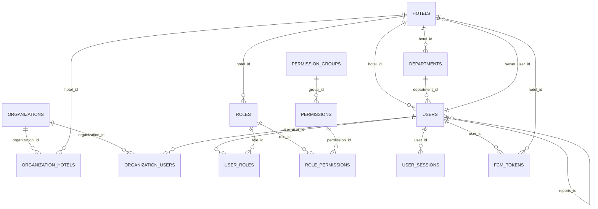
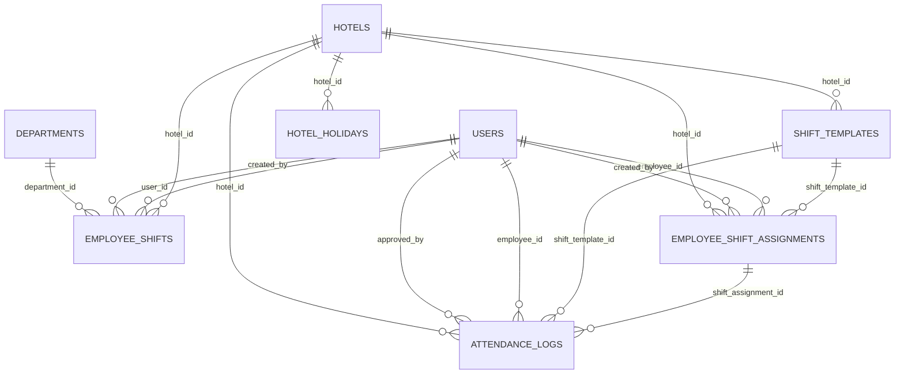
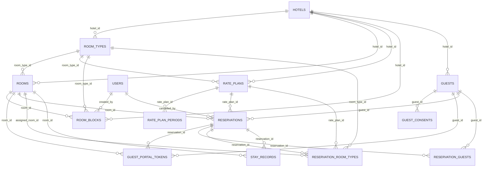
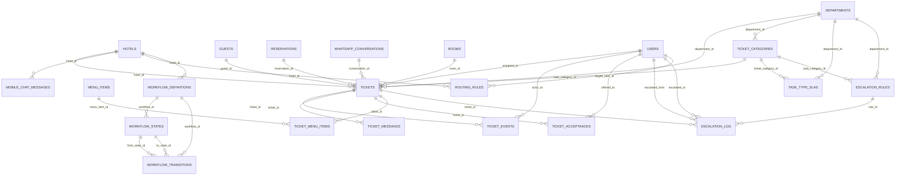
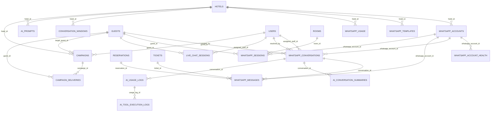
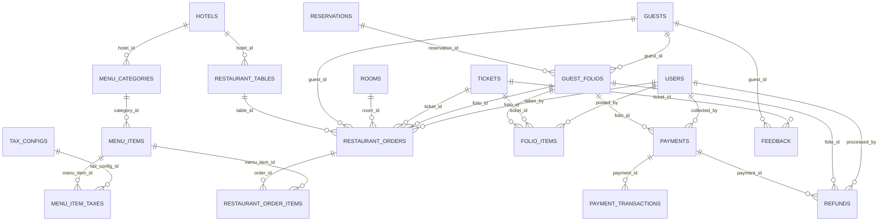
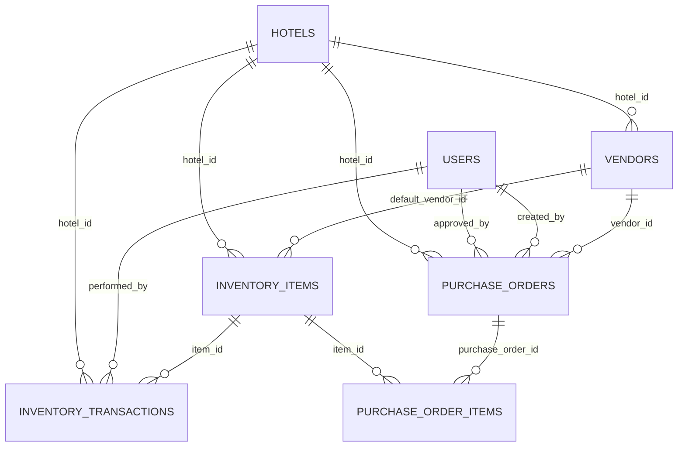
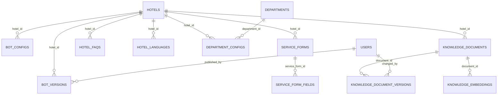
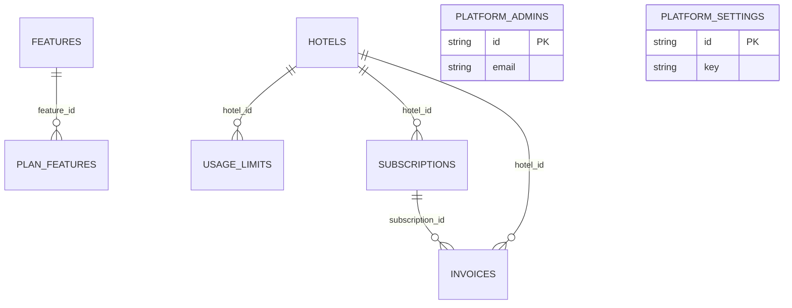

# Database ER Diagram

This document maps the current SQLAlchemy models in `backend/app/models` into Mermaid ER diagrams.
The schema currently contains 107 mapped database tables. The diagrams are split by domain so the relationships stay readable.

## Reading the Diagrams

- Entity names are shown in uppercase for diagram readability. They map directly to lowercase table names, for example `HOTELS` means `hotels`.
- `||--o{` means one parent row can have zero or many child rows.
- Association tables are shown explicitly, for example `USER_ROLES`, `ROLE_PERMISSIONS`, `MENU_ITEM_TAXES`, and `TICKET_MENU_ITEMS`.
- Most tenant-owned tables contain `hotel_id`. The tenant root is shown in each domain where it helps, but repeated `HOTELS -> table` edges may be summarized when a diagram would otherwise become too dense.

## Tenant, Organization, And Access Control

## Staff, Shifts, And Attendance

## Rooms, Rates, Reservations, And Guest Stay

## Tickets, Workflow, SLA, And Escalation

## WhatsApp, Campaigns, Live Chat, And AI

## Food And Beverage, Folios, Payments, And Feedback

## Inventory And Procurement

## Operations, Housekeeping, Maintenance, And Jobs

```mermaid
erDiagram
    HOTELS ||--o{ HOUSEKEEPING_CHECKLISTS : hotel_id
    HOTELS ||--o{ HOUSEKEEPING_SCHEDULES : hotel_id
    ROOMS ||--o{ HOUSEKEEPING_SCHEDULES : room_id
    USERS ||--o{ HOUSEKEEPING_SCHEDULES : assigned_to

    HOTELS ||--o{ MAINTENANCE_ORDERS : hotel_id
    ROOMS ||--o{ MAINTENANCE_ORDERS : room_id
    TICKETS ||--o{ MAINTENANCE_ORDERS : ticket_id
    USERS ||--o{ MAINTENANCE_ORDERS : reported_by
    USERS ||--o{ MAINTENANCE_ORDERS : assigned_to

    HOTELS ||--o{ LOST_FOUND_ITEMS : hotel_id
    GUESTS ||--o{ LOST_FOUND_ITEMS : guest_id
    USERS ||--o{ LOST_FOUND_ITEMS : found_by

    HOTELS ||--o{ AUDIT_LOGS : hotel_id
    USERS ||--o{ AUDIT_LOGS : user_id
    HOTELS ||--o{ NOTIFICATIONS : hotel_id
    USERS ||--o{ NOTIFICATIONS : user_id
    HOTELS ||--o{ MEDIA_FILES : hotel_id
    USERS ||--o{ MEDIA_FILES : uploaded_by

    HOTELS ||--o{ ANALYTICS_SNAPSHOTS : hotel_id
    HOTELS ||--o{ API_RATE_LIMITS : hotel_id
    HOTELS ||--o{ HOTEL_SECRETS : hotel_id
    HOTELS ||--o{ JOB_EXECUTIONS : hotel_id

    HOTELS ||--o{ EXPORT_JOBS : hotel_id
    USERS ||--o{ EXPORT_JOBS : requested_by
    HOTELS ||--o{ IMPORT_JOBS : hotel_id
    USERS ||--o{ IMPORT_JOBS : uploaded_by
```

## Knowledge Base, Bot Configuration, And Service Forms

## SaaS, Subscription, And Platform Tables

## Coverage Notes

- The diagrams cover all model tables listed in `database-model-table-inventory.md`.
- The model metadata exposes 238 foreign-key relationships. The diagrams show the important domain relationships and repeated tenant ownership relationships where they clarify ownership.
- Actor references to `users.id` are shown for operational ownership fields such as `created_by`, `assigned_to`, `approved_by`, `uploaded_by`, and similar audit columns where useful.
