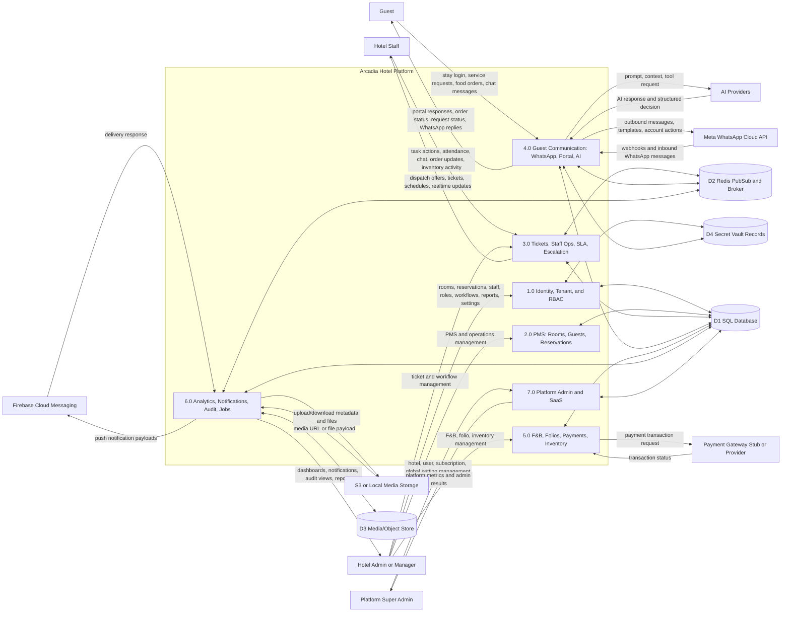

# Feature List And DFD Level 0

This document lists the current Arcadia Hotel Platform feature set and gives a Level 0 Data Flow Diagram for the system.
It is derived from the backend API modules, dashboard feature folders, mobile feature folders, and the current architecture notes.

## Feature Inventory

| Feature area | Features |
|---|---|
| Multi-tenant hotel platform | Hotel creation, hotel bootstrap, `hotel_id` tenant scoping, tenant-aware API routes, organization-to-hotel mapping, organization users, PostgreSQL tenant context support. |
| Platform administration | Platform admin login, platform dashboard metrics, hotel management, platform user management, subscription overview, global platform settings. |
| Authentication and sessions | Hotel user login, token refresh, logout, logout-all, current profile, password/profile update support, refresh-token session persistence. |
| RBAC and permissions | Hotel-defined roles, permission groups, permission assignment, scoped role grants, user-role assignment, permission-protected API routes, frontend permission gates. |
| Staff and departments | Department management, staff directory, staff profile pages, reporting hierarchy, staff workload views, staff portal, department hierarchy views. |
| Shifts and attendance | Shift templates, shift assignments, employee shifts, attendance logs, check-in/check-out tracking, approval metadata, hotel holidays. |
| Rooms and room types | Room type catalog, room inventory, room status, room matrix, room create/edit flows, room-to-type mapping. |
| Availability and room blocks | Availability checks, room blocks, room-type blocks, maintenance/VIP/manual holds, overlap prevention support. |
| Reservations and PMS | Reservation creation, reservation detail, multi-guest reservation links, room-type booking, assigned-room handling, room change, check-in/check-out stay records, soft cancellation metadata. |
| Guest management | Guest profiles, guest search/listing, guest detail pages, guest statuses, guest consent records, guest reservation linkage. |
| Guest portal | Stay verification by token or details, guest profile, menu browsing, cart, food ordering, order tracking, service request creation, guest request listing. |
| Guest portal chat | Guest-facing chat endpoints and chat widget support for guest support conversations. |
| Folios and billing | Guest folios, folio items, tax configs, payments, refunds, payment transaction stubs, folio posting from room service and operations. |
| Ticket and task management | Ticket creation, ticket board/list/detail, ticket filters, ticket messages, ticket events, task categories, task lifecycle actions such as accept, reject, complete, approve, and reopen. |
| Dispatch and workload routing | Shift-aware staff selection, department routing, staff-level routing, current workload checks, assignment offer tracking. |
| SLA and escalation | Task-type SLA rules, escalation rules, escalation logs, acceptance timeout handling, escalated ticket views, per-ticket escalation timeline. |
| Workflow configuration | Workflow definitions, workflow states, workflow transitions, configurable ticket/process stages. |
| Notifications and realtime | Persisted notifications, notification bell, dispatch alerts, WebSocket channels for tickets/chat/notifications/orders, Redis pub/sub integration, mobile push notification support. |
| WhatsApp integration | WhatsApp account setup, webhook handling, inbound/outbound messages, conversations, templates, account health, monthly usage, conversation windows, onboarding/test messaging. |
| Live chat handoff | Staff handoff from automated WhatsApp/bot flow to live support sessions. |
| AI chatbot operations | AI chat endpoint, hotel AI settings, provider abstraction, conversation context builder, structured AI decisions, reply/ticket/escalation actions, local fallback provider. |
| AI observability | AI conversation summaries, usage logs, tool execution logs, prompt templates, token/cost tracking support. |
| Knowledge base and RAG | Hotel FAQs, knowledge documents, document versions, embeddings, knowledge search before AI fallback, embedding processing status. |
| Bot configuration | Config-driven bot menus, bot config APIs, bot version snapshots, rollback-oriented bot version records, service-form collection. |
| Campaigns | Campaign creation/listing, target guest linkage, campaign delivery tracking, delivery status/counters. |
| Food and Beverage | Menu categories, menu items, tax assignment, F&B dashboard, staff/manual orders, guest portal food orders, order edit flow, order status workflow. |
| Kitchen operations | Kitchen board, order status updates, realtime restaurant order refresh. |
| Restaurant/POS | Restaurant tables, restaurant orders, restaurant order items, room-service links, ticket and folio links. |
| Inventory and procurement | Vendors, inventory items, inventory transactions, purchase orders, purchase order items, stock movement tracking. |
| Housekeeping | Housekeeping schedules, checklist templates, room-linked housekeeping tasks, staff assignment. |
| Maintenance | Maintenance orders, room-linked maintenance issues, ticket linkage, reporter and assignee tracking. |
| Lost and found | Lost/found item records, guest linkage, found-by tracking, item lifecycle metadata. |
| Analytics and reporting | Analytics dashboard, analytics snapshots, operational metrics, platform dashboard metrics. |
| Audit logs | Persistent audit log records for user and system actions. |
| Media management | Media file records, uploaded file metadata, storage integration boundary, DB-backed media fallback. |
| Secrets and integrations | Encrypted hotel secrets, provider credentials, WhatsApp/AI/FCM/S3/payment integration boundaries. |
| SaaS subscriptions and limits | Feature catalog, plan features, usage limits, subscriptions, invoices, subscription update flows. |
| Import/export and jobs | Import jobs, export jobs, job execution tracking, background worker records. |
| Rate limiting and performance | API rate limit records, rate-limiter middleware, request/query performance tracking. |
| Mobile staff app | Mobile login, manager/attendant dashboards, task screens, ticket details, updates, transfers, inventory, chat, notifications, QR scan, profile. |
| Web dashboard | Hotel dashboard shell, overview, rooms, guests, reservations, tickets, staff settings, roles, workflow settings, WhatsApp, AI, F&B, kitchen, housekeeping, escalations, analytics, audit logs. |
| Deployment and development operations | Setup guides, Windows backend setup, Cloud Run deployment docs, Supabase/Postgres deployment flow, seeding/reset scripts, Alembic migration workflow. |

## DFD Level 0

This Level 0 DFD shows Arcadia as a set of high-level processes, the external actors that exchange data with the system, and the major data stores.

## Level 0 Process Summary

| Process | Main inputs | Main outputs | Primary stores |
|---|---|---|---|
| 1.0 Identity, Tenant, and RBAC | Login credentials, refresh tokens, hotel/org setup, role and permission changes | Access tokens, validated sessions, user/role updates, permission decisions | `users`, `user_sessions`, `roles`, `permissions`, `hotels`, `organizations`, `hotel_secrets` |
| 2.0 PMS: Rooms, Guests, Reservations | Room setup, guest data, booking requests, room assignment, cancellation/check-in/check-out actions | Room inventory, availability results, reservations, stays, guest records | `rooms`, `room_types`, `room_blocks`, `guests`, `reservations`, `stay_records` |
| 3.0 Tickets, Staff Ops, SLA, Escalation | Service requests, task updates, staff availability, shifts, acceptance decisions | Tickets, assignments, SLA timers, escalation logs, ticket events/messages | `tickets`, `ticket_events`, `ticket_acceptances`, `task_type_slas`, `escalation_rules`, `employee_shifts`, `attendance_logs` |
| 4.0 Guest Communication: WhatsApp, Portal, AI | WhatsApp webhooks, guest portal actions, chat messages, knowledge context, AI settings | WhatsApp replies, guest portal responses, AI decisions, live-chat sessions | `whatsapp_*`, `guest_portal_tokens`, `knowledge_documents`, `knowledge_embeddings`, `ai_*`, `live_chat_sessions` |
| 5.0 F&B, Folios, Payments, Inventory | Menu/order actions, room-service orders, payment/refund actions, stock movements, purchase orders | Orders, kitchen status, folio charges, payments, inventory transactions, purchase orders | `menu_*`, `restaurant_*`, `guest_folios`, `folio_items`, `payments`, `inventory_*`, `purchase_orders` |
| 6.0 Analytics, Notifications, Audit, Jobs | Domain events, scheduled jobs, imports/exports, media uploads, rate-limit events | Notifications, WebSocket events, audit entries, analytics snapshots, job results, import/export records | `notifications`, `audit_logs`, `analytics_snapshots`, `job_executions`, `import_jobs`, `export_jobs`, `media_files`, `api_rate_limits` |
| 7.0 Platform Admin and SaaS | Platform admin actions, hotel onboarding, subscription edits, global settings, usage-limit changes | Platform dashboard data, hotel/account changes, subscription/invoice state, plan feature configuration | `platform_admins`, `platform_settings`, `features`, `plan_features`, `usage_limits`, `subscriptions`, `invoices` |

## External Entity Summary

| External entity | Data sent to Arcadia | Data received from Arcadia |
|---|---|---|
| Guest | Portal login details, service requests, food orders, chat/WhatsApp messages, feedback | Portal session, menu/order/request status, WhatsApp replies, support responses |
| Hotel staff | Task actions, attendance punches, chat messages, order status changes, inventory activity | Ticket offers, assigned work, notifications, schedules, chat/order updates |
| Hotel admin or manager | Hotel configuration, rooms, reservations, staff, roles, reports, workflow settings | Dashboard metrics, audit logs, operational status, alerts, records |
| Platform super admin | Platform login, hotel/user/subscription/global setting changes | Platform metrics, hotel list, user list, subscription state |
| Meta WhatsApp Cloud API | Webhooks, delivery events, inbound messages | Outbound WhatsApp messages, template/account actions |
| AI providers | Model responses, structured decisions, usage metadata | Prompt, conversation context, knowledge snippets, tool instructions |
| Firebase Cloud Messaging | Delivery response | Push notification payloads |
| Payment provider or stub | Transaction status | Payment/refund transaction request |
| S3/local media storage | File URLs or file payloads | Upload/download requests |

## Main Data Stores

| Store | Purpose |
|---|---|
| D1 SQL Database | Source of truth for tenant data, users, PMS, tickets, WhatsApp, AI logs, billing, inventory, jobs, and audit records. |
| D2 Redis PubSub and Broker | Realtime event distribution, Celery broker/result backend, cross-process notification flow. |
| D3 Media/Object Store | Uploaded media and file payload storage when object storage is configured. |
| D4 Secret Vault Records | Encrypted hotel integration secrets such as provider API keys and channel credentials. |
