# Arcadia Hotel Platform - Interview System Design and LLD Prep

This document explains the current project in an interview-friendly way. It is written so you can:

- Explain the system design from a high level.
- Draw an Excalidraw architecture sheet quickly.
- Prepare low-level design charts for the backend, frontend, mobile app, RBAC, reservations, tickets, WhatsApp, AI, and realtime flows.
- Answer "why did you design it this way?" questions with tradeoffs.

## 1. Project Snapshot

Arcadia is a multi-tenant hotel operations platform. It combines PMS-style hotel management, staff task workflows, guest communication, WhatsApp automation, AI-assisted guest handling, restaurant/POS, housekeeping, inventory, folios, analytics, platform administration, and mobile staff operations.

The current project is organized as:

| Area | Path | Main responsibility |
| --- | --- | --- |
| Backend API | `backend/app` | FastAPI modular monolith, domain services, repositories, SQLAlchemy models, WebSockets, workers |
| Admin dashboard | `apps/dashboard` | Next.js web dashboard for hotel admins, staff, guest portal, and platform admins |
| Mobile app | `hoboerp` | React Native staff/manager mobile app using API, React Query, WebSocket, push notifications |
| Experimental mobile app | `hobo-exp-app` | Expo-based staff operations app |
| Migrations | `backend/alembic` | Alembic schema history |
| Tests | `backend/tests`, `hoboerp/src/**/__tests__` | Backend feature tests, RBAC tests, mobile tests |
| Infra | `docker-compose.yml`, `Dockerfile.frontend`, `infra/*` | Local and cloud deployment scripts |
| Docs | `docs/*` | Versioned architecture and operational guides |

The backend follows a "modular monolith first" design. This is a good interview point: the business domain needs strong consistency across reservations, rooms, tickets, staff, folios, and audit logs. Keeping those flows inside one deployable backend reduces distributed transaction complexity while still separating modules clearly at code level.

## 2. Business Problem

Hotels often run operations through disconnected tools:

- Front desk maintains reservations and rooms.
- Housekeeping uses calls or manual registers.
- Engineering receives issues late.
- Guest requests arrive on WhatsApp without structured tracking.
- Managers lack live SLA visibility.
- Food orders, folios, inventory, and staff shifts live separately.
- Multi-hotel owners need tenant-level administration and subscription controls.

Arcadia solves this by centralizing hotel operations around a tenant-scoped backend, a realtime dashboard, staff mobile workflows, and guest-facing WhatsApp/portal channels.

## 3. Functional Requirements

Core tenant and admin:

- Create and manage hotels, organizations, platform admins, hotel admins, and staff users.
- Support platform-level admin login separately from hotel-user login.
- Support dynamic hotel-defined roles and permissions.
- Enforce tenant boundaries using `hotel_id`.
- Support subscription plans, usage limits, invoices, and global platform settings.

Hotel PMS and operations:

- Manage room types, rooms, availability blocks, reservations, stays, check-in, check-out, cancellation, and room changes.
- Book by room type and assign actual rooms at check-in.
- Prevent double booking through room blocks and availability checks.
- Manage guests, multi-guest reservations, guest statuses, guest portal tokens, and consent records.
- Create folios, folio items, taxes, payments, refunds, and payment transaction stubs.

Task and staff workflows:

- Create tickets from dashboard, staff app, guest portal, WhatsApp, AI, restaurant orders, maintenance, and housekeeping.
- Route tickets by department, category, staff level, shift, workload, and escalation rules.
- Support ticket accept/reject flow with timeout.
- Track ticket timeline events and messages.
- Support configurable workflow states and transitions.
- Track staff shifts, attendance, hierarchy, holidays, and reporting relationships.

Guest communication:

- Receive Meta WhatsApp webhooks.
- Verify webhook signatures when app secret is configured.
- Store WhatsApp accounts, conversations, messages, templates, health, usage, and billing windows per hotel.
- Support live chat handoff.
- Support guest portal chat, menu, orders, requests, and cart flows.

AI operations:

- Build conversation context from guest, reservation, room, knowledge, and recent messages.
- Select AI provider per hotel using vault-stored keys.
- Generate structured AI decisions: reply, create ticket, escalate, suggest response, summarize.
- Store usage logs and tool execution debug steps.
- Fall back to a local provider by default in development.

Realtime and notifications:

- WebSocket channels for tickets, chat, orders, and user notifications.
- Redis pub/sub as cross-process event transport.
- In-process WebSocket broadcast for current process.
- FCM push notifications for mobile users when configured.
- Notification center records for persisted user notifications.

Analytics, jobs, and operations:

- Generate analytics snapshots.
- Track job execution.
- Run Celery scheduled jobs for acceptance timeout, escalation checks, and attendance finalization.
- Support import/export jobs.
- Add API rate limits and performance metrics headers.

## 4. Non-Functional Requirements

| Requirement | Design answer in this project |
| --- | --- |
| Multi-tenancy | Every tenant-owned table carries `hotel_id`; dependencies validate token hotel against path hotel; PostgreSQL tenant context uses `app.current_hotel_id` for RLS support |
| Security | JWT access tokens, refresh sessions, Argon2 password hashing, separate platform token scope, RBAC permissions, hotel secret vault, webhook signature validation |
| Consistency | Single database transaction for critical flows such as reservation creation, check-in, ticket dispatch, cancellation, and audit logging |
| Realtime | WebSockets plus Redis pub/sub plus persisted notification center |
| Scalability | Stateless API instances, PostgreSQL source of truth, Redis/Celery for background work, pagination repositories, rate limiting |
| Extensibility | Domain services and repositories per module; AI provider interface; integration adapters for WhatsApp, FCM, Stripe, S3, Deepgram, ElevenLabs |
| Observability | Audit logs, AI usage/debug logs, job executions, error envelopes, request performance headers, test coverage |
| Recoverability | Alembic migrations, backup/DR doc, scripts for seeding/resetting local databases |

## 5. Technology Stack

Backend:

| Technology | Usage |
| --- | --- |
| FastAPI | REST API, OpenAPI docs, WebSocket routes |
| SQLAlchemy 2 | ORM models, repositories, transactions |
| Alembic | Database migrations |
| PostgreSQL | Production source of truth |
| SQLite | Local default development database |
| Redis | Pub/sub, Celery broker/result backend |
| Celery | Scheduled/background jobs |
| Pydantic v2 | Request/response schemas and settings |
| PyJWT / python-jose | JWT token handling |
| Argon2 via passlib | Password hashing |
| Firebase Admin | FCM push notification sending |
| httpx | External HTTP calls, for example WhatsApp Graph API |
| OpenAI, Anthropic, Gemini SDKs | AI provider integrations |

Frontend dashboard:

| Technology | Usage |
| --- | --- |
| Next.js 15 | App router dashboard and portals |
| React 19 | UI rendering |
| TypeScript | Typed UI and domain contracts |
| React Query | Server state caching and invalidation |
| Zustand | Auth, guest cart/session, notification state |
| Axios | API client with token interceptor and error normalization |
| CASL | Ability/RBAC utilities |
| Zod + React Hook Form | Form validation |
| Recharts / FullCalendar / XYFlow | Charts, calendars, workflow visualization |
| Tailwind CSS | Styling |

Mobile:

| Technology | Usage |
| --- | --- |
| React Native | Staff and manager app |
| React Query | Backend-backed resource state |
| AsyncStorage | Session persistence |
| React Navigation packages | Navigation dependencies |
| Firebase Messaging | Push notifications |
| WebSocket client | Realtime notification stream with reconnect backoff |
| Zustand | Local session, UI, operations, notification state |

## 6. Current Architecture

### System Context

Use this as the first Excalidraw frame.

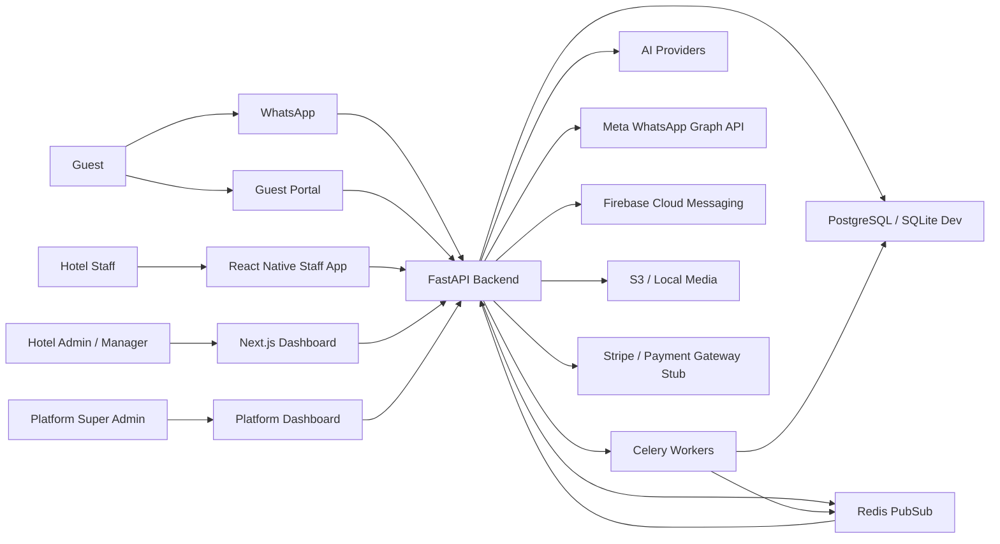

### Container Diagram

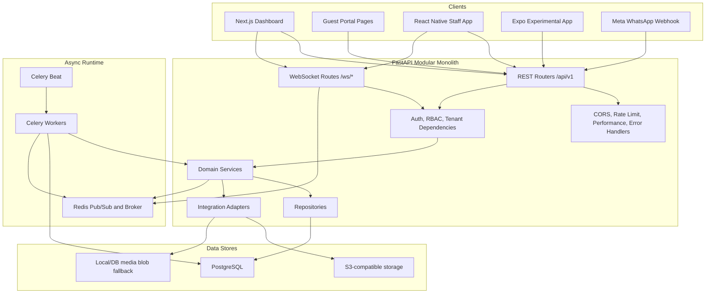

### Backend Layering

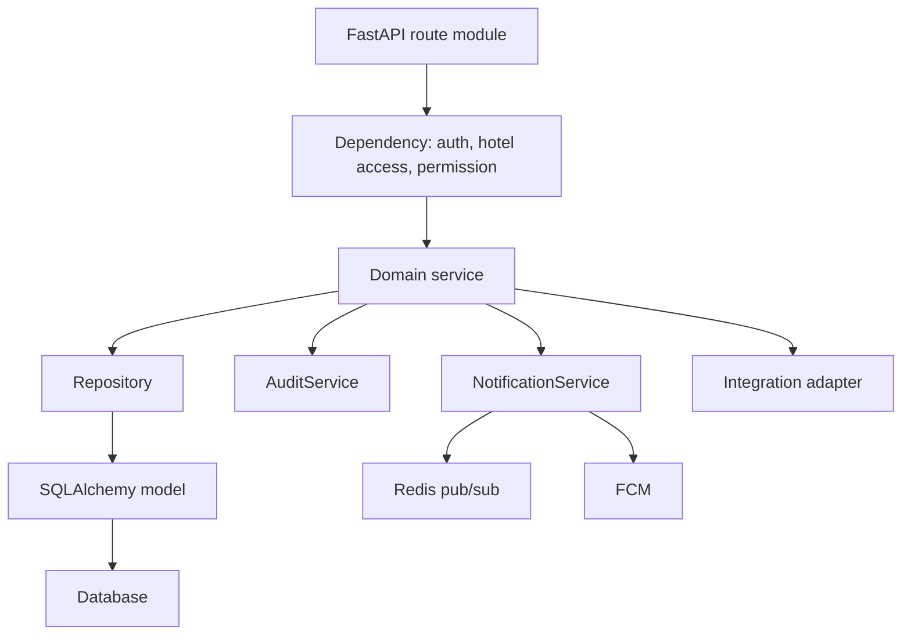

The important interview explanation:

- Routes translate HTTP into domain calls.
- Dependencies authenticate users, validate tenant access, set tenant context, and require permissions.
- Services own business rules.
- Repositories own persistence queries.
- Models describe the database.
- Integrations are behind adapter classes so core services do not hardcode vendors.

## 7. Main Backend Entry Points

| File | Interview explanation |
| --- | --- |
| `backend/app/main.py` | Creates FastAPI app, adds middleware, registers error handlers, seeds RBAC permissions on startup, includes API/webhook/WebSocket routers |
| `backend/app/api/v1/router.py` | Composes all domain routers under `/api/v1` |
| `backend/app/api/dependencies.py` | Hotel JWT authentication, platform JWT authentication, hotel access validation, permission checks, tenant context |
| `backend/app/api/guest_dependencies.py` | Guest portal session validation |
| `backend/app/api/ws/routes.py` | JWT-authenticated WebSocket channels for tickets, chat, orders, notifications |
| `backend/app/core/database.py` | Engine/session setup, query metrics, PostgreSQL tenant context |
| `backend/app/core/security.py` | JWT, Argon2 password hashing, Meta signature verification |
| `backend/app/core/rate_limiter.py` | Per-group API rate limiting middleware |
| `backend/app/workers/celery_app.py` | Celery broker/backend and periodic jobs |

## 8. Domain Modules

| Module | Key backend files | Responsibility |
| --- | --- | --- |
| Auth | `api/v1/auth.py`, `services/auth_service.py`, `models/user.py` | Hotel login, refresh/logout sessions, password change, current user |
| Platform admin | `api/v1/platform_admin.py`, `models/platform_admin.py` | Super admin login, hotels, users, subscriptions, settings |
| RBAC | `api/v1/roles.py`, `services/rbac_service.py`, `models/rbac.py` | Permissions, scoped role grants, user role assignment, permission cache |
| Hotels/orgs | `hotels.py`, `organizations.py`, `models/hotel.py`, `models/organization.py` | Tenant creation and organization mapping |
| Rooms/availability | `rooms.py`, `room_types.py`, `availability.py`, `services/availability_service.py` | Room inventory, type-level holds, room blocks, calendar |
| Reservations | `reservations.py`, `services/reservation_service.py` | Booking, guests, check-in/out, room assignment, cancellation, room change |
| Guests | `guests.py`, `guest_portal.py`, `guest_portal_chat.py` | Guest records, portal sessions, guest requests/orders/chat |
| Folios | `folios.py`, `services/folio_service.py` | Folios, items, taxes, payments, refunds |
| Tickets | `tickets.py`, `services/ticket_service.py`, `services/dispatch_service.py` | Task creation, assignment, acceptance, rejection, lifecycle, timeline |
| SLA/escalation | `task_slas.py`, `escalation_rules.py`, `services/sla_service.py` | Category SLAs, accept timeout, escalation levels |
| Staff | `users.py`, `shifts.py`, `attendance.py`, `hierarchy.py` | Staff profiles, shifts, attendance, reporting hierarchy |
| WhatsApp | `webhooks.py`, `whatsapp_accounts.py`, `services/whatsapp_account_service.py` | WhatsApp account setup, conversations, messages, templates, live handoff |
| AI | `ai_chat.py`, `ai_settings.py`, `services/ai_orchestrator.py` | AI settings, context, knowledge, provider calls, decisions, tool execution |
| Restaurant/FnB | `restaurant.py`, `menu.py` | Menu, tables, orders, room service, food-order tickets |
| Housekeeping/maintenance | `housekeeping.py`, `maintenance.py`, `lost_found.py` | Operational tasks linked to rooms and tickets |
| Inventory | `inventory.py` | Vendors, inventory items, transactions, purchase orders |
| Ops/analytics | `ops.py`, `analytics.py`, `feedback.py`, `campaigns.py`, `knowledge.py` | Notifications, media, exports/imports, jobs, audit logs, analytics, campaigns |

## 9. Data Model Overview

The database is organized around `hotel_id`. Platform-level tables exist separately where needed.

### Core ERD

Use this as the second Excalidraw frame.

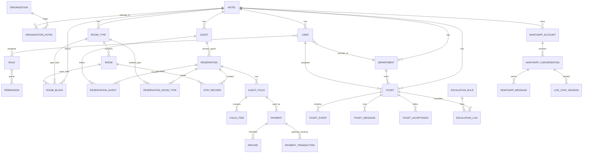

### Important Entities

| Entity group | Tables/classes |
| --- | --- |
| Tenant and identity | `Hotel`, `Organization`, `OrganizationHotel`, `OrganizationUser`, `User`, `PlatformAdmin`, `PlatformSetting` |
| RBAC | `Role`, `PermissionGroup`, `Permission`, role-user and role-permission association tables |
| PMS | `RoomType`, `Room`, `RoomBlock`, `Reservation`, `ReservationGuest`, `ReservationRoomType`, `StayRecord`, `RatePlan` |
| Guest | `Guest`, `GuestConsent`, `GuestPortalToken` |
| Folio and billing | `GuestFolio`, `FolioItem`, `TaxConfig`, `Payment`, `Refund`, `PaymentTransaction`, `Subscription`, `Invoice` |
| Ticket workflow | `Ticket`, `TicketEvent`, `TicketMessage`, `TicketAcceptance`, `TicketCategory`, `TaskTypeSLA`, `EscalationRule`, `EscalationLog`, `RoutingRule` |
| Staff | `EmployeeShift`, `ShiftTemplate`, `EmployeeShiftAssignment`, `AttendanceLog`, `HotelHoliday` |
| WhatsApp | `WhatsAppAccount`, `WhatsAppAccountHealth`, `WhatsAppUsage`, `WhatsAppTemplate`, `WhatsAppConversation`, `WhatsAppMessage`, `LiveChatSession`, `ConversationWindow`, `WhatsAppSession` |
| AI | `AIConversationSummary`, `AIUsageLog`, `AIToolExecutionLog`, `AIPrompt` |
| Knowledge/bot | `HotelFAQ`, `BotVersion`, `DepartmentConfig`, `ServiceForm`, `ServiceFormField`, `KnowledgeDocument`, `KnowledgeDocumentVersion`, `KnowledgeEmbedding`, `BotConfig` |
| Ops | `AuditLog`, `Notification`, `MediaFile`, `HotelSecret`, `AnalyticsSnapshot`, `JobExecution`, `ApiRateLimit`, `ExportJob`, `ImportJob` |
| Restaurant and inventory | `MenuCategory`, `MenuItem`, `RestaurantTable`, `RestaurantOrder`, `RestaurantOrderItem`, `Vendor`, `InventoryItem`, `InventoryTransaction`, `PurchaseOrder`, `PurchaseOrderItem` |

## 10. Multi-Tenancy and RBAC Design

### Tenant isolation

Every hotel-owned resource uses `hotel_id`. API routes usually include `/hotels/{hotel_id}/...`.

For hotel user requests:

1. JWT is decoded.
2. Token must have hotel scope, not platform scope.
3. `sub` resolves to an active `User`.
4. `user.hotel_id` must equal path `hotel_id`.
5. PostgreSQL tenant context is set with `app.current_hotel_id`.
6. RBAC permission is checked.
7. Service/repository queries still filter by `hotel_id`.

This gives layered defense:

- Token claim validation.
- Route dependency validation.
- Database tenant context for PostgreSQL RLS support.
- Query-level hotel filters.

### RBAC model

Permissions are dynamic and hotel roles can be customized. A role grants permission codes such as:

- `ticket.view`
- `ticket.create`
- `ticket.update`
- `reservation.manage`
- `staff.view`
- `hotel.settings.manage`

Some permissions are scoped:

- `own`: user can access records assigned to self or followed by self.
- `department`: user can access records inside their department.
- `hotel`: user can access all hotel records.

RBACService also supports legacy alias permissions such as `ticket.view_own`, `ticket.view_dept`, and `ticket.view_all`, and normalizes them to the scoped model.

### RBAC LLD Chart

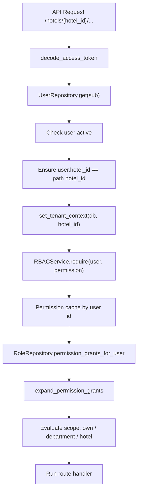

### Interview Talking Point

If asked "Why not hardcoded roles?", answer:

The hotel domain needs different staff structures across properties. A boutique hotel and a chain property do not use the same operational roles. Hardcoded roles would become a product bottleneck. Dynamic RBAC lets each hotel define roles while still enforcing stable permission codes in the backend.

## 11. Backend LLD

### Service and Repository Pattern

The backend uses a consistent pattern:

| Layer | Responsibility |
| --- | --- |
| API route | Request parsing, dependency injection, response envelope |
| Dependency | Auth, tenant validation, permission check |
| Schema | Pydantic validation and response shape |
| Service | Business decisions and transaction boundary |
| Repository | Database queries and persistence helpers |
| Model | SQLAlchemy table mapping |
| Integration | Vendor-specific API client |

### Generic LLD Class Chart

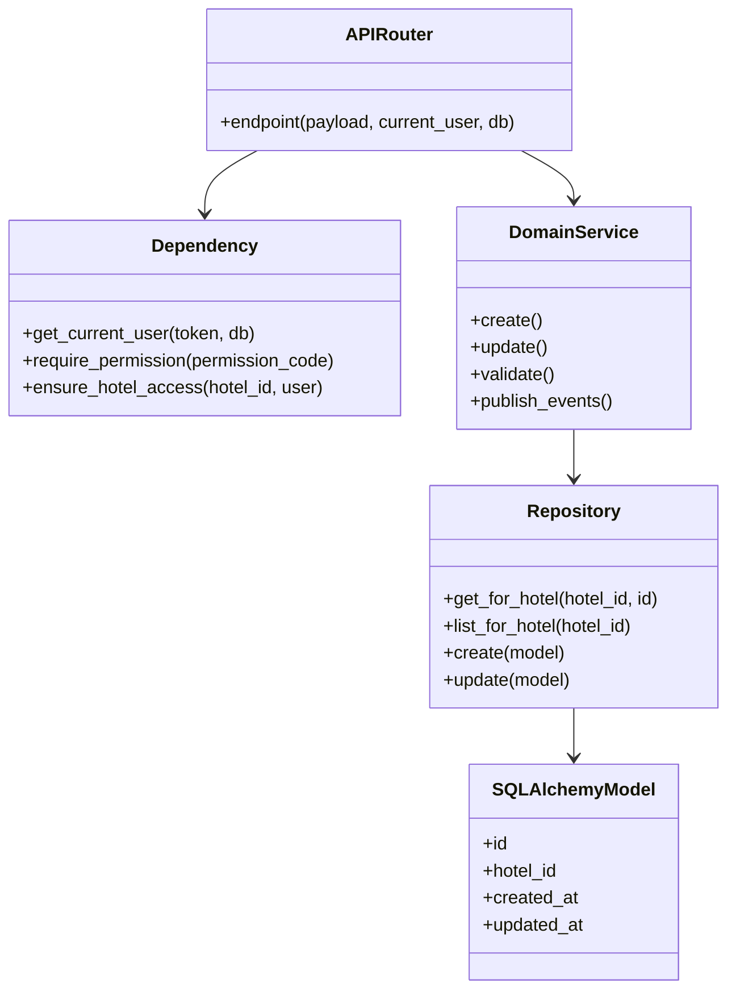

## 12. Reservation and Availability Design

### Problem Solved

Hotels usually sell room inventory by room type, not specific room number. The project supports:

- Book "1 Deluxe Room" at reservation time.
- Hold room-type inventory immediately.
- Assign actual room number at check-in.
- Block specific rooms once assigned.
- Release blocks on cancellation, checkout, or room change.

### Key classes

| Class | Responsibility |
| --- | --- |
| `ReservationService` | Create/update reservation, guest links, check-in, check-out, cancel, room change |
| `AvailabilityService` | Check room availability, find available rooms, hold room types, block rooms, release blocks, calendar |
| `ReservationRepository` | Reservation persistence |
| `ReservationRoomTypeRepository` | Booked room type rows |
| `RoomBlockRepository` | Availability conflict lookup |
| `FolioService` | Create/close folios on check-in/check-out |
| `HousekeepingService` | Create checkout clean tasks |
| `AuditService` | Audit reservation changes |

### Reservation Create Flow

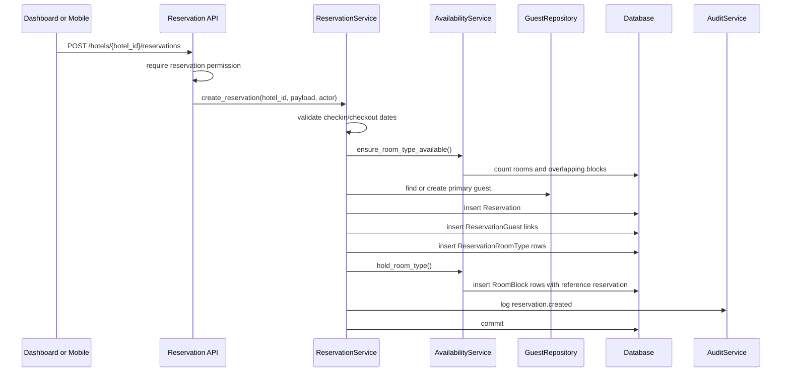

### Check-In Flow

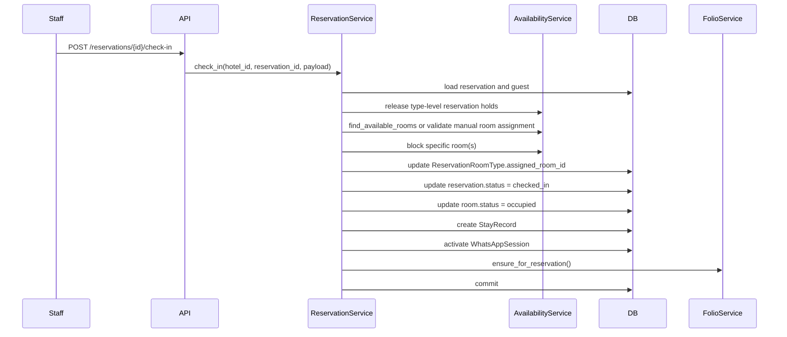

### Cancel Flow

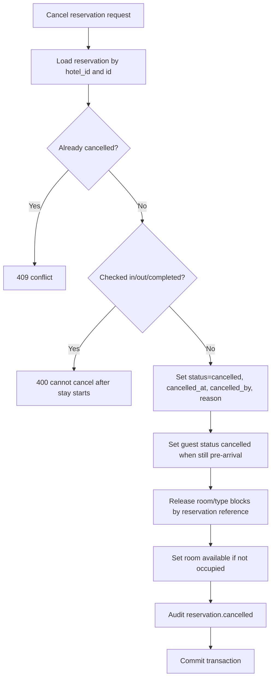

### Design Tradeoffs

| Decision | Reason |
| --- | --- |
| Type-level holds at booking | Supports real hotel behavior where room number is assigned at arrival |
| Specific room block at check-in | Prevents double assignment once room is chosen |
| Keep cancelled reservation row | Preserves booking history, auditability, and reports |
| Release blocks by `reference_type/reference_id` | One clean operation for cancellation, checkout, and room change |
| Availability service as central authority | Avoids duplicate availability logic in reservation, maintenance, and room screens |

## 13. Ticket Dispatch, SLA, and Escalation Design

### Problem Solved

Guest and operational requests must not disappear in chat. They should become trackable tasks with:

- Department ownership.
- Category-specific SLA.
- Staff assignment.
- Accept/reject workflow.
- Reassignment and escalation if staff does not accept.
- Realtime notification to dashboard and mobile app.

### Key classes

| Class | Responsibility |
| --- | --- |
| `TicketService` | Create/update tickets, messages, timeline, stage changes, complete/approve/reopen |
| `DispatchService` | Broadcast offers, accept/reject handling, expired offers, escalation to next staff level |
| `SLAService` | Resolve SLA and accept timeout using task type, category, and department config |
| `ShiftService` / `StaffService` | Find available staff by department, shift, level, workload |
| `RoutingRuleRepository` | Fast-track routing for selected ticket types |
| `EscalationRuleRepository` | Find next escalation rule |
| `NotificationService` | Publish realtime events and FCM pushes |
| `NotificationCenterService` | Persist notifications for users |

### Ticket Create Flow

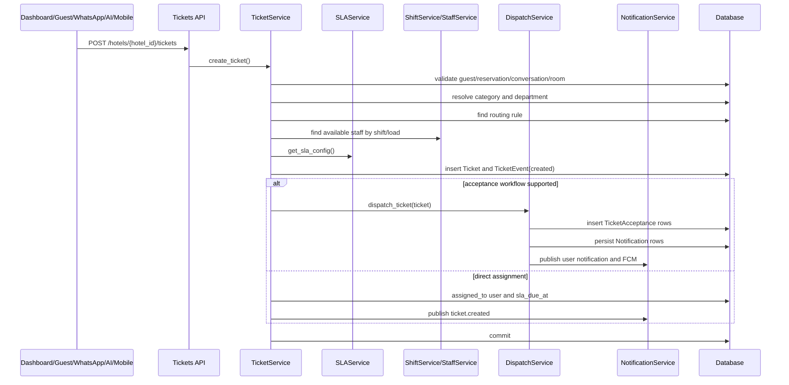

### Acceptance and Escalation Flow

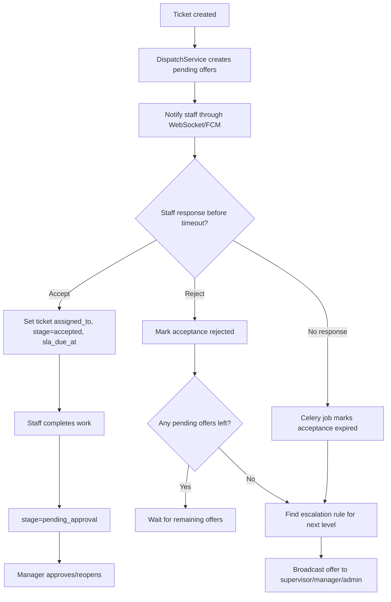

### Celery Jobs

| Job | Schedule | Purpose |
| --- | --- | --- |
| `tickets.check_pending_acceptances` | Every minute | Expire pending ticket offers and trigger escalation |
| `tickets.check_escalations` | Every minute | Check SLA/escalation rules |
| `attendance.finalize_missing` | Nightly | Finalize missing attendance |

### Design Tradeoffs

| Decision | Reason |
| --- | --- |
| Ticket events table | Creates a reliable timeline for debugging and audit |
| Ticket acceptance table | Models broadcast offers and response history instead of overwriting assignment |
| Celery for timeout checks | Avoids keeping long timers in web processes |
| Realtime plus persisted notifications | Users see live alerts, but also have notification history if offline |
| SLA config hierarchy | Allows specific category SLA first, then department config, then default |

## 14. WhatsApp and AI Design

### WhatsApp responsibilities

The project supports:

- Per-hotel WhatsApp accounts.
- Account health and usage tracking.
- Template messages.
- Conversation and message persistence.
- Webhook verification.
- Live chat handoff.
- Conversation windows for billing.
- Bot config and service form data.

### AI pipeline

The AI orchestration flow is implemented in `AIOrchestratorService`.

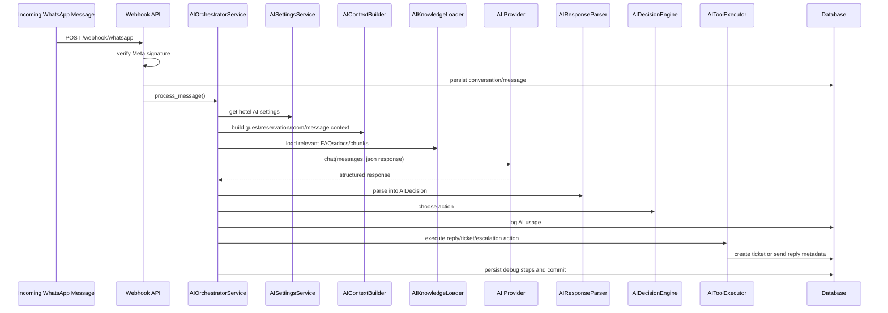

### AI LLD Chart

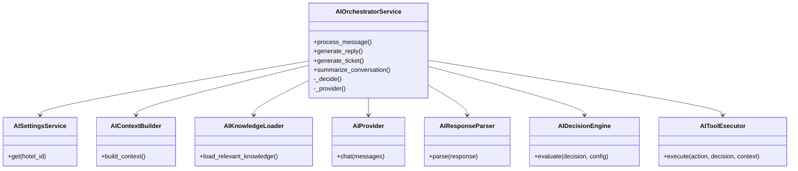

### Provider abstraction

AI providers are selected through `app.integrations.ai.factory.get_ai_provider`. Implementations exist for:

- Local provider.
- Gemini.
- OpenAI.
- Anthropic.
- Groq.

Hotel-specific API keys are retrieved from `Vault` using keys like `ai:{provider}:api_key`.

### Design Tradeoffs

| Decision | Reason |
| --- | --- |
| AI provider abstraction | Avoids vendor lock-in and supports local/dev fallback |
| Structured AI decision | Reduces unpredictable free-text behavior; backend chooses actions from parsed decision |
| Usage and debug logs | Makes AI behavior explainable for staff and developers |
| Knowledge before action | Uses hotel-specific FAQ/docs/context before creating tickets |
| Human handoff support | Important for low-confidence, sensitive, or escalated conversations |

## 15. Realtime and Notification Design

### Channels

| WebSocket path | Purpose |
| --- | --- |
| `/ws/tickets` | Authenticated hotel ticket stream |
| `/ws/orders` | Authenticated restaurant order stream |
| `/ws/chat` | Authenticated chat stream |
| `/ws/notifications` | Authenticated user notification stream |
| `/ws/{hotel_id}/tickets` | Hotel-specific ticket stream |
| `/ws/{hotel_id}/chat/{ticket_id}` | Ticket-specific chat stream |

### Notification flow

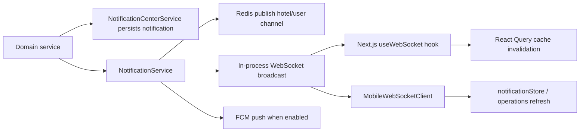

### Mobile WebSocket behavior

The mobile app builds the WebSocket URL from the API base URL, connects to `/ws/notifications?token=...`, emits events to handlers, and reconnects with exponential backoff up to 30 seconds.

### Dashboard WebSocket behavior

The dashboard `useWebSocket(hotelId)` hook connects to notifications, reads dispatch/ticket events, updates the notification store, and invalidates React Query caches for tickets and notifications.

## 16. Frontend Dashboard LLD

### Dashboard architecture

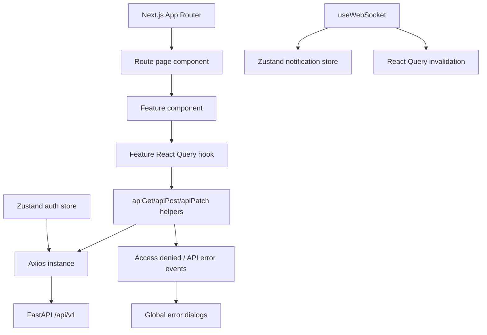

### Dashboard route groups

| Route group | Purpose |
| --- | --- |
| `(marketing)` | Public marketing pages |
| `(auth)` | Hotel login |
| `(platform)` | Platform super admin dashboard |
| `(dashboard)/[hotelId]` | Hotel admin/staff dashboard |
| `(guest)/guest` | Guest portal pages |

### Main dashboard features

| Feature folder | UI purpose |
| --- | --- |
| `features/tickets` | Ticket board, list, detail, create dialog |
| `features/reservations` | Reservation table, detail, create/cancel flows |
| `features/guests` | Guest list and profile |
| `features/rooms` | Room matrix and room CRUD |
| `features/staff` | Staff directory, attendance, shifts, hierarchy, workload |
| `features/roles` | Role editor and permission matrix |
| `features/housekeeping` | Housekeeping planner and task dialogs |
| `features/whatsapp` | Inbox, conversations, settings, templates |
| `features/ai` | AI dashboard and settings |
| `features/platform` | Super admin hotels, users, subscriptions, settings |
| `features/guest-portal` | Guest menu, orders, requests, chat, cart |

### Dashboard design point

The dashboard separates backend-backed state from UI state:

- React Query owns server data.
- Zustand owns auth, notification, guest cart/session, and local session-like state.
- Axios interceptors inject JWT tokens and normalize errors.
- Feature hooks hide endpoint details from components.

## 17. Mobile App LLD

### Mobile architecture

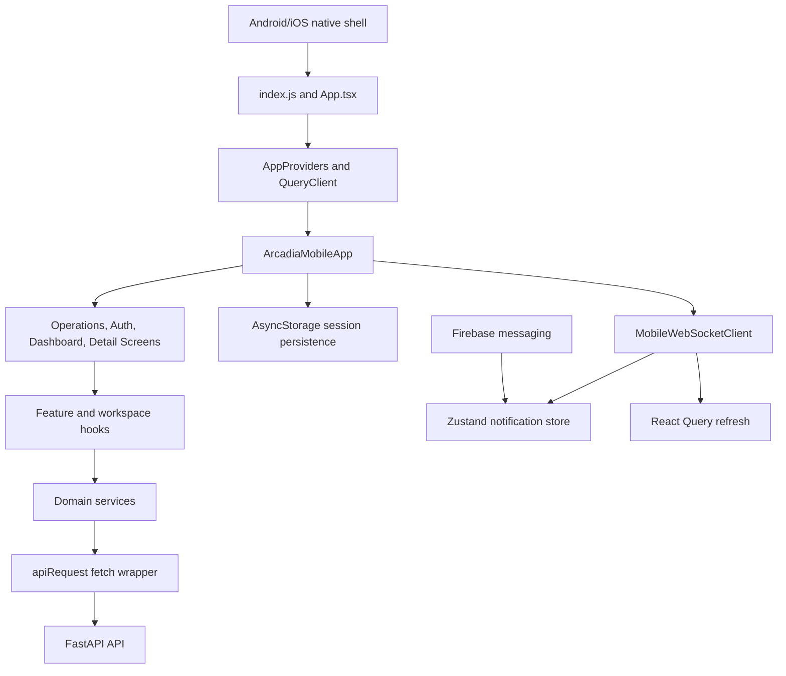

### Mobile design decisions

| Decision | Reason |
| --- | --- |
| React Query | Keeps backend resources cached and refreshable |
| AsyncStorage session | Restores user session after app restart |
| Fetch wrapper with refresh retry | Handles expired access tokens cleanly |
| WebSocket reconnect backoff | Mobile networks are unstable |
| Permission checks before navigation/actions | Keeps UI aligned with backend RBAC |
| Feature flags | Allows realtime/offline features to be enabled gradually |

## 18. API Design

### API shape

Most hotel APIs follow:

```text
/api/v1/hotels/{hotel_id}/{resource}
```

Examples:

```text
POST /api/v1/auth/login
POST /api/v1/auth/refresh
GET  /api/v1/auth/me

GET  /api/v1/hotels/{hotel_id}/rooms
POST /api/v1/hotels/{hotel_id}/reservations
POST /api/v1/hotels/{hotel_id}/reservations/{reservation_id}/check-in
POST /api/v1/hotels/{hotel_id}/reservations/{reservation_id}/cancel

GET  /api/v1/hotels/{hotel_id}/tickets
POST /api/v1/hotels/{hotel_id}/tickets
POST /api/v1/hotels/{hotel_id}/tickets/{ticket_id}/accept
POST /api/v1/hotels/{hotel_id}/tickets/{ticket_id}/reject

GET  /api/v1/platform/dashboard
GET  /api/v1/platform/hotels
GET  /api/v1/platform/users
GET  /api/v1/platform/subscriptions
```

### Why tenant id is in the path

It makes tenant context explicit:

- The UI knows which hotel workspace it is operating in.
- The backend can compare path `hotel_id` with token `hotel_id`.
- Logs and audit records can include hotel id clearly.
- Future API gateway policies can route or limit traffic per hotel.

## 19. Consistency and Transactions

Critical flows are handled inside service methods and committed as one unit.

Examples:

| Flow | State changes in one transaction |
| --- | --- |
| Reservation create | Guest create/reuse, reservation row, reservation guest links, room type booking rows, room blocks, audit log |
| Check-in | Room assignment, room status, stay record, WhatsApp session state, folio creation, audit log |
| Checkout | Guest/reservation status, room cleaning status, housekeeping clean task, stay checkout, session expiry, availability release, folio close |
| Ticket create | Usage limit check, department/category resolution, ticket row, event row, dispatch offers, notification rows, audit |
| Ticket accept | Acceptance response, ticket assignment, SLA due time, event row, notifications |
| Reservation cancel | Reservation cancellation fields, guest status, availability release, room availability, audit log |

This is a strong interview point: many operations involve multiple tables that must stay consistent, so the modular monolith and SQL transaction boundary are intentional.

## 20. Scalability Design

### Current scale posture

The system is designed to scale vertically first, then horizontally:

- Stateless FastAPI instances can be replicated.
- PostgreSQL remains the source of truth.
- Redis supports pub/sub and Celery broker/result backend.
- Celery workers can be scaled independently for background jobs.
- Frontend can run as a separate Next.js service.
- Mobile apps consume the same API.

### Bottlenecks and mitigations

| Bottleneck | Current mitigation | Future improvement |
| --- | --- | --- |
| Database query load | Pagination repositories, query count/time headers, indexed tenant queries | Read replicas for analytics/reporting |
| WebSocket fanout | In-process manager plus Redis pub/sub publish | Dedicated WebSocket gateway or broadcaster consumer per process |
| Ticket timeout checks | Celery beat every minute | Queue delayed jobs per acceptance for high scale |
| AI latency/cost | Provider abstraction, usage logs, local provider fallback | Response caching, streaming, budget enforcement |
| Media storage | DB base64 fallback and local media path support | Direct S3 upload and CDN delivery |
| Large imports/exports | Job tables and background workers | Chunked processing and signed URL upload |
| Availability conflicts | Central service and room block model | PostgreSQL exclusion constraints in production |

### Horizontal scaling diagram

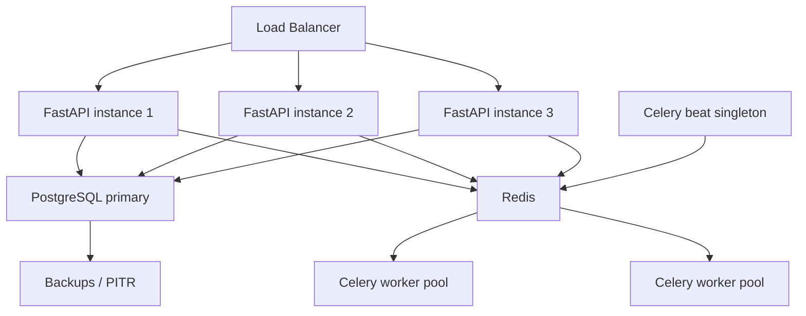

## 21. Security Design

| Concern | Implementation |
| --- | --- |
| Password storage | Argon2 hashes through passlib |
| Hotel JWT | Access token includes `sub` and `hotel_id`; default expiry controlled by settings |
| Platform JWT | Separate token with `scope=platform` |
| Refresh sessions | Stored in `UserSession`, can be revoked on password change/logout |
| RBAC | `require_permission` dependencies plus service-level scope helpers |
| Tenant isolation | `hotel_id` checks, tenant context, query filters |
| Secret handling | `Vault` and `HotelSecret` for encrypted per-hotel secrets |
| WhatsApp webhook | HMAC SHA-256 signature verification when app secret configured |
| Rate limiting | Middleware groups requests by auth/tickets/WhatsApp/menu/export/import/general |
| Error handling | Structured error envelopes with cause/hint/context for UI |
| Audit logs | Business changes write `AuditLog` records |

### Security interview answer

If asked "How do you prevent a user from hotel A reading hotel B?", answer:

The design uses defense in depth. The JWT carries the user's hotel id. Each hotel route has a path hotel id. The dependency rejects requests where token hotel id and path hotel id differ. The dependency sets PostgreSQL tenant context for RLS support. Repositories still filter by hotel id. Permissions then decide what the user can do within that hotel.

## 22. Observability and Reliability

Implemented signals:

- `AuditLog` for business mutations.
- `Notification` table for persisted notification history.
- `AIUsageLog` and `AIToolExecutionLog` for AI traceability.
- `JobExecution` model for async job tracking.
- Request headers:
  - `X-Process-Time-ms`
  - `X-DB-Query-Count`
  - `X-DB-Query-Time-ms`
- Structured API errors used by dashboard error dialogs.
- Tests for health, RBAC, WhatsApp flow, SLA escalation, AI chatbot, performance pagination, and platform features.

Reliability behavior:

- Notification send failures do not necessarily break the core transaction.
- WhatsApp confirmation send is best-effort after reservation creation.
- Celery handles recurring timeout/escalation checks.
- Dry-run mode exists for WhatsApp and FCM in development.

## 23. Deployment View

Local development:

- Backend: Uvicorn with FastAPI.
- Frontend: Next.js dev server on port 3000.
- Database: SQLite default or local PostgreSQL.
- Redis: local/WSL Redis.
- Workers: Celery worker and beat.

Cloud-ready deployment:

- Backend Dockerfile for FastAPI.
- Frontend Dockerfile for dashboard.
- PostgreSQL managed database.
- Redis managed instance.
- S3-compatible media storage.
- Environment variables and secrets configured by infra scripts.
- Alembic migrations before release.

## 24. Testing Strategy

Backend tests currently cover:

- Health endpoint.
- WhatsApp guest flow.
- AI chatbot MVP.
- Guest portal chat.
- SLA escalation flow.
- Staff portal RBAC.
- Role/permission upgrades.
- Platform admin password recovery.
- Demo seeding.
- Performance pagination.
- Error detail envelopes.
- Employee profile web features.
- Attendance v2.
- Seed load generator.
- Rate limiter.

Interview explanation:

The tests are domain-focused rather than only controller-level. They verify business behavior such as escalation, RBAC, WhatsApp conversations, platform operations, and data-seeding correctness.

## 25. Excalidraw Board Plan

Create one Excalidraw file with 6 frames. This will make your interview explanation smooth.

### Frame 1: System Context

Title: `Arcadia Hotel Platform - System Context`

Draw:

- Left: Users and external entry points:
  - Guest
  - Hotel Staff
  - Hotel Admin
  - Platform Super Admin
  - WhatsApp / Meta
- Middle: Client apps:
  - Next.js Dashboard
  - Guest Portal
  - React Native Staff App
  - Expo App
- Center-right: FastAPI Modular Monolith
- Right: data and integrations:
  - PostgreSQL
  - Redis
  - Celery Workers
  - Meta WhatsApp Graph API
  - AI Providers
  - Firebase FCM
  - S3/local media
  - Payment gateway stub

Recommended colors:

| Color | Meaning |
| --- | --- |
| Blue | Client apps |
| Green | Backend services |
| Orange | Async/workers |
| Purple | External vendors |
| Gray | Data stores |

### Frame 2: Backend Layered Architecture

Title: `FastAPI Backend LLD`

Draw vertical layers:

1. API Routers
2. Auth/RBAC/Tenant Dependencies
3. Pydantic Schemas
4. Domain Services
5. Repositories
6. SQLAlchemy Models
7. PostgreSQL

On the side, connect services to:

- AuditService
- NotificationService
- Vault
- Integration adapters

### Frame 3: Core Data Model

Title: `Core ERD`

Draw clusters:

- Tenant/RBAC: Hotel, User, Role, Permission, Department.
- PMS: RoomType, Room, Reservation, RoomBlock, StayRecord.
- Guest/Folio: Guest, ReservationGuest, Folio, Payment.
- Ticket workflow: Ticket, TicketEvent, TicketAcceptance, EscalationRule.
- WhatsApp/AI: WhatsAppConversation, WhatsAppMessage, AIUsageLog.

Show `hotel_id` near all tenant-owned clusters.

### Frame 4: Reservation Flow

Title: `Reservation and Availability Flow`

Draw sequence:

1. Create reservation.
2. Validate dates.
3. Check room type availability.
4. Create/reuse guest.
5. Insert reservation and room type booking.
6. Hold room type with room block.
7. Check-in releases type hold.
8. Assign actual room.
9. Block specific room.
10. Create stay and folio.
11. Checkout releases block and creates housekeeping clean.

### Frame 5: Ticket Dispatch and Escalation Flow

Title: `Ticket Dispatch LLD`

Draw:

- Sources: Dashboard, Guest Portal, WhatsApp, AI, Mobile.
- TicketService.
- SLAService.
- ShiftService/StaffService.
- DispatchService.
- TicketAcceptance table.
- NotificationService.
- WebSocket/FCM.
- Celery timeout job.
- EscalationRule and EscalationLog.

Flow:

Create ticket -> resolve department/category -> find staff -> broadcast offer -> accept/reject/timeout -> escalate -> complete -> approve.

### Frame 6: WhatsApp + AI Pipeline

Title: `WhatsApp AI Assistant LLD`

Draw:

Webhook -> WhatsApp conversation/message store -> AIOrchestrator -> settings -> context builder -> knowledge loader -> provider factory -> parser -> decision engine -> tool executor -> reply/ticket/escalation -> usage/debug logs.

## 26. LLD Informative Charts

Use these tables directly in your LLD notes.

### ReservationService LLD

| Method | Inputs | Main dependencies | Output/state change |
| --- | --- | --- | --- |
| `create_reservation` | hotel id, reservation payload, actor | GuestRepository, RoomRepository, RatePlanRepository, AvailabilityService, AuditService | Reservation, guest link, type booking, room blocks |
| `check_in` | hotel id, reservation id, room assignment payload | AvailabilityService, WhatsAppSessionRepository, FolioService | Room assignment, stay record, room occupied, guest checked in |
| `check_out` | hotel id, reservation id | HousekeepingService, FolioService, AvailabilityService | Guest checked out, room cleaning, stay closed, blocks released |
| `cancel_reservation` | hotel id, reservation id, reason | AvailabilityService, AuditService | Reservation cancelled, blocks released, audit log |
| `change_room` | hotel id, reservation id, new room | AvailabilityService, StayRecordRepository | Old stay closed, new room occupied, new block inserted |

### TicketService LLD

| Method | Inputs | Main dependencies | Output/state change |
| --- | --- | --- | --- |
| `create_ticket` | hotel id, ticket payload, actor | UsageService, DepartmentRepository, RoutingRuleRepository, SLAService, ShiftService, DispatchService, AuditService | Ticket row, event row, assignment/dispatch, notification |
| `accept_ticket` | hotel id, ticket id, user id | DispatchService | Accepted assignment, SLA due time, notification |
| `reject_ticket` | hotel id, ticket id, user id, reason | DispatchService | Rejected offer and possible escalation |
| `complete_ticket` | hotel id, ticket id, user id | TicketRepository, AuditService | Stage `pending_approval` |
| `approve_ticket` | hotel id, ticket id, actor | TicketRepository, AuditService | Stage `approved`, resolved timestamp |
| `update_stage` | hotel id, ticket id, stage | WorkflowService, NotificationService | Workflow transition and ticket event |

### RBACService LLD

| Responsibility | Detail |
| --- | --- |
| Permission seeding | Seeds permission groups and permission codes from defaults at startup |
| Owner role seeding | Creates Owner, Manager, Receptionist, Staff system roles |
| Dynamic role CRUD | Creates, updates, deletes non-system roles |
| Scoped grants | Normalizes permissions into `own`, `department`, or `hotel` scope |
| Permission cache | Caches grants per user for `permission_cache_ttl_seconds` |
| Ticket visibility | Computes own/department/all visibility |
| Staff visibility | Computes staff access scope |

### AIOrchestrator LLD

| Step | Component | Purpose |
| --- | --- | --- |
| 1 | AISettingsService | Load hotel AI configuration |
| 2 | AIContextBuilder | Build conversation context from guest, room, reservation, messages, tickets |
| 3 | AIKnowledgeLoader | Add relevant hotel knowledge |
| 4 | Provider factory | Select local/Gemini/OpenAI/Anthropic/Groq provider |
| 5 | AIRequestBuilder | Build system/user messages |
| 6 | Provider chat | Generate JSON-like AI response |
| 7 | AIResponseParser | Convert response into `AIDecision` |
| 8 | AIDecisionEngine | Decide action based on thresholds and open tickets |
| 9 | AIToolExecutor | Execute reply, ticket creation, escalation, or suggestion |
| 10 | AIAnalyticsService | Log usage, latency, tokens, errors, debug steps |

### Notification LLD

| Component | Role |
| --- | --- |
| NotificationCenterService | Persists user-facing notifications |
| NotificationService.publish | Publishes JSON payload to Redis channel |
| WebSocket ConnectionManager | Tracks active local WebSocket connections |
| FCMClient | Sends push notifications to Firebase tokens |
| Dashboard `useWebSocket` | Updates Zustand notification store and invalidates React Query |
| MobileWebSocketClient | Parses events and reconnects with exponential backoff |

## 27. Interview Deep-Dive Questions and Answers

### Why modular monolith instead of microservices?

Because reservation, room availability, folio, ticket, and audit flows require strong consistency. Splitting too early would add distributed transactions, network failures, and operational overhead. The code is modular at package level, so future extraction is possible if a boundary becomes independently scalable, such as notification delivery or AI processing.

### How do you prevent double booking?

All reservation and room assignment flows go through `AvailabilityService`. At booking time it checks room-type availability and creates type-level `RoomBlock` holds. At check-in it releases type-level holds, validates or finds actual rooms, and creates specific room blocks. Cancellation, checkout, and room change release blocks by reservation reference.

### How do you handle staff who do not accept a task?

`DispatchService` creates `TicketAcceptance` rows with an expiry. Celery checks pending acceptances every minute. If an offer expires or all staff reject it, the service finds the next escalation rule and broadcasts the task to the next staff level.

### How do you enforce permissions?

Each protected route uses dependency functions like `require_permission`. The dependency decodes JWT, checks active user, checks hotel id, sets tenant context, and calls `RBACService.require`. RBAC expands role grants, handles equivalent permissions, and applies scopes like own, department, or hotel.

### How does AI avoid directly doing unsafe actions?

AI produces a structured decision. The backend parses it and uses `AIDecisionEngine` plus `AIToolExecutor` to decide what action is allowed. The backend remains the authority for creating tickets, replying, escalating, and logging usage.

### How do realtime updates work?

Domain services call `NotificationService`, which publishes to Redis channels and broadcasts to active in-process WebSocket connections. Dashboard and mobile connect to `/ws/notifications` using the JWT token, receive events, update local stores, and invalidate React Query data.

### How is the platform multi-tenant?

The core tenant key is `hotel_id`. User tokens contain hotel id. Routes contain hotel id. The backend rejects mismatches, sets PostgreSQL tenant context, and repositories filter by hotel id. Platform admin APIs use a separate token scope.

### How would you scale this system?

I would first run multiple stateless FastAPI instances behind a load balancer, use managed PostgreSQL, managed Redis, and horizontally scale Celery workers. Then I would isolate analytics/reporting reads, improve WebSocket fanout with a dedicated gateway, move media to S3/CDN, and use delayed queue jobs for high-volume ticket acceptance timeouts.

### What are the most important tables?

For interviews, focus on:

- `hotels`, `users`, `roles`, `permissions`
- `room_types`, `rooms`, `room_blocks`
- `guests`, `reservations`, `reservation_room_types`, `reservation_guests`, `stay_records`
- `tickets`, `ticket_events`, `ticket_acceptances`, `task_type_slas`, `escalation_rules`, `escalation_logs`
- `whatsapp_conversations`, `whatsapp_messages`
- `guest_folios`, `folio_items`, `payments`
- `audit_logs`, `notifications`, `ai_usage_logs`, `job_executions`

## 28. What To Emphasize In The Interview

Start with:

"This is a multi-tenant hotel operations platform built as a modular monolith. The backend is FastAPI with SQLAlchemy and PostgreSQL, the dashboard is Next.js, and the staff app is React Native. The main design challenges were tenant isolation, dynamic RBAC, room availability consistency, realtime ticket dispatch, WhatsApp guest communication, and AI-assisted automation."

Then explain in this order:

1. System context: clients, backend, database, workers, integrations.
2. Tenant and RBAC model.
3. Reservation and availability consistency.
4. Ticket dispatch, SLA, and escalation.
5. WhatsApp and AI pipeline.
6. Realtime notifications.
7. Scalability and tradeoffs.

## 29. Short Verbal Pitch

Arcadia is a hotel operations platform that connects front desk, housekeeping, engineering, food and beverage, guests, and platform admins. It uses a FastAPI modular monolith because the core flows need transactional consistency. Every tenant-owned resource is scoped by `hotel_id`, RBAC is dynamic and scoped, and critical workflows like reservations and tickets are handled in domain services. Reservations use room-type holds and room blocks to prevent double booking. Tickets use SLA-aware dispatch, acceptance timeouts, escalation rules, WebSockets, and FCM notifications. WhatsApp messages are persisted per hotel and can be processed by an AI orchestrator that builds context, loads knowledge, calls a provider abstraction, parses structured decisions, and executes backend-approved actions.

## 30. Suggested Diagram Order For Excalidraw Presentation

When explaining, move through your Excalidraw sheet in this sequence:

1. System Context.
2. Container Architecture.
3. Backend LLD layers.
4. Data model clusters.
5. Reservation sequence.
6. Ticket dispatch/escalation sequence.
7. WhatsApp/AI sequence.
8. Security and scaling notes.

That order lets the interviewer see both architecture breadth and implementation depth.
