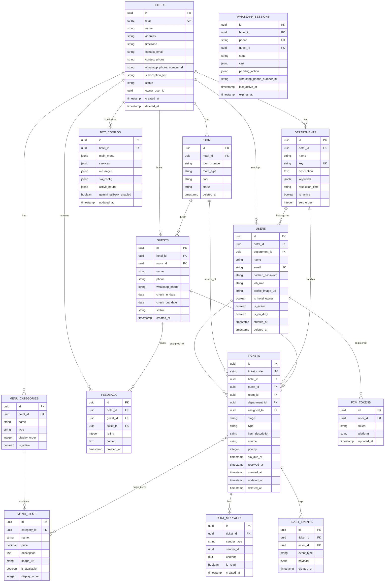

# My Architecture Design for Arcadia Platform

> **Design philosophy**: One language. One database. One API. Everything else is a plugin.
> Built for a team of 2–4 developers. Scales to 10,000 hotels. Runs on a single $20/month VPS to start.

---

## 0. Core Design Principles I Follow

1. **Modular Monolith first** — NOT microservices. The project is too small for microservices overhead. One FastAPI app with clean internal boundaries is the right call.
2. **PostgreSQL is the single source of truth** — No Firebase, no split-brain between Firestore + RTDB. One DB, one query language.
3. **Real-time is a layer, not a foundation** — WebSocket is just a push notification channel on top of REST. The data always lives in PostgreSQL.
4. **Multi-tenancy by `hotel_id` on every row** — Not separate schemas per hotel. Every query always filters by `hotel_id`.
5. **Config-driven bot, not code-driven** — Hotel customizations live in a DB table, not in hardcoded prompt strings.
6. **Security is baked in from day one** — JWT auth, row-level scoping, no API keys in the frontend.

---

## 1. The Big Picture

```
┌─────────────────────────────────────────────────────────────────────────────┐
│                              CLIENTS                                         │
│                                                                              │
│  ┌──────────────┐  ┌──────────────┐  ┌──────────────┐  ┌────────────────┐  │
│  │ Android App  │  │ Staff React  │  │ Guest Web    │  │ WhatsApp /     │  │
│  │ (Hotel Staff │  │ Dashboard    │  │ Chatbot      │  │ Twilio Voice   │  │
│  │ & Managers)  │  │ (Vite)       │  │ (Next.js)    │  │ Webhooks       │  │
│  └──────┬───────┘  └──────┬───────┘  └──────┬───────┘  └───────┬────────┘  │
│         │                 │                  │                  │           │
└─────────┼─────────────────┼──────────────────┼──────────────────┼───────────┘
          │  REST + WS      │  REST + WS        │  REST + WS       │  POST webhook
          ▼                 ▼                   ▼                  ▼
┌─────────────────────────────────────────────────────────────────────────────┐
│                        API GATEWAY LAYER                                     │
│                   (nginx — SSL termination, rate limiting)                   │
└──────────────────────────────────────┬──────────────────────────────────────┘
                                       │
                                       ▼
┌─────────────────────────────────────────────────────────────────────────────┐
│                      FastAPI Application (Python 3.12)                       │
│                                                                              │
│  ┌───────────────────────────────────────────────────────────────────────┐  │
│  │                         ROUTER LAYER                                   │  │
│  │  /api/v1/auth    /api/v1/hotels    /api/v1/tickets    /api/v1/menu    │  │
│  │  /api/v1/users   /api/v1/guests    /api/v1/chat       /api/v1/bot     │  │
│  │  /ws/{hotel_id}  /webhook/whatsapp  /webhook/voice                    │  │
│  └──────────────────────────────────┬────────────────────────────────────┘  │
│                                     │                                        │
│  ┌──────────────────────────────────▼────────────────────────────────────┐  │
│  │                       SERVICE LAYER                                    │  │
│  │  AuthService  │ HotelService │ TicketService │ MenuService             │  │
│  │  GuestService │ ChatService  │ BotService    │ NotifService            │  │
│  └──────────────────────────────────┬────────────────────────────────────┘  │
│                                     │                                        │
│  ┌──────────────────────────────────▼────────────────────────────────────┐  │
│  │                      REPOSITORY LAYER                                  │  │
│  │  (SQLAlchemy async ORM — every query scoped by hotel_id)               │  │
│  └──────────────────────────────────┬────────────────────────────────────┘  │
│                                     │                                        │
│  ┌──────────────────────────────────▼────────────────────────────────────┐  │
│  │                    INTEGRATION LAYER (plugins)                         │  │
│  │  WhatsApp Cloud API │ Twilio │ Gemini AI │ FCM Push │ ElevenLabs TTS  │  │
│  └───────────────────────────────────────────────────────────────────────┘  │
└──────────────────────────────────────┬──────────────────────────────────────┘
                                       │
              ┌───────────────────────┼─────────────────────┐
              ▼                       ▼                     ▼
   ┌──────────────────┐   ┌──────────────────┐   ┌──────────────────┐
   │   PostgreSQL 16   │   │  Redis 7          │   │  Celery Workers  │
   │   (Primary DB)    │   │  • Session store  │   │  • SLA sweeper   │
   │   • All tables    │   │  • WS Pub/Sub     │   │  • Checkout sync │
   │   • JSONB config  │   │  • Rate limiting  │   │  • Notif sender  │
   │   • Full text     │   │  • Bot cache      │   │  • Review sweep  │
   └──────────────────┘   └──────────────────┘   └──────────────────┘
```

---

## 2. Database Design (PostgreSQL)

### Design Decisions
- **UUIDs** as primary keys (safe for distributed inserts)
- **`hotel_id` on every tenant table** — enforced at DB level with FK + application-level guard middleware
- **`JSONB` for flexible config** — `bot_config`, `sla_config`, `department_keywords` don't need rigid columns
- **Soft deletes** — `deleted_at` timestamp, never hard-delete operational data
- **Audit trail built-in** — `ticket_events` table records every state change

### Full Schema



---

## 3. Layered Code Architecture

### Project Structure (FastAPI)

```
arcadia/
│
├── main.py                     # App factory, lifespan events
├── core/
│   ├── config.py               # Pydantic Settings (env vars)
│   ├── database.py             # Async SQLAlchemy engine + session
│   ├── redis.py                # Redis connection pool
│   ├── security.py             # JWT sign/verify, password hashing
│   ├── exceptions.py           # Custom HTTP exceptions
│   └── middleware.py           # hotel_id scoping, request logging
│
├── models/                     # SQLAlchemy ORM models (1:1 with tables above)
│   ├── hotel.py
│   ├── user.py
│   ├── ticket.py
│   ├── menu.py
│   ├── guest.py
│   ├── bot_config.py
│   └── whatsapp_session.py
│
├── schemas/                    # Pydantic request/response models
│   ├── auth.py
│   ├── hotel.py
│   ├── ticket.py
│   └── ...
│
├── repositories/               # Data access (SQL queries only live here)
│   ├── base.py                 # BaseRepository with hotel_id guard
│   ├── ticket_repo.py
│   ├── user_repo.py
│   └── ...
│
├── services/                   # Business logic (no SQL, no HTTP)
│   ├── auth_service.py         # Login, JWT, OTP
│   ├── ticket_service.py       # Create, assign, stage-change + events
│   ├── bot_service.py          # Flow engine + Gemini fallback
│   ├── notification_service.py # WebSocket push + FCM push
│   └── whatsapp_service.py     # Send WhatsApp messages via Meta API
│
├── api/
│   ├── v1/
│   │   ├── auth.py
│   │   ├── hotels.py
│   │   ├── users.py
│   │   ├── tickets.py
│   │   ├── menu.py
│   │   ├── guests.py
│   │   ├── feedback.py
│   │   ├── bot_config.py
│   │   └── webhooks.py         # WhatsApp + Twilio webhook handlers
│   └── ws/
│       ├── tickets_ws.py       # /ws/{hotel_id}/tickets
│       └── chat_ws.py          # /ws/{hotel_id}/chat/{ticket_id}
│
├── integrations/               # External API clients (pure I/O)
│   ├── meta_whatsapp.py        # httpx client for Meta API
│   ├── gemini.py               # Google Generative AI client
│   ├── fcm.py                  # Firebase Admin SDK (push only)
│   ├── deepgram.py             # STT for voice bot
│   └── elevenlabs.py           # TTS for voice bot
│
├── workers/                    # Celery async tasks
│   ├── celery_app.py
│   ├── sla_worker.py           # Check SLA breach every minute
│   ├── checkout_worker.py      # Evict checked-out guest sessions
│   └── notification_worker.py  # Send FCM push notifications
│
└── alembic/                    # DB migrations
    └── versions/
```

---

## 4. The Real-Time System (How live updates work)

This replaces Firebase RTDB entirely with a 3-step pattern:

```
Step 1: Client connects WebSocket
        Android App ──WS──▶ /ws/HOT100/tickets
        (FastAPI holds the connection open in async)

Step 2: Any write triggers a publish
        POST /api/v1/tickets     ← creates ticket in PostgreSQL
        TicketService publishes: Redis PUBLISH "hotel:HOT100:tickets" '{"event":"created", ...}'

Step 3: FastAPI WS handler subscribes to same Redis channel
        → Receives the published message
        → Forwards JSON to all WebSocket clients in that hotel

Result: Android app gets the ticket update in ~50ms with zero polling
```

### Why Redis Pub/Sub and not something else?
- Solves the **Load Balancer problem** — if you run 3 instances of the API, they all share the same Redis channel, so any client connected to ANY instance gets the event.
- Already being used for session cache — one dependency, two purposes.

---

## 5. Security Design

| Threat | My Solution |
|---|---|
| Unauthenticated API access | JWT `Bearer` token required on every `/api/v1` route |
| Cross-tenant data leak | `hotel_id` FK middleware validates token's `hotel_id` matches URL's `hotel_id` before every request |
| API keys in frontend | Zero client-side keys — all Gemini/Meta/Firebase calls happen server-side only |
| WhatsApp webhook spoofing | HMAC-SHA256 signature verification on every `POST /webhook/whatsapp` |
| Brute force login | Redis-backed rate limiter: 5 failed logins per IP per 15 min |
| Password storage | `bcrypt` via `passlib` |
| SQL injection | SQLAlchemy ORM + parameterized queries only |

---

## 6. Bot Architecture (WhatsApp Flow Engine)

The WhatsApp bot logic is redesigned as a clean state machine stored in PostgreSQL (`whatsapp_sessions` table) instead of an in-memory JS object.

```
Incoming WhatsApp message (webhook POST)
            │
            ▼
   Load session from PostgreSQL (or create new)
            │
            ▼
    ┌───────────────────────────────┐
    │      FLOW ENGINE              │
    │                               │
    │  switch(session.state):       │
    │                               │
    │  "new"/"idle"                 │──▶ Send main menu
    │                               │
    │  "awaiting_service_select"    │──▶ Create ticket directly
    │                               │
    │  "awaiting_food_confirm"      │──▶ Create food order ticket
    │                               │
    │  "awaiting_free_text"         │──▶ Create ticket with text
    │                               │
    │  "talking_to_manager"         │──▶ Bridge to Chat system
    │                               │
    │  FREE TEXT (no state match)   │──▶ Gemini Fallback:
    │                               │     • Load bot_configs from DB
    │                               │     • Build SLIM prompt (~25 lines)
    │                               │     • Call Gemini API
    │                               │     • Match → confirm + ticket
    │                               │     • No match → send main menu
    └───────────────────────────────┘
            │
            ▼
   Save updated session to PostgreSQL
            │
            ▼
   Publish ticket event to Redis (if ticket created)
            │
            ▼
   Reply via Meta WhatsApp API
```

---

## 7. Android API Design Principles

The REST API is designed to be **Android-friendly**:

1. **Consistent envelope** — every response has the same shape:
    ```json
    {
      "success": true,
      "data": { ... },
      "meta": { "total": 100, "page": 1, "limit": 20 }
    }
    ```
2. **Cursor pagination** — use `?cursor=<id>&limit=20` (not page numbers) — works perfectly with RecyclerView infinite scroll
3. **Offline-friendly** — `updated_at` timestamp on every resource; Android can do `GET /tickets?updated_after=<ts>` to sync only changes
4. **Minimal payloads** — list endpoints return summary fields; detail endpoints return full data
5. **WebSocket reconnect** — the server sends a `ping` frame every 30 seconds; Android client reconnects automatically on drop

---

## 8. Infrastructure (Production-Ready, Starts Cheap)

```
┌─────────────────────────────────────────────────────────────┐
│                    Single VPS ($20/month)                    │
│                      (to start with)                        │
│                                                             │
│  ┌─────────────┐  ┌─────────────┐  ┌─────────────────────┐ │
│  │  nginx       │  │  FastAPI    │  │  Celery Workers     │ │
│  │  (SSL + LB)  │  │  (uvicorn   │  │  (3 worker procs)   │ │
│  │             │  │  4 workers) │  │                     │ │
│  └─────────────┘  └─────────────┘  └─────────────────────┘ │
│                                                             │
│  ┌─────────────┐  ┌─────────────┐                          │
│  │ PostgreSQL  │  │  Redis      │                          │
│  │  (local)    │  │  (local)    │                          │
│  └─────────────┘  └─────────────┘                          │
└─────────────────────────────────────────────────────────────┘

When you outgrow 1 VPS (10,000+ requests/hour):
→ Move PostgreSQL to AWS RDS / Supabase
→ Move Redis to AWS ElastiCache
→ Run 3 FastAPI instances behind nginx (Pub/Sub keeps WS working)
→ Celery workers on separate container
→ No code changes needed!
```

---

## 9. What I Would Keep from the Current System

| Current Component | Keep? | Reason |
|---|---|---|
| Firebase FCM push | ✅ Keep | Python `firebase-admin` SDK works perfectly for push notifications only |
| Gemini AI for fallback | ✅ Keep | Already has Python SDK, works great |
| Department routing logic | ✅ Port | The alias map + scoring algorithm in `departments.js` is actually excellent — just convert to Python |
| Voice Bot (FastAPI) | ✅ Keep & refactor | Already Python, just point it to PostgreSQL instead of Firebase |
| Bot session state machine logic | ✅ Port | The 17-state machine in `session.js` is well-thought-out — port it, persist it in PostgreSQL |
| Meta WhatsApp webhook | ✅ Port | Move from Express to FastAPI, same logic |
| Dashboard (React/Vite) | ✅ Keep | Frontend doesn't need to change — just update API URLs |

### What I Would Remove

| Current Component | Remove? | Replace With |
|---|---|---|
| Firebase Firestore | ✅ Remove | PostgreSQL |
| Firebase RTDB | ✅ Remove | PostgreSQL + Redis Pub/Sub |
| Express.js WhatsApp Bot | ✅ Remove | FastAPI webhook handler |
| Legacy Django backend | ✅ Remove | FastAPI service |
| In-memory JS session map | ✅ Remove | `whatsapp_sessions` table in PostgreSQL |
| In-memory department cache | ✅ Remove | Redis cache with 5-min TTL |
| Hardcoded OpenAI key in source | ✅ Remove | Environment variable |
| VITE_* keys in browser | ✅ Remove | Server-side only |
