# Arcadia Platform — Extended Architecture Design (v2.0)

> **v1.0** → Good MVP (8.5/10)
> **v2.0** → Production-grade multi-tenant hotel SaaS (9.5+/10)
>
> This document merges the original architecture with all 14 additions from the extended analysis.

---

## Table of Contents

1. [Design Principles](#1-design-principles)
2. [System Architecture Diagram](#2-system-architecture-diagram)
3. [Full PostgreSQL Schema (30+ Tables)](#3-full-postgresql-schema-30-tables)
4. [Priority 1 — Core Additions](#4-priority-1--core-additions)
5. [Priority 2 — Strongly Recommended](#5-priority-2--strongly-recommended)
6. [Priority 3 — Future SaaS Features](#6-priority-3--future-saas-features)
7. [Restructured Service Layer](#7-restructured-service-layer)
8. [Updated REST API Endpoint List](#8-updated-rest-api-endpoint-list)
9. [Updated Folder Structure](#9-updated-folder-structure)
10. [Phase-by-Phase Build Order](#10-phase-by-phase-build-order)

---

## 1. Design Principles

Unchanged from v1, plus two additions:

1. **Modular Monolith first** — one FastAPI app with clean internal boundaries
2. **PostgreSQL is the single source of truth** — no Firebase split-brain
3. **Real-time is a layer, not a foundation** — WebSocket on top of REST
4. **Multi-tenancy by `hotel_id` on every row** — not separate schemas
5. **Config-driven bot, not code-driven** — customizations live in DB
6. **Security baked in from day one** — JWT + RBAC + row-level scoping
7. **🆕 Every hotel is fully independent** — own WhatsApp number, own branding, own roles, own bot config, own FAQ
8. **🆕 Audit everything** — every mutation is logged, every WhatsApp message is stored

---

## 2. System Architecture Diagram

```
┌─────────────────────────────────────────────────────────────────────────────┐
│                              CLIENTS                                         │
│                                                                              │
│  ┌──────────────┐  ┌──────────────┐  ┌──────────────┐  ┌────────────────┐  │
│  │ Android App  │  │ Staff React  │  │ Guest Web    │  │ WhatsApp /     │  │
│  │ (Hotel Staff │  │ Dashboard    │  │ Chatbot      │  │ Twilio Voice   │  │
│  │ & Managers)  │  │ (Vite)       │  │ (Next.js)    │  │ Webhooks       │  │
│  └──────┬───────┘  └──────┬───────┘  └──────┬───────┘  └───────┬────────┘  │
└─────────┼─────────────────┼──────────────────┼──────────────────┼───────────┘
          │  REST + WS      │  REST + WS        │  REST + WS       │ POST
          ▼                 ▼                   ▼                  ▼
┌─────────────────────────────────────────────────────────────────────────────┐
│                   nginx (SSL + Rate Limiting)                                │
└──────────────────────────────────────┬──────────────────────────────────────┘
                                       │
┌──────────────────────────────────────▼──────────────────────────────────────┐
│                      FastAPI Application (Python 3.12)                       │
│                                                                              │
│  ┌───────────────────────────────────────────────────────────────────────┐  │
│  │                         ROUTER LAYER                                   │  │
│  │  /api/v1/auth     /api/v1/hotels      /api/v1/tickets                 │  │
│  │  /api/v1/users    /api/v1/guests      /api/v1/menu                    │  │
│  │  /api/v1/rooms    /api/v1/departments  /api/v1/reservations           │  │
│  │  /api/v1/bot      /api/v1/campaigns   /api/v1/faqs                    │  │
│  │  /api/v1/roles    /api/v1/media       /api/v1/subscriptions           │  │
│  │  /ws/{hotel_id}   /webhook/whatsapp    /webhook/voice                 │  │
│  └──────────────────────────────────┬────────────────────────────────────┘  │
│                                     │                                        │
│  ┌──────────────────────────────────▼────────────────────────────────────┐  │
│  │                  MIDDLEWARE LAYER (v2.0 — NEW)                         │  │
│  │                                                                        │  │
│  │  JWTAuthMiddleware → RBACMiddleware → HotelScopeMiddleware            │  │
│  │       │                    │                   │                        │  │
│  │  Verify token        Check permission     Validate hotel_id            │  │
│  │  Extract user_id     from user's roles    matches token's hotel        │  │
│  │                      e.g. ticket.assign                                │  │
│  └──────────────────────────────────┬────────────────────────────────────┘  │
│                                     │                                        │
│  ┌──────────────────────────────────▼────────────────────────────────────┐  │
│  │                       SERVICE LAYER (Restructured)                     │  │
│  │                                                                        │  │
│  │  ┌─────────────────┐  ┌──────────────────┐  ┌─────────────────────┐  │  │
│  │  │  BotService      │  │  NotifService     │  │  Core Services      │  │  │
│  │  │  ├─ FlowEngine   │  │  ├─ FCMChannel    │  │  ├─ AuthService     │  │  │
│  │  │  ├─ FAQEngine    │  │  ├─ EmailChannel  │  │  ├─ HotelService    │  │  │
│  │  │  ├─ AIEngine     │  │  ├─ WhatsApp Ch.  │  │  ├─ TicketService   │  │  │
│  │  │  └─ WhatsAppSvc  │  │  ├─ SMSChannel    │  │  ├─ ReservationSvc  │  │  │
│  │  │                  │  │  └─ WebSocketCh.  │  │  ├─ GuestService    │  │  │
│  │  └─────────────────┘  └──────────────────┘  │  ├─ MenuService     │  │  │
│  │                                              │  ├─ RBACService     │  │  │
│  │                                              │  ├─ CampaignSvc     │  │  │
│  │                                              │  ├─ MediaService    │  │  │
│  │                                              │  └─ AuditService    │  │  │
│  │                                              └─────────────────────┘  │  │
│  └───────────────────────────────────────────────────────────────────────┘  │
│                                                                              │
│  ┌───────────────────────────────────────────────────────────────────────┐  │
│  │                      REPOSITORY LAYER                                  │  │
│  │  (SQLAlchemy async ORM — every query scoped by hotel_id)               │  │
│  └───────────────────────────────────────────────────────────────────────┘  │
│                                                                              │
│  ┌───────────────────────────────────────────────────────────────────────┐  │
│  │                    INTEGRATION LAYER (plugins)                         │  │
│  │  Meta WhatsApp API │ Twilio │ Gemini AI │ FCM │ SMTP │ S3/R2         │  │
│  └───────────────────────────────────────────────────────────────────────┘  │
└──────────────────────────────────────┬──────────────────────────────────────┘
                                       │
        ┌──────────────────────────────┼──────────────────────────────┐
        ▼                              ▼                              ▼
┌──────────────────┐      ┌──────────────────┐           ┌──────────────────┐
│  PostgreSQL 16   │      │  Redis 7          │           │  Object Storage  │
│  30+ tables      │      │  Sessions         │           │  S3 / R2 / MinIO │
│  JSONB configs   │      │  WS Pub/Sub       │           │  Menu images     │
│  Full-text search│      │  Rate limiting    │           │  Profile photos  │
│  Audit trail     │      │  Bot config cache │           │  Media files     │
└──────────────────┘      └──────────────────┘           └──────────────────┘
```

---

## 3. Full PostgreSQL Schema (30+ Tables)

### Complete ER Diagram

```mermaid
erDiagram
    HOTELS ||--o{ USERS : "employs"
    HOTELS ||--o{ ROOMS : "has"
    HOTELS ||--o{ DEPARTMENTS : "has"
    HOTELS ||--o{ DEPARTMENT_CONFIGS : "configures"
    HOTELS ||--o{ MENU_CATEGORIES : "has"
    HOTELS ||--o{ BOT_CONFIGS : "configures"
    HOTELS ||--o{ BOT_VERSIONS : "versions"
    HOTELS ||--o{ GUESTS : "hosts"
    HOTELS ||--o{ RESERVATIONS : "manages"
    HOTELS ||--o{ FEEDBACK : "receives"
    HOTELS ||--o{ ROLES : "defines"
    HOTELS ||--o{ WHATSAPP_ACCOUNTS : "owns"
    HOTELS ||--o{ WHATSAPP_TEMPLATES : "uses"
    HOTELS ||--o{ WHATSAPP_CONVERSATIONS : "has"
    HOTELS ||--o{ HOTEL_FAQS : "answers"
    HOTELS ||--o{ HOTEL_LANGUAGES : "supports"
    HOTELS ||--o{ CAMPAIGNS : "sends"
    HOTELS ||--o{ SUBSCRIPTIONS : "subscribes"
    HOTELS ||--o{ AUDIT_LOGS : "records"
    HOTELS ||--o{ MEDIA_FILES : "stores"
    HOTELS ||--o{ NOTIFICATIONS : "sends"
    HOTELS ||--o{ SERVICE_FORMS : "defines"
    USERS ||--o{ USER_ROLES : "has"
    ROLES ||--o{ ROLE_PERMISSIONS : "grants"
    ROLES ||--o{ USER_ROLES : "assigned_to"
    PERMISSIONS ||--o{ ROLE_PERMISSIONS : "granted_by"
    USERS ||--o{ TICKETS : "assigned_to"
    USERS ||--o{ FCM_TOKENS : "registered"
    ROOMS ||--o{ GUESTS : "hosts"
    ROOMS ||--o{ TICKETS : "source_of"
    ROOMS ||--o{ RESERVATIONS : "booked_for"
    DEPARTMENTS ||--o{ TICKETS : "handles"
    DEPARTMENTS ||--o{ USERS : "belongs_to"
    DEPARTMENTS ||--o{ DEPARTMENT_CONFIGS : "configured_by"
    TICKETS ||--o{ TICKET_EVENTS : "logs"
    TICKETS ||--o{ CHAT_MESSAGES : "has"
    GUESTS ||--o{ TICKETS : "raises"
    GUESTS ||--o{ FEEDBACK : "gives"
    GUESTS ||--o{ RESERVATIONS : "books"
    GUESTS ||--o{ WHATSAPP_CONVERSATIONS : "chats_in"
    RESERVATIONS ||--o{ STAY_RECORDS : "produces"
    MENU_CATEGORIES ||--o{ MENU_ITEMS : "contains"
    WHATSAPP_CONVERSATIONS ||--o{ WHATSAPP_MESSAGES : "contains"
    CAMPAIGNS ||--o{ CAMPAIGN_DELIVERIES : "tracks"
    SERVICE_FORMS ||--o{ SERVICE_FORM_FIELDS : "has"

    HOTELS {
        uuid id PK
        string slug UK
        string name
        string address
        string timezone
        string contact_email
        string contact_phone
        string logo_url
        string subscription_tier
        string status
        uuid owner_user_id
        timestamp created_at
        timestamp deleted_at
    }

    ROLES {
        uuid id PK
        uuid hotel_id FK
        string name
        string description
        boolean is_system_role
        timestamp created_at
    }

    PERMISSIONS {
        uuid id PK
        string code UK
        string name
        string module
    }

    ROLE_PERMISSIONS {
        uuid role_id FK
        uuid permission_id FK
    }

    USER_ROLES {
        uuid user_id FK
        uuid role_id FK
    }

    USERS {
        uuid id PK
        uuid hotel_id FK
        uuid department_id FK
        string name
        string email UK
        string hashed_password
        string job_role
        string profile_image_url
        boolean is_hotel_owner
        boolean is_active
        boolean is_on_duty
        timestamp created_at
        timestamp deleted_at
    }

    ROOMS {
        uuid id PK
        uuid hotel_id FK
        string room_number
        string room_type
        string floor
        string status
        timestamp deleted_at
    }

    DEPARTMENTS {
        uuid id PK
        uuid hotel_id FK
        string name
        string key UK
        text description
        boolean is_active
        integer sort_order
    }

    DEPARTMENT_CONFIGS {
        uuid id PK
        uuid hotel_id FK
        uuid department_id FK
        jsonb keywords
        integer sla_minutes
        boolean auto_assignment_enabled
        string assignment_strategy
    }

    GUESTS {
        uuid id PK
        uuid hotel_id FK
        uuid room_id FK
        string name
        string phone
        string whatsapp_phone
        string email
        string status
        timestamp created_at
    }

    RESERVATIONS {
        uuid id PK
        uuid hotel_id FK
        string reservation_no UK
        uuid guest_id FK
        uuid room_id FK
        string status
        date checkin_date
        date checkout_date
        string source
        text notes
        timestamp created_at
    }

    STAY_RECORDS {
        uuid id PK
        uuid reservation_id FK
        uuid room_id FK
        timestamp actual_checkin
        timestamp actual_checkout
        text notes
    }

    TICKETS {
        uuid id PK
        string ticket_code UK
        uuid hotel_id FK
        uuid guest_id FK
        uuid room_id FK
        uuid department_id FK
        uuid assigned_to FK
        string stage
        string type
        string item_description
        string source
        integer priority
        timestamp sla_due_at
        timestamp resolved_at
        timestamp created_at
        timestamp updated_at
        timestamp deleted_at
    }

    TICKET_EVENTS {
        uuid id PK
        uuid ticket_id FK
        uuid actor_id FK
        string event_type
        jsonb payload
        timestamp created_at
    }

    CHAT_MESSAGES {
        uuid id PK
        uuid ticket_id FK
        string sender_type
        uuid sender_id
        text content
        boolean is_read
        timestamp created_at
    }

    MENU_CATEGORIES {
        uuid id PK
        uuid hotel_id FK
        string name
        string type
        integer display_order
        boolean is_active
    }

    MENU_ITEMS {
        uuid id PK
        uuid category_id FK
        string name
        decimal price
        text description
        string image_url
        boolean is_available
        integer display_order
    }

    FEEDBACK {
        uuid id PK
        uuid hotel_id FK
        uuid guest_id FK
        uuid ticket_id FK
        integer rating
        text content
        timestamp created_at
    }

    FCM_TOKENS {
        uuid id PK
        uuid user_id FK
        string token
        string platform
        timestamp updated_at
    }

    BOT_CONFIGS {
        uuid id PK
        uuid hotel_id FK
        jsonb main_menu
        jsonb services
        jsonb messages
        jsonb sla_config
        jsonb active_hours
        boolean gemini_fallback_enabled
        integer active_version
        timestamp updated_at
    }

    BOT_VERSIONS {
        uuid id PK
        uuid hotel_id FK
        integer version_number
        jsonb config_snapshot
        uuid published_by FK
        string change_note
        timestamp created_at
    }

    WHATSAPP_ACCOUNTS {
        uuid id PK
        uuid hotel_id FK
        string business_name
        string phone_number
        string phone_number_id UK
        string waba_id
        string access_token_encrypted
        string webhook_verify_token
        string status
        timestamp created_at
    }

    WHATSAPP_TEMPLATES {
        uuid id PK
        uuid hotel_id FK
        string template_name
        string template_type
        string language
        string status
        string meta_template_id
        jsonb header_params
        jsonb body_params
        timestamp created_at
    }

    WHATSAPP_CONVERSATIONS {
        uuid id PK
        uuid hotel_id FK
        uuid guest_id FK
        string phone
        string status
        timestamp started_at
        timestamp last_message_at
    }

    WHATSAPP_MESSAGES {
        uuid id PK
        uuid conversation_id FK
        string direction
        string message_type
        text message_text
        string meta_message_id
        string status
        timestamp created_at
    }

    WHATSAPP_SESSIONS {
        uuid id PK
        uuid hotel_id FK
        string phone UK
        uuid guest_id FK
        string state
        jsonb cart
        jsonb pending_action
        jsonb form_responses
        string whatsapp_phone_number_id
        timestamp last_active_at
        timestamp expires_at
    }

    HOTEL_FAQS {
        uuid id PK
        uuid hotel_id FK
        string question
        text answer
        string category
        string language
        boolean is_active
        integer sort_order
    }

    HOTEL_LANGUAGES {
        uuid id PK
        uuid hotel_id FK
        string default_language
        jsonb supported_languages
    }

    CAMPAIGNS {
        uuid id PK
        uuid hotel_id FK
        string name
        string template_name
        string target_type
        jsonb target_filter
        jsonb params
        string status
        timestamp scheduled_at
        integer sent_count
        integer delivered_count
        integer read_count
        integer failed_count
        uuid created_by FK
        timestamp created_at
    }

    CAMPAIGN_DELIVERIES {
        uuid id PK
        uuid campaign_id FK
        uuid guest_id FK
        string phone
        string status
        timestamp sent_at
        timestamp delivered_at
        timestamp read_at
        string error_detail
    }

    SUBSCRIPTIONS {
        uuid id PK
        uuid hotel_id FK
        string plan
        string status
        string billing_cycle
        timestamp current_period_start
        timestamp current_period_end
        timestamp cancelled_at
        timestamp created_at
    }

    INVOICES {
        uuid id PK
        uuid subscription_id FK
        uuid hotel_id FK
        decimal amount
        string currency
        string status
        string payment_method
        timestamp due_date
        timestamp paid_at
        timestamp created_at
    }

    AUDIT_LOGS {
        uuid id PK
        uuid hotel_id FK
        uuid user_id FK
        string action
        string entity
        uuid entity_id
        jsonb old_payload
        jsonb new_payload
        string ip_address
        timestamp created_at
    }

    NOTIFICATIONS {
        uuid id PK
        uuid hotel_id FK
        uuid user_id FK
        string channel
        string title
        text message
        string status
        jsonb metadata
        timestamp read_at
        timestamp created_at
    }

    MEDIA_FILES {
        uuid id PK
        uuid hotel_id FK
        string file_url
        string file_type
        string file_name
        integer file_size_bytes
        string storage_provider
        uuid uploaded_by FK
        timestamp created_at
    }

    SERVICE_FORMS {
        uuid id PK
        uuid hotel_id FK
        string service_name
        string service_id
        boolean is_active
        timestamp created_at
    }

    SERVICE_FORM_FIELDS {
        uuid id PK
        uuid form_id FK
        string field_name
        string field_type
        string label
        boolean is_required
        jsonb options
        integer sort_order
    }
```



---

## 4. Priority 1 — Core Additions

### 4.1 Dynamic RBAC (Role-Based Access Control)

**Problem**: The v1 design had no permission system — any logged-in user could do anything.

**Solution**: Hotel admin defines their own roles and assigns fine-grained permissions.

#### How It Works

```
POST /api/v1/auth/login
          │
          ▼
    JWT token issued with:
    {
      "user_id": "uuid",
      "hotel_id": "HOT100",
      "roles": ["manager", "receptionist"]
    }
          │
          ▼
    Every API request → RBACMiddleware:
    1. Extract user_id from JWT
    2. Load user_roles → roles → role_permissions → permissions
    3. Check: does user have the required permission?
          │
          ▼
    Router decorated with:

    @require_permission("ticket.assign")
    async def assign_ticket(...)

    @require_permission("campaign.send")
    async def send_campaign(...)

    @require_permission("hotel.settings.manage")
    async def update_hotel(...)
```

#### Permission Module Map

| Module | Permissions |
|---|---|
| **Tickets** | `ticket.view`, `ticket.create`, `ticket.assign`, `ticket.close`, `ticket.delete` |
| **Rooms** | `room.view`, `room.create`, `room.update`, `room.delete` |
| **Guests** | `guest.view`, `guest.create`, `guest.edit`, `guest.checkout` |
| **Users** | `user.view`, `user.manage`, `user.delete` |
| **Roles** | `role.view`, `role.manage` |
| **Menu** | `menu.view`, `menu.manage` |
| **Campaigns** | `campaign.view`, `campaign.create`, `campaign.send` |
| **Bot** | `bot.view`, `bot.manage`, `bot.publish` |
| **Hotel** | `hotel.settings.manage`, `hotel.billing.view` |
| **Analytics** | `analytics.view`, `analytics.export` |
| **Media** | `media.upload`, `media.delete` |

#### System Roles (Seeded on Hotel Creation)

```python
SYSTEM_ROLES = {
    "owner": ALL_PERMISSIONS,                    # Hotel owner — everything
    "manager": ALL_EXCEPT("hotel.billing.*", "role.manage"),
    "receptionist": ["ticket.*", "guest.*", "room.view", "room.update"],
    "staff": ["ticket.view", "ticket.create"],   # Housekeeping, Engineering, etc.
}
```

Hotels can add custom roles (e.g., "Restaurant Manager" with only `menu.*` + `ticket.view`).

---

### 4.2 Reservation & Stay Management

**Problem**: v1 had `guests` table but no concept of **reservations** or **stays**. Without this, it's a chatbot, not a PMS.

**Solution**: Proper hotel lifecycle: Reservation → Check-in → Stay → Check-out.

```
Reservation Created (online / phone / walk-in)
        │
        ▼
┌─────────────────────────────────────────────────────┐
│  reservations table                                  │
│  status: "confirmed"                                 │
│  checkin_date: 2026-06-15                            │
│  checkout_date: 2026-06-18                           │
│  source: "booking.com" | "walk-in" | "phone"        │
└──────────────────────┬──────────────────────────────┘
                       │
          Guest arrives at hotel
                       │
                       ▼
        POST /api/v1/hotels/{id}/reservations/{res_id}/checkin
                       │
                       ▼
┌─────────────────────────────────────────────────────┐
│  1. UPDATE reservations SET status = 'checked_in'    │
│  2. INSERT INTO stay_records (actual_checkin = NOW)  │
│  3. UPDATE guests SET status = 'checked_in'          │
│  4. UPDATE rooms SET status = 'occupied'             │
│  5. Auto-send WhatsApp welcome message               │
│  6. Create WhatsApp session for the guest            │
└──────────────────────┬──────────────────────────────┘
                       │
            During the stay (tickets, food, etc.)
                       │
                       ▼
        POST /api/v1/hotels/{id}/reservations/{res_id}/checkout
                       │
                       ▼
┌─────────────────────────────────────────────────────┐
│  1. UPDATE stay_records SET actual_checkout = NOW    │
│  2. UPDATE reservations SET status = 'completed'     │
│  3. UPDATE guests SET status = 'checked_out'         │
│  4. UPDATE rooms SET status = 'available'            │
│  5. Expire WhatsApp session                          │
│  6. Send checkout WhatsApp message + feedback link   │
└─────────────────────────────────────────────────────┘
```

---

### 4.3 Per-Hotel WhatsApp Credentials

**Problem**: v1 assumed a single SaaS WhatsApp number. Guests would see "Arcadia Bot" — not the hotel's brand.

**Solution**: Each hotel registers their own WhatsApp Business number. The guest sees "Grand Palace Hotel" — their actual hotel.

#### Webhook Routing

```
Meta sends POST /webhook/whatsapp
with payload containing: phone_number_id = "123456"
          │
          ▼
┌───────────────────────────────────────────────────────────┐
│  WhatsApp Router (in webhook handler)                      │
│                                                            │
│  1. Extract phone_number_id from payload                   │
│  2. SELECT hotel_id FROM whatsapp_accounts                 │
│     WHERE phone_number_id = '123456'                       │
│  3. Found → hotel_id = "HOTEL_A"                           │
│  4. Load BOT_CONFIG for HOTEL_A                            │
│  5. Load HOTEL_FAQS for HOTEL_A                            │
│  6. Load MENU for HOTEL_A                                  │
│  7. Load SERVICES for HOTEL_A                              │
│  8. Process message in context of HOTEL_A only             │
│                                                            │
│  Guest sees:                                               │
│  ┌────────────────────────────────────┐                    │
│  │  From: Grand Palace Hotel  ✅      │                    │
│  │  NOT: "Arcadia Bot"               │                    │
│  └────────────────────────────────────┘                    │
└───────────────────────────────────────────────────────────┘
```

#### Security

```python
# Access token stored encrypted in DB (not plaintext!)
# Decrypted only at runtime when sending messages

from cryptography.fernet import Fernet

class WhatsAppAccountService:
    def get_access_token(self, hotel_id: UUID) -> str:
        account = await repo.get_by_hotel(hotel_id)
        return decrypt(account.access_token_encrypted)
```

---

### 4.4 WhatsApp Template Management

```
Hotel Admin → Dashboard → WhatsApp Templates tab
          │
          ▼
Sees all templates registered with Meta:
┌──────────────────────────────────────────────────────────┐
│  Template Name          │ Type          │ Status         │
│  welcome_message        │ Transactional │ ✅ Approved    │
│  checkin_reminder       │ Transactional │ ✅ Approved    │
│  dinner_offer           │ Marketing     │ ✅ Approved    │
│  checkout_reminder      │ Transactional │ ✅ Approved    │
│  feedback_request       │ Transactional │ ⏳ Pending     │
│  spa_promotion          │ Marketing     │ ❌ Rejected    │
└──────────────────────────────────────────────────────────┘
```

Templates are synced from Meta's API and stored locally for fast lookup during campaign sends.

---

### 4.5 WhatsApp Conversation Storage

**Problem**: v1 didn't persist WhatsApp messages. No audit trail, no search, no analytics.

**Solution**: Every WhatsApp message (inbound and outbound) is stored in `whatsapp_messages`.

```
Guest sends: "mera AC kharab hai"
          │
          ▼
┌───────────────────────────────────────────────────────────┐
│  1. Find/create whatsapp_conversations for this guest     │
│  2. INSERT into whatsapp_messages:                        │
│     direction: "inbound"                                  │
│     message_type: "text"                                  │
│     message_text: "mera AC kharab hai"                    │
│     meta_message_id: "wamid.xxx"                          │
│     status: "received"                                    │
│  3. Process via BotService (flow engine / AI)             │
│  4. Bot replies → INSERT into whatsapp_messages:          │
│     direction: "outbound"                                 │
│     message_text: "Should I raise a request for AC?"      │
│     status: "sent" → "delivered" → "read"                 │
└───────────────────────────────────────────────────────────┘
```

**Dashboard benefits**:
- Staff can **search all guest conversations** ("show me complaints about AC")
- Manager can **review bot responses** for quality
- Analytics: messages per day, response time, resolution rate

---

## 5. Priority 2 — Strongly Recommended

### 5.1 Hotel FAQ / Knowledge Base

AI should answer common questions **from the hotel's own data**, not by hallucinating.

```
Guest asks: "What time is breakfast?"
          │
          ▼
BotService → FAQEngine:
  SELECT answer FROM hotel_faqs
  WHERE hotel_id = 'HOT100'
    AND category = 'dining'
    AND question ILIKE '%breakfast%time%'
          │
          ▼
Found: "Breakfast is served from 7:00 AM to 10:30 AM at the Courtyard Restaurant."
          │
          ▼
Bot replies instantly — NO Gemini API call needed!
          │
If NO FAQ match → Gemini fallback with FAQ context injected into prompt
```

#### FAQ Categories

```
Dining        → Breakfast timing, restaurant hours, room service hours
Amenities     → Pool timing, gym timing, spa availability
Connectivity  → WiFi password, TV channels
Policies      → Checkout time, cancellation policy, pet policy
Transport     → Airport shuttle, taxi, parking
Location      → Nearby ATM, pharmacy, attractions
```

---

### 5.2 Bot Versioning

```
Admin edits bot config on Dashboard
          │
          ▼
PUT /api/v1/hotels/{id}/bot-config
          │
          ▼
┌───────────────────────────────────────────────────────────┐
│  1. Snapshot current config → INSERT into bot_versions    │
│     (version=3, config_snapshot=<current JSONB>)          │
│  2. Apply new config → UPDATE bot_configs                 │
│  3. Log: INSERT audit_logs (action="bot.config.updated")  │
└───────────────────────────────────────────────────────────┘

Admin realizes the new config broke something
          │
          ▼
POST /api/v1/hotels/{id}/bot-config/rollback?version=2
          │
          ▼
Load bot_versions WHERE version=2, restore to bot_configs
```

---

### 5.3 Multi-Language Support

```
Guest sends: "مجھے تولیے چاہیے" (Urdu: "I need towels")
          │
          ▼
hotel_languages for this hotel:
  default: "en"
  supported: ["en", "hi", "ur", "ar"]
          │
          ▼
Gemini detects language: Urdu
          │
          ▼
Bot replies in Urdu: "آپ کی درخواست درج ہو گئی ہے! ✅"
Hotel FAQs with language="ur" are searched first
```

---

### 5.4 Dynamic Service Forms

**Problem**: Some services need extra information. "Airport Pickup" needs Flight Number, Arrival Time, Passengers. Can't hardcode this per service.

**Solution**: Hotel admin creates custom forms for services in the Dashboard.

```
Hotel admin creates form for "Airport Pickup":
┌──────────────────────────────────────┐
│  Field: Flight Number                │
│  Type: text, Required: yes           │
│                                      │
│  Field: Arrival Time                 │
│  Type: datetime, Required: yes       │
│                                      │
│  Field: Number of Passengers         │
│  Type: number, Required: yes         │
│                                      │
│  Field: Special Requirements         │
│  Type: textarea, Required: no        │
└──────────────────────────────────────┘

Guest taps "Airport Pickup" on WhatsApp:
          │
          ▼
Bot loads service_form_fields for this service
          │
          ▼
Bot: "What is your flight number?"
Guest: "AI 302"
Bot: "What time does your flight arrive?"
Guest: "3:30 PM"
Bot: "How many passengers?"
Guest: "2"
          │
          ▼
All responses stored in whatsapp_sessions.form_responses JSONB
          │
          ▼
Ticket created with form_responses attached to ticket payload
```

---

## 6. Priority 3 — Future SaaS Features

### 6.1 Subscription & Billing

```
Free     → 1 hotel, 50 tickets/month, no campaigns, basic bot
Pro      → Unlimited tickets, campaigns, FAQ, forms, 1 WhatsApp number
Business → Multi-hotel, advanced analytics, API access, SLA alerts
```

Enforced via middleware:

```python
@require_subscription("pro")
async def send_campaign(...):
    ...
```

### 6.2 Audit Logs

Every mutation is logged automatically:

```python
# In AuditService (called by every service after a write)
await audit_service.log(
    hotel_id=hotel_id,
    user_id=current_user.id,
    action="ticket.assigned",
    entity="ticket",
    entity_id=ticket.id,
    old_payload={"assigned_to": None},
    new_payload={"assigned_to": "uuid-dinesh"},
    ip_address=request.client.host
)
```

### 6.3 Notification Center

Single table, multiple channels:

```python
await notification_service.send(
    hotel_id=hotel_id,
    user_id=dinesh.id,
    title="New Ticket Assigned",
    message="AC Not Working — Room 204",
    channels=["fcm", "websocket", "email"]  # sends to ALL specified channels
)
```

### 6.4 Media Management

```
POST /api/v1/hotels/{id}/media/upload
  → Multipart file upload
  → Stored in S3/R2/MinIO
  → media_files record created with URL
  → URL used in menu_items.image_url, hotels.logo_url, etc.
```

---

## 7. Restructured Service Layer

v1 had a flat `BotService`. v2 splits it into focused engines:

```
BotService (orchestrator)
  │
  ├── FlowEngine
  │     Handles interactive button/list replies
  │     State machine: new → awaiting_service → awaiting_food → ...
  │     Reads bot_configs for menu structure
  │     Reads service_forms for dynamic form collection
  │
  ├── FAQEngine
  │     Searches hotel_faqs table (text matching + full-text search)
  │     Returns instant answers for known questions
  │     Falls through to AIEngine if no match
  │
  ├── AIEngine
  │     Gemini fallback for free-text classification
  │     Builds SLIM prompt from bot_configs.services[]
  │     Injects hotel_faqs as context
  │     Respects hotel_languages for multilingual replies
  │
  └── WhatsAppService
        Sends messages via Meta API
        Uses per-hotel credentials from whatsapp_accounts
        Sends template messages for campaigns
        Stores every message in whatsapp_messages

NotificationService (orchestrator)
  │
  ├── FCMChannel        → Firebase Admin SDK push
  ├── EmailChannel      → SMTP via aiosmtplib
  ├── WhatsAppChannel   → Meta template messages
  ├── SMSChannel        → Twilio SMS (future)
  └── WebSocketChannel  → Redis Pub/Sub → FastAPI WS
```

---

## 8. Updated REST API Endpoint List

### 🆕 New endpoints (added in v2)

| Method | Endpoint | Permission | Description |
|---|---|---|---|
| **Roles & Permissions** |
| `GET` | `/hotels/{id}/roles` | `role.view` | List roles for hotel |
| `POST` | `/hotels/{id}/roles` | `role.manage` | Create custom role |
| `PUT` | `/hotels/{id}/roles/{role_id}` | `role.manage` | Update role permissions |
| `DELETE` | `/hotels/{id}/roles/{role_id}` | `role.manage` | Delete role |
| `POST` | `/hotels/{id}/users/{uid}/roles` | `user.manage` | Assign role to user |
| **Reservations** |
| `GET` | `/hotels/{id}/reservations` | `guest.view` | List reservations |
| `POST` | `/hotels/{id}/reservations` | `guest.create` | Create reservation |
| `GET` | `/hotels/{id}/reservations/{rid}` | `guest.view` | Get reservation detail |
| `PUT` | `/hotels/{id}/reservations/{rid}` | `guest.edit` | Update reservation |
| `POST` | `/hotels/{id}/reservations/{rid}/checkin` | `guest.create` | Check in guest |
| `POST` | `/hotels/{id}/reservations/{rid}/checkout` | `guest.checkout` | Check out guest |
| **WhatsApp Accounts** |
| `GET` | `/hotels/{id}/whatsapp/account` | `hotel.settings.manage` | Get WhatsApp config |
| `PUT` | `/hotels/{id}/whatsapp/account` | `hotel.settings.manage` | Update WhatsApp creds |
| **WhatsApp Templates** |
| `GET` | `/hotels/{id}/whatsapp/templates` | `campaign.view` | List templates |
| `POST` | `/hotels/{id}/whatsapp/templates/sync` | `campaign.create` | Sync from Meta |
| **WhatsApp Conversations** |
| `GET` | `/hotels/{id}/whatsapp/conversations` | `ticket.view` | List conversations |
| `GET` | `/hotels/{id}/whatsapp/conversations/{cid}/messages` | `ticket.view` | Get message history |
| **FAQs** |
| `GET` | `/hotels/{id}/faqs` | `bot.view` | List FAQs |
| `POST` | `/hotels/{id}/faqs` | `bot.manage` | Create FAQ |
| `PUT` | `/hotels/{id}/faqs/{fid}` | `bot.manage` | Update FAQ |
| `DELETE` | `/hotels/{id}/faqs/{fid}` | `bot.manage` | Delete FAQ |
| **Bot Versioning** |
| `GET` | `/hotels/{id}/bot-config/versions` | `bot.view` | List bot versions |
| `POST` | `/hotels/{id}/bot-config/rollback` | `bot.publish` | Rollback to version |
| **Service Forms** |
| `GET` | `/hotels/{id}/service-forms` | `bot.view` | List forms |
| `POST` | `/hotels/{id}/service-forms` | `bot.manage` | Create form |
| `PUT` | `/hotels/{id}/service-forms/{fid}` | `bot.manage` | Update form |
| **Campaigns** |
| `GET` | `/hotels/{id}/campaigns` | `campaign.view` | List campaigns |
| `POST` | `/hotels/{id}/campaigns` | `campaign.create` | Create campaign |
| `POST` | `/hotels/{id}/campaigns/{cid}/send` | `campaign.send` | Trigger send |
| `GET` | `/hotels/{id}/campaigns/{cid}/stats` | `campaign.view` | Delivery stats |
| **Media** |
| `POST` | `/hotels/{id}/media/upload` | `media.upload` | Upload file |
| `GET` | `/hotels/{id}/media` | `media.upload` | List files |
| `DELETE` | `/hotels/{id}/media/{mid}` | `media.delete` | Delete file |
| **Audit Logs** |
| `GET` | `/hotels/{id}/audit-logs` | `hotel.settings.manage` | Query audit trail |
| **Notifications** |
| `GET` | `/hotels/{id}/notifications/me` | (any) | My notifications |
| `PUT` | `/hotels/{id}/notifications/{nid}/read` | (any) | Mark as read |
| **Subscriptions** |
| `GET` | `/hotels/{id}/subscription` | `hotel.billing.view` | Current plan |
| `POST` | `/hotels/{id}/subscription/upgrade` | `hotel.settings.manage` | Change plan |
| `GET` | `/hotels/{id}/invoices` | `hotel.billing.view` | List invoices |

---

## 9. Updated Folder Structure

```
arcadia/
│
├── main.py
├── core/
│   ├── config.py
│   ├── database.py
│   ├── redis.py
│   ├── security.py
│   ├── rbac.py                   # 🆕 @require_permission decorator
│   ├── encryption.py             # 🆕 Fernet for WhatsApp token encryption
│   ├── exceptions.py
│   └── middleware.py             # JWT + RBAC + HotelScope
│
├── models/
│   ├── hotel.py
│   ├── user.py
│   ├── role.py                   # 🆕 roles, permissions, role_permissions, user_roles
│   ├── ticket.py
│   ├── menu.py
│   ├── guest.py
│   ├── reservation.py            # 🆕 reservations, stay_records
│   ├── bot_config.py
│   ├── bot_version.py            # 🆕
│   ├── whatsapp_account.py       # 🆕
│   ├── whatsapp_template.py      # 🆕
│   ├── whatsapp_conversation.py  # 🆕
│   ├── whatsapp_session.py
│   ├── campaign.py               # 🆕
│   ├── faq.py                    # 🆕
│   ├── service_form.py           # 🆕
│   ├── subscription.py           # 🆕
│   ├── audit_log.py              # 🆕
│   ├── notification.py           # 🆕
│   └── media_file.py             # 🆕
│
├── schemas/                      # Pydantic request/response models
│
├── repositories/
│   ├── base.py                   # hotel_id guard baked in
│   └── ...
│
├── services/
│   ├── auth_service.py
│   ├── rbac_service.py           # 🆕
│   ├── ticket_service.py
│   ├── reservation_service.py    # 🆕
│   ├── campaign_service.py       # 🆕
│   ├── audit_service.py          # 🆕
│   ├── media_service.py          # 🆕
│   ├── bot/                      # 🆕 Restructured
│   │   ├── bot_service.py        # Orchestrator
│   │   ├── flow_engine.py
│   │   ├── faq_engine.py         # 🆕
│   │   ├── ai_engine.py
│   │   └── form_engine.py        # 🆕 Dynamic form collection
│   ├── notifications/            # 🆕 Restructured
│   │   ├── notification_service.py
│   │   ├── fcm_channel.py
│   │   ├── email_channel.py
│   │   ├── whatsapp_channel.py
│   │   └── websocket_channel.py
│   └── whatsapp/                 # 🆕 Restructured
│       ├── whatsapp_service.py
│       ├── account_service.py
│       ├── template_service.py
│       └── conversation_service.py
│
├── api/v1/
│   ├── auth.py
│   ├── hotels.py
│   ├── users.py
│   ├── roles.py                  # 🆕
│   ├── tickets.py
│   ├── reservations.py           # 🆕
│   ├── menu.py
│   ├── guests.py
│   ├── feedback.py
│   ├── faqs.py                   # 🆕
│   ├── bot_config.py
│   ├── campaigns.py              # 🆕
│   ├── whatsapp.py               # 🆕 accounts, templates, conversations
│   ├── media.py                  # 🆕
│   ├── audit_logs.py             # 🆕
│   ├── notifications.py          # 🆕
│   ├── subscriptions.py          # 🆕
│   ├── service_forms.py          # 🆕
│   └── webhooks.py
│
├── workers/
│   ├── celery_app.py
│   ├── sla_worker.py
│   ├── checkout_worker.py
│   ├── campaign_worker.py        # 🆕 Send scheduled campaigns
│   └── notification_worker.py
│
├── alembic/
└── tests/
```

---

## 10. Phase-by-Phase Build Order

| Phase | What | Time (1-2 devs) |
|---|---|---|
| **Phase 1** | Foundation: FastAPI + PostgreSQL + Alembic + JWT + RBAC | 3 weeks |
| **Phase 2** | Hotels + Users + Rooms + Departments + Dept Config | 2 weeks |
| **Phase 3** | Reservations + Stay Records + Guests | 2 weeks |
| **Phase 4** | Tickets + Events + Auto-assign + WebSocket real-time | 3 weeks |
| **Phase 5** | Menu + Feedback + Media upload (S3/R2) | 1.5 weeks |
| **Phase 6** | Bot Config + Versions + FAQs + Service Forms | 2 weeks |
| **Phase 7** | WhatsApp: Accounts + Templates + Conversations + Messages | 2.5 weeks |
| **Phase 8** | WhatsApp Bot: Flow Engine + FAQ Engine + AI Engine | 3 weeks |
| **Phase 9** | Campaigns + Scheduled sends + Delivery tracking | 1.5 weeks |
| **Phase 10** | Notifications (multi-channel) + Audit Logs | 1.5 weeks |
| **Phase 11** | Subscriptions + Billing (if SaaS) | 2 weeks |
| **Phase 12** | Testing + Data migration + Docker + Deployment | 2.5 weeks |
| | **Total** | **~26 weeks (6.5 months) for 1-2 devs** |
| | **Core API ready for Android (Phase 1–5)** | **~11 weeks** |

> [!TIP]
> **Fast track for Android**: Complete Phases 1–5 first. That gives you RBAC, hotels, users, rooms, reservations, guests, tickets, menus, and real-time WebSocket — enough for a fully functional staff Android app. Bot and WhatsApp integration runs in parallel or comes later.
