# Arcadia Platform — Final Architecture (v3.0)

> **v1.0** → Good MVP (8.5/10)
> **v2.0** → Production SaaS (9.1/10)
> **v3.0** → Complete Hotel PMS SaaS Platform (10/10)
>
> Every gap from the v2 review is addressed below.

---

## Table of Contents

1. [What Changed: v2 → v3](#1-what-changed-v2--v3)
2. [System Architecture Diagram (Final)](#2-system-architecture-diagram-final)
3. [Critical Fixes (Problems 1–5)](#3-critical-fixes-problems-15)
4. [RBAC Improvement — Permission Groups](#4-rbac-improvement--permission-groups)
5. [WhatsApp — 3 Missing Features](#5-whatsapp--3-missing-features)
6. [AI Architecture — Knowledge Base + pgvector](#6-ai-architecture--knowledge-base--pgvector)
7. [Security Fixes](#7-security-fixes)
8. [Multi-Hotel / Chain Ownership](#8-multi-hotel--chain-ownership)
9. [Analytics Snapshots](#9-analytics-snapshots)
10. [Missing PMS Modules](#10-missing-pms-modules)
11. [Complete PostgreSQL Schema (50+ Tables)](#11-complete-postgresql-schema-50-tables)
12. [Updated REST API Endpoints](#12-updated-rest-api-endpoints)
13. [Final Folder Structure](#13-final-folder-structure)
14. [Build Timeline](#14-build-timeline)

---

## 1. What Changed: v2 → v3

| # | Problem | v2 Status | v3 Fix |
|---|---|---|---|
| 1 | `guests.room_id` coupling | ❌ Direct FK | ✅ Removed — StayRecords is source of truth |
| 2 | No room types/pricing | ❌ Missing | ✅ `room_types` + `rooms.room_type_id` |
| 3 | No payment architecture | ❌ Missing | ✅ `guest_folios` + `folio_items` + `payments` + `taxes` |
| 4 | No rate plans | ❌ Missing | ✅ `rate_plans` + `rate_plan_periods` (seasonal) |
| 5 | WS leaks hotel_id in URL | ❌ Insecure | ✅ JWT-extracted, topic-based channels |
| 6 | RBAC no grouping | ⚠️ Flat list | ✅ `permission_groups` table |
| 7 | No WA health monitoring | ❌ Missing | ✅ `whatsapp_account_health` |
| 8 | No WA usage tracking | ❌ Missing | ✅ `whatsapp_usage` |
| 9 | No human handoff table | ⚠️ State only | ✅ `live_chat_sessions` |
| 10 | AI limited to FAQs | ⚠️ Basic | ✅ `knowledge_documents` + pgvector embeddings |
| 11 | No refresh token mgmt | ❌ Missing | ✅ `user_sessions` with hashed refresh tokens |
| 12 | Secrets only for WA | ⚠️ Partial | ✅ `hotel_secrets` vault for ALL credentials |
| 13 | No multi-hotel chains | ❌ Missing | ✅ `organizations` + `organization_hotels` |
| 14 | No analytics snapshots | ❌ Missing | ✅ `analytics_snapshots` — precomputed daily |
| 15 | No housekeeping module | ❌ Missing | ✅ `housekeeping_tasks` + `housekeeping_schedules` |
| 16 | No maintenance module | ❌ Missing | ✅ `maintenance_orders` |
| 17 | No lost & found | ❌ Missing | ✅ `lost_found_items` |

---

## 2. System Architecture Diagram (Final)

```
┌─────────────────────────────────────────────────────────────────────────────┐
│                              CLIENTS                                         │
│  ┌──────────────┐  ┌──────────────┐  ┌──────────────┐  ┌────────────────┐  │
│  │ Android App  │  │ Staff React  │  │ Guest Web    │  │ WhatsApp /     │  │
│  │ (Staff +     │  │ Dashboard    │  │ Chatbot      │  │ Voice          │  │
│  │  Management) │  │ (Vite)       │  │ (Next.js)    │  │ Webhooks       │  │
│  └──────┬───────┘  └──────┬───────┘  └──────┬───────┘  └───────┬────────┘  │
└─────────┼─────────────────┼──────────────────┼──────────────────┼───────────┘
          │                 │                  │                  │
          ▼                 ▼                  ▼                  ▼
┌─────────────────────────────────────────────────────────────────────────────┐
│                   nginx (SSL + Rate Limiting)                                │
└──────────────────────────────────────┬──────────────────────────────────────┘
                                       │
┌──────────────────────────────────────▼──────────────────────────────────────┐
│                      FastAPI Application (Python 3.12)                       │
│                                                                              │
│  ┌───────────────────────────────────────────────────────────────────────┐  │
│  │                       MIDDLEWARE CHAIN                                 │  │
│  │                                                                       │  │
│  │  Request → JWT Auth → RBAC Check → Hotel Scope → Subscription Guard  │  │
│  │             │            │              │              │               │  │
│  │       Extract user   Check perms   Validate hotel   Check plan limit  │  │
│  │       + hotel_id     from roles    matches token    (free/pro/biz)    │  │
│  └───────────────────────────────────────────────────────────────────────┘  │
│                                                                              │
│  ┌───────────────────────────────────────────────────────────────────────┐  │
│  │                    SERVICE LAYER (Final Structure)                     │  │
│  │                                                                       │  │
│  │  ┌──────────────┐  ┌──────────────┐  ┌──────────────────────────┐    │  │
│  │  │ BotService   │  │ NotifService │  │ Core Services             │    │  │
│  │  │ ├ FlowEngine │  │ ├ FCM        │  │ ├ AuthService             │    │  │
│  │  │ ├ FAQEngine  │  │ ├ Email      │  │ ├ RBACService             │    │  │
│  │  │ ├ AIEngine   │  │ ├ WhatsApp   │  │ ├ HotelService            │    │  │
│  │  │ ├ FormEngine │  │ ├ SMS        │  │ ├ ReservationService      │    │  │
│  │  │ └ RAGEngine  │  │ └ WebSocket  │  │ ├ TicketService           │    │  │
│  │  └──────────────┘  └──────────────┘  │ ├ FolioService (🆕)       │    │  │
│  │                                      │ ├ HousekeepingService(🆕) │    │  │
│  │                                      │ ├ MaintenanceService (🆕) │    │  │
│  │                                      │ ├ AnalyticsService (🆕)   │    │  │
│  │                                      │ └ OrgService (🆕)         │    │  │
│  │                                      └──────────────────────────┘    │  │
│  └───────────────────────────────────────────────────────────────────────┘  │
│                                                                              │
│  ┌───────────────────────────────────────────────────────────────────────┐  │
│  │                    INTEGRATION LAYER                                   │  │
│  │  Meta WA │ Twilio │ Gemini │ FCM │ SMTP │ S3/R2 │ pgvector (🆕)    │  │
│  └───────────────────────────────────────────────────────────────────────┘  │
└──────────────────────────────────────┬──────────────────────────────────────┘
          ┌────────────────────────────┼──────────────────────────────┐
          ▼                            ▼                              ▼
┌──────────────────────┐  ┌──────────────────┐           ┌──────────────────┐
│  PostgreSQL 16       │  │  Redis 7          │           │  Object Storage  │
│  + pgvector (🆕)     │  │  Sessions         │           │  S3 / R2 / MinIO │
│  50+ tables          │  │  Pub/Sub          │           │  Menu images     │
│  Embeddings for RAG  │  │  Rate limit       │           │  Knowledge docs  │
│  Analytics snapshots │  │  WS channels      │           │  Media files     │
└──────────────────────┘  └──────────────────┘           └──────────────────┘
```

---

## 3. Critical Fixes (Problems 1–5)

### Fix 1: Remove `guests.room_id` — StayRecords as Source of Truth

**Problem**: A guest moves from Room 101 → Room 201. With `guests.room_id`, history is lost.

**v3 Fix**: Remove `room_id` from `guests`. The current room is always derived from `stay_records`.

```
BEFORE (v2 — wrong):
  guests.room_id = "room-101"     ← overwritten on move, history lost

AFTER (v3 — correct):
  guests table           → no room_id, only identity + phone
  reservations table     → booking with dates
  stay_records table     → actual room occupancy (can have MULTIPLE per reservation)

Query: "What room is Rahul in right now?"

  SELECT r.room_number
  FROM stay_records sr
  JOIN rooms r ON r.id = sr.room_id
  WHERE sr.reservation_id IN (
    SELECT id FROM reservations
    WHERE guest_id = 'uuid-rahul'
      AND status = 'checked_in'
  )
  AND sr.actual_checkout IS NULL    -- currently occupying
  ORDER BY sr.actual_checkin DESC
  LIMIT 1;

Query: "Show me Rahul's full room history"

  SELECT r.room_number, sr.actual_checkin, sr.actual_checkout, sr.notes
  FROM stay_records sr
  JOIN rooms r ON r.id = sr.room_id
  WHERE sr.reservation_id IN (
    SELECT id FROM reservations WHERE guest_id = 'uuid-rahul'
  )
  ORDER BY sr.actual_checkin;

  Result:
  ┌────────────┬─────────────┬──────────────┬──────────────────┐
  │ Room       │ Check-in    │ Check-out    │ Notes            │
  │ 101        │ Jun 13 2PM  │ Jun 14 10AM  │ AC issue         │
  │ 201        │ Jun 14 10AM │ Jun 16 11AM  │ Upgraded (sorry) │
  └────────────┴─────────────┴──────────────┴──────────────────┘
```

**Room change flow**:

```
POST /api/v1/hotels/{id}/reservations/{rid}/change-room
{
  "new_room_id": "uuid-room-201",
  "reason": "AC not repairable, upgraded to suite"
}
          │
          ▼
1. UPDATE stay_records SET actual_checkout = NOW()
   WHERE reservation_id = rid AND actual_checkout IS NULL

2. INSERT stay_records (reservation_id, room_id = new_room, actual_checkin = NOW())

3. UPDATE rooms SET status = 'available' WHERE id = old_room
4. UPDATE rooms SET status = 'occupied' WHERE id = new_room

5. INSERT ticket_events (event_type = 'room_changed', payload = {...})
6. INSERT audit_logs (action = 'room.changed')
```

---

### Fix 2: Room Inventory Model

**v3**: Separate `room_types` from `rooms`.

```sql
room_types
----------
id              UUID PK
hotel_id        UUID FK → hotels
name            VARCHAR        -- "Deluxe", "Suite", "Executive"
description     TEXT
max_occupancy   INTEGER
base_price      DECIMAL(10,2)
amenities       JSONB          -- ["AC", "TV", "minibar", "balcony"]
is_active       BOOLEAN
sort_order      INTEGER

rooms
-----
id              UUID PK
hotel_id        UUID FK → hotels
room_type_id    UUID FK → room_types   ← NEW relationship
room_number     VARCHAR
floor           VARCHAR
status          VARCHAR                -- 'available','occupied','maintenance','cleaning'
notes           TEXT
deleted_at      TIMESTAMP
```

**Example**:

```
Room Types for "Grand Palace":
┌─────────────┬───────────┬──────────┬────────────────────────────┐
│ Name        │ Max Occ.  │ Base ₹   │ Amenities                  │
│ Standard    │ 2         │ 3,000    │ AC, TV, WiFi               │
│ Deluxe      │ 2         │ 5,000    │ AC, TV, WiFi, Minibar      │
│ Suite       │ 4         │ 10,000   │ AC, TV, WiFi, Minibar, Bal │
│ Presidential│ 4         │ 25,000   │ Everything + Butler        │
└─────────────┴───────────┴──────────┴────────────────────────────┘

Rooms:
┌──────────┬───────────┬───────┬────────────┐
│ Number   │ Type      │ Floor │ Status     │
│ 101      │ Standard  │ 1     │ Occupied   │
│ 102      │ Standard  │ 1     │ Available  │
│ 201      │ Deluxe    │ 2     │ Cleaning   │
│ 301      │ Suite     │ 3     │ Available  │
│ 401      │ President │ 4     │ Maintenance│
└──────────┴───────────┴───────┴────────────┘
```

---

### Fix 3: Full Payment Architecture

```
Guest checks in
      │
      ▼
Folio auto-created for reservation
      │
      ├── Room charges (auto-added nightly by Celery worker)
      ├── Food order ticket → folio_item added
      ├── Laundry ticket → folio_item added
      ├── Minibar charge → staff adds manually
      │
      ▼ Guest checks out
      │
      ▼
Folio finalized → payment collected
```

```sql
guest_folios
------------
id              UUID PK
hotel_id        UUID FK → hotels
reservation_id  UUID FK → reservations
guest_id        UUID FK → guests
folio_number    VARCHAR UK               -- "FOL-20260613-001"
status          VARCHAR                  -- 'open', 'closed', 'settled'
total_charges   DECIMAL(12,2) DEFAULT 0
total_payments  DECIMAL(12,2) DEFAULT 0
balance_due     DECIMAL(12,2) DEFAULT 0
currency        VARCHAR DEFAULT 'INR'
created_at      TIMESTAMP
closed_at       TIMESTAMP

folio_items
-----------
id              UUID PK
folio_id        UUID FK → guest_folios
ticket_id       UUID FK → tickets        -- NULL for room charges
item_type       VARCHAR                  -- 'room','food','laundry','minibar','service','tax','discount'
description     VARCHAR
quantity        INTEGER DEFAULT 1
unit_price      DECIMAL(10,2)
tax_amount      DECIMAL(10,2) DEFAULT 0
discount_amount DECIMAL(10,2) DEFAULT 0
total_amount    DECIMAL(10,2)            -- (quantity × unit_price) + tax - discount
date            DATE                     -- which night / which day
posted_by       UUID FK → users          -- staff who added
created_at      TIMESTAMP

tax_configs
-----------
id              UUID PK
hotel_id        UUID FK → hotels
name            VARCHAR                  -- "GST 12%", "Service Tax 5%"
rate_percent    DECIMAL(5,2)
applies_to      VARCHAR                  -- 'room', 'food', 'service', 'all'
is_active       BOOLEAN

payments
--------
id              UUID PK
folio_id        UUID FK → guest_folios
amount          DECIMAL(12,2)
currency        VARCHAR
payment_method  VARCHAR                  -- 'cash', 'card', 'upi', 'bank_transfer'
reference_no    VARCHAR                  -- UPI ref, card last-4, etc.
status          VARCHAR                  -- 'completed', 'pending', 'refunded'
collected_by    UUID FK → users
created_at      TIMESTAMP

refunds
-------
id              UUID PK
payment_id      UUID FK → payments
folio_id        UUID FK → guest_folios
amount          DECIMAL(12,2)
reason          TEXT
status          VARCHAR
processed_by    UUID FK → users
created_at      TIMESTAMP
```

**Auto-post room charges (Celery nightly task)**:

```python
# workers/nightly_charge_worker.py — runs at midnight hotel-local-time

async def post_nightly_room_charges():
    """For every checked-in reservation, add tonight's room charge to folio."""
    active_stays = await stay_repo.get_all_active()
    for stay in active_stays:
        room_type = await room_type_repo.get(stay.room.room_type_id)
        rate = await rate_plan_service.get_effective_rate(
            stay.reservation, room_type, date=today
        )
        await folio_service.add_item(
            folio_id=stay.reservation.folio.id,
            item_type="room",
            description=f"Room {stay.room.room_number} — {room_type.name}",
            unit_price=rate.price,
            tax=calculate_tax(rate.price, hotel.tax_configs),
            date=today
        )
```

---

### Fix 4: Rate Plan System

```sql
rate_plans
----------
id              UUID PK
hotel_id        UUID FK → hotels
name            VARCHAR              -- "Room Only", "Breakfast Included", "Corporate"
description     TEXT
room_type_id    UUID FK → room_types
base_price      DECIMAL(10,2)        -- overrides room_type.base_price
includes        JSONB                -- ["breakfast", "wifi", "parking"]
is_default      BOOLEAN
is_active       BOOLEAN

rate_plan_periods
-----------------
id              UUID PK
rate_plan_id    UUID FK → rate_plans
name            VARCHAR              -- "Peak Season", "Weekend", "Diwali Special"
start_date      DATE
end_date        DATE
price_override  DECIMAL(10,2)        -- NULL = use base_price
multiplier      DECIMAL(4,2)         -- 1.5 = 150% of base
day_of_week     JSONB                -- ["fri","sat"] for weekend pricing, NULL = all days
```

**Rate resolution logic**:

```python
async def get_effective_rate(reservation, room_type, date) -> Decimal:
    """
    Priority:
    1. Reservation-specific rate plan → rate_plan_periods for today
    2. Reservation-specific rate plan → base_price
    3. Room type default rate plan → periods
    4. Room type base_price (fallback)
    """
    plan = reservation.rate_plan or room_type.default_rate_plan

    if plan:
        # Check if any seasonal period applies today
        period = await rate_plan_repo.get_active_period(plan.id, date)
        if period:
            if period.price_override:
                return period.price_override
            return plan.base_price * period.multiplier
        return plan.base_price

    return room_type.base_price
```

**Example**:

```
Rate Plans for "Grand Palace":
┌──────────────────┬──────────┬──────────┬────────────────────────┐
│ Plan             │ Room Type│ Base ₹   │ Includes               │
│ Room Only        │ Deluxe   │ 5,000    │ WiFi                   │
│ B&B              │ Deluxe   │ 6,500    │ WiFi, Breakfast        │
│ Corporate        │ Deluxe   │ 4,200    │ WiFi, Breakfast, Park  │
│ Weekend Special  │ Suite    │ 8,000    │ WiFi, Breakfast, Spa   │
└──────────────────┴──────────┴──────────┴────────────────────────┘

Seasonal Periods for "Room Only — Deluxe":
┌─────────────────┬────────────┬────────────┬──────────┐
│ Period          │ Start      │ End        │ Price    │
│ Regular         │ (default)  │ (default)  │ ₹5,000   │
│ Peak Season     │ Dec 20     │ Jan 5      │ ₹7,500   │
│ Weekend         │ (fri,sat)  │ (fri,sat)  │ ₹6,000   │
│ Diwali Special  │ Oct 29     │ Nov 3      │ ₹9,000   │
└─────────────────┴────────────┴────────────┴──────────┘
```

---

### Fix 5: WebSocket — JWT-Secured, Topic-Based

**v2 (insecure)**:

```
/ws/{hotel_id}/tickets     ← hotel_id in URL, can be guessed
```

**v3 (secure)**:

```
/ws/tickets                ← hotel_id extracted from JWT
/ws/chat                   ← user_id, roles extracted from JWT
/ws/notifications          ← personal notification stream
```

```python
# api/ws/handler.py

@app.websocket("/ws/tickets")
async def ws_tickets(websocket: WebSocket):
    # 1. Accept connection
    await websocket.accept()

    # 2. Expect JWT as first message (or query param)
    token = websocket.query_params.get("token")
    if not token:
        data = await websocket.receive_json()
        token = data.get("token")

    # 3. Validate JWT → extract hotel_id, user_id, roles
    try:
        payload = verify_jwt(token)
        hotel_id = payload["hotel_id"]
        user_id = payload["user_id"]
    except InvalidToken:
        await websocket.close(code=4001, reason="Invalid token")
        return

    # 4. Check permission
    if not await rbac_service.has_permission(user_id, "ticket.view"):
        await websocket.close(code=4003, reason="Forbidden")
        return

    # 5. Subscribe to Redis channel (scoped by hotel_id from JWT)
    channel = f"hotel:{hotel_id}:tickets"
    async with redis.pubsub() as pubsub:
        await pubsub.subscribe(channel)
        async for message in pubsub.listen():
            if message["type"] == "message":
                await websocket.send_text(message["data"])
```

**Result**: `hotel_id` is never exposed in the URL. A malicious client can't guess or tamper with it.

---

## 4. RBAC Improvement — Permission Groups

```sql
permission_groups
-----------------
id      UUID PK
name    VARCHAR         -- "Ticket Management", "Guest Management"
module  VARCHAR         -- "tickets", "guests"
sort_order INTEGER

-- permissions table gets a new FK:
permissions.group_id FK → permission_groups
```

**Dashboard UX**:

```
Instead of showing 40+ flat checkboxes, admin sees:

Role: "Receptionist"

┌─────────────────────────────────────────┐
│ ☑ Ticket Management                     │
│   ☑ View tickets                        │
│   ☑ Create tickets                      │
│   ☑ Assign tickets                      │
│   ☐ Close tickets                       │
│   ☐ Delete tickets                      │
├─────────────────────────────────────────┤
│ ☑ Guest Management                      │
│   ☑ View guests                         │
│   ☑ Create guests                       │
│   ☑ Edit guests                         │
│   ☑ Check out guests                    │
├─────────────────────────────────────────┤
│ ☐ Bot Management                        │
│   ☐ View bot config                     │
│   ☐ Edit bot config                     │
│   ☐ Publish bot config                  │
├─────────────────────────────────────────┤
│ ☐ Hotel Settings                        │
│   ☐ Manage settings                     │
│   ☐ View billing                        │
└─────────────────────────────────────────┘
```

---

## 5. WhatsApp — 3 Missing Features

### 5.1 Health Monitoring

```sql
whatsapp_account_health
-----------------------
id                      UUID PK
hotel_id                UUID FK → hotels
whatsapp_account_id     UUID FK → whatsapp_accounts
last_message_sent_at    TIMESTAMP
last_message_received_at TIMESTAMP
last_webhook_received_at TIMESTAMP
token_status            VARCHAR     -- 'valid', 'expiring_soon', 'expired'
webhook_status          VARCHAR     -- 'active', 'stale', 'disconnected'
error_count_24h         INTEGER
last_error_message      TEXT
checked_at              TIMESTAMP
```

**Celery worker runs every 5 minutes**:

```python
# workers/whatsapp_health_worker.py

async def check_whatsapp_health():
    for account in await wa_repo.get_all_active():
        health = await health_repo.get(account.id)

        # Check 1: No webhook received in 30 minutes
        if health.last_webhook_received_at < now() - timedelta(minutes=30):
            health.webhook_status = "stale"
            await notification_service.alert_admin(
                hotel_id=account.hotel_id,
                title="⚠️ WhatsApp Webhook Stale",
                message="No incoming webhooks for 30+ minutes. Check Meta settings."
            )

        # Check 2: Token expiry (Meta tokens expire every 60 days)
        if account.token_expires_at < now() + timedelta(days=7):
            health.token_status = "expiring_soon"
            await notification_service.alert_admin(...)

        # Check 3: High error rate
        if health.error_count_24h > 50:
            health.webhook_status = "degraded"
            await notification_service.alert_admin(...)
```

### 5.2 Usage Tracking

```sql
whatsapp_usage
--------------
id                  UUID PK
hotel_id            UUID FK → hotels
year_month          VARCHAR(7)     -- "2026-06"
messages_sent       INTEGER DEFAULT 0
messages_received   INTEGER DEFAULT 0
template_sent       INTEGER DEFAULT 0
media_sent          INTEGER DEFAULT 0
api_calls           INTEGER DEFAULT 0
estimated_cost      DECIMAL(10,2)  -- Meta conversation charges
updated_at          TIMESTAMP
```

**Incremented on every message send/receive**:

```python
# In WhatsAppService, after every API call:
await usage_repo.increment(
    hotel_id=hotel_id,
    year_month="2026-06",
    field="messages_sent"
)
```

**Used for**: billing dashboards, plan limits, cost alerts.

### 5.3 Human Handoff (Live Chat)

```sql
live_chat_sessions
------------------
id                  UUID PK
hotel_id            UUID FK → hotels
guest_id            UUID FK → guests
guest_phone         VARCHAR
assigned_staff_id   UUID FK → users
status              VARCHAR     -- 'waiting', 'active', 'ended'
started_at          TIMESTAMP
ended_at            TIMESTAMP
ended_by            VARCHAR     -- 'guest', 'staff', 'timeout'
```

**Flow**:

```
Guest taps "💬 Talk to Manager"
          │
          ▼
1. INSERT live_chat_sessions (status = 'waiting')
2. Find available manager/receptionist (is_on_duty = true)
3. Send FCM push: "Guest Rahul (Room 204) wants to chat"
4. Staff accepts → UPDATE status = 'active', assigned_staff_id = ...
5. All subsequent messages:
   - Guest → WhatsApp webhook → INSERT whatsapp_messages → forward to staff WS
   - Staff → POST /api/v1/chat/send → INSERT whatsapp_messages → send via Meta API
6. Staff ends chat → UPDATE status = 'ended'
7. Bot resumes: "Chat ended. Anything else I can help with?"
          │
          ▼
WhatsApp session.state returns to "active" (normal bot mode)
```

**Timeout**: If no staff accepts within 5 minutes, auto-reply:

```
"Our team is currently busy. Your message has been noted.
 A manager will call you back shortly at your room. 🙏"
```

Create a ticket instead (fallback).

---

## 6. AI Architecture — Knowledge Base + pgvector

### Knowledge Documents Table

```sql
knowledge_documents
-------------------
id              UUID PK
hotel_id        UUID FK → hotels
title           VARCHAR         -- "Hotel Policies", "Spa Menu", "Pool Rules"
content         TEXT            -- Full text content
category        VARCHAR         -- "policies", "amenities", "dining", "transport"
file_url        VARCHAR         -- Original PDF/doc if uploaded
language        VARCHAR
is_active       BOOLEAN
created_at      TIMESTAMP

-- Vector embeddings for RAG (requires pgvector extension)
knowledge_embeddings
--------------------
id              UUID PK
document_id     UUID FK → knowledge_documents
chunk_index     INTEGER         -- which chunk of the document
chunk_text      TEXT            -- the text chunk (500-1000 chars)
embedding       VECTOR(768)     -- embedding from Gemini/OpenAI
```

### AI Engine Flow (v3 — with RAG)

```
Guest asks: "Is the pool heated? What time does it close?"
          │
          ▼
Step 1: FAQEngine — exact match in hotel_faqs
  SELECT * FROM hotel_faqs
  WHERE hotel_id = ? AND question ILIKE '%pool%'
          │
  Found "Pool Timing: 6AM–9PM" but NOT "heated" info
          │
          ▼
Step 2: RAGEngine (🆕) — semantic search in knowledge_documents
  Generate embedding for "Is the pool heated?"
  SELECT chunk_text FROM knowledge_embeddings
  WHERE document_id IN (SELECT id FROM knowledge_documents WHERE hotel_id = ?)
  ORDER BY embedding <=> $query_embedding    -- pgvector cosine similarity
  LIMIT 3
          │
  Found chunks from "Pool Rules" document:
  "Our outdoor pool is heated to 28°C year-round..."
  "Pool closes at 9 PM. Last entry 8:30 PM..."
          │
          ▼
Step 3: AIEngine — Gemini with RAG context
  Prompt:
  "Answer the guest's question using ONLY this context:
   {faq_results}
   {rag_chunks}
   Guest question: Is the pool heated? What time does it close?"
          │
          ▼
Bot replies:
  "Yes! Our pool is heated to 28°C year-round 🏊
   Pool hours: 6 AM – 9 PM (last entry 8:30 PM)"
```

**Enable pgvector**:

```sql
CREATE EXTENSION IF NOT EXISTS vector;
```

---

## 7. Security Fixes

### 7.1 Refresh Token Sessions

```sql
user_sessions
-------------
id                  UUID PK
user_id             UUID FK → users
refresh_token_hash  VARCHAR         -- bcrypt hash, NOT plaintext
device_info         VARCHAR         -- "Android 14 / Pixel 8"
ip_address          VARCHAR
expires_at          TIMESTAMP
created_at          TIMESTAMP
revoked_at          TIMESTAMP       -- NULL = active
```

**Token lifecycle**:

```
Login:
  → Issue access_token (15 min TTL, signed JWT)
  → Issue refresh_token (30 day TTL, opaque UUID)
  → Hash refresh_token → store in user_sessions

API call:
  → Send access_token in Authorization header
  → If 401 (expired) → call POST /auth/refresh with refresh_token
  → Verify refresh_token hash against user_sessions
  → Issue new access_token + rotate refresh_token (one-time use)

Logout:
  → POST /auth/logout
  → Revoke user_sessions row (set revoked_at)

Logout all devices:
  → POST /auth/logout-all
  → Revoke ALL user_sessions for this user
```

### 7.2 Encrypted Secrets Vault

```sql
hotel_secrets
-------------
id              UUID PK
hotel_id        UUID FK → hotels
secret_type     VARCHAR         -- 'whatsapp_token', 'smtp_password', 'gemini_key'
encrypted_value TEXT            -- Fernet-encrypted
created_at      TIMESTAMP
updated_at      TIMESTAMP
```

**All third-party credentials flow through this**:

```python
# core/vault.py

from cryptography.fernet import Fernet

MASTER_KEY = os.environ["VAULT_MASTER_KEY"]  # Only env var that holds a key
cipher = Fernet(MASTER_KEY)

class Vault:
    async def store(self, hotel_id, secret_type, plaintext):
        encrypted = cipher.encrypt(plaintext.encode())
        await secrets_repo.upsert(hotel_id, secret_type, encrypted)

    async def retrieve(self, hotel_id, secret_type) -> str:
        record = await secrets_repo.get(hotel_id, secret_type)
        return cipher.decrypt(record.encrypted_value).decode()
```

**Used by**: WhatsAppService, EmailService, GeminiService — never read plaintext from DB columns.

---

## 8. Multi-Hotel / Chain Ownership

```sql
organizations
-------------
id              UUID PK
name            VARCHAR         -- "Taj Group", "Marriott India"
slug            VARCHAR UK
logo_url        VARCHAR
contact_email   VARCHAR
created_at      TIMESTAMP

organization_hotels
-------------------
organization_id UUID FK → organizations
hotel_id        UUID FK → hotels
role            VARCHAR         -- 'owner', 'managed'
added_at        TIMESTAMP

-- Users can belong to org level (cross-hotel access)
organization_users
------------------
organization_id UUID FK → organizations
user_id         UUID FK → users
org_role        VARCHAR         -- 'org_admin', 'org_viewer'
```

**Flow for chain owner**:

```
Taj Group org_admin logs in
          │
          ▼
JWT contains: { org_id: "taj", hotel_id: null, org_role: "org_admin" }
          │
          ▼
Dashboard shows hotel picker:
  ┌────────────────────────┐
  │ Taj Group Hotels       │
  │  ✦ Taj Palace Delhi    │
  │  ✦ Taj Exotica Goa     │
  │  ✦ Taj Mahal Mumbai    │
  │  ───────────────────   │
  │  📊 Cross-Hotel Report │
  └────────────────────────┘
          │
Selects "Taj Palace Delhi" → JWT refreshed with hotel_id = "taj-delhi"
          │
Normal hotel-scoped dashboard from here
```

---

## 9. Analytics Snapshots

```sql
analytics_snapshots
-------------------
id                      UUID PK
hotel_id                UUID FK → hotels
snapshot_date           DATE
occupancy_rate          DECIMAL(5,2)    -- 78.50%
total_rooms             INTEGER
occupied_rooms          INTEGER
total_reservations      INTEGER
new_checkins            INTEGER
checkouts               INTEGER
ticket_count            INTEGER
avg_resolution_minutes  DECIMAL(8,2)
guest_satisfaction_avg  DECIMAL(3,2)    -- 4.2 out of 5
revenue_room            DECIMAL(12,2)
revenue_food            DECIMAL(12,2)
revenue_other           DECIMAL(12,2)
revenue_total           DECIMAL(12,2)
whatsapp_messages       INTEGER
created_at              TIMESTAMP
```

**Celery worker runs at midnight**:

```python
# workers/analytics_worker.py — runs daily at 00:05 hotel-local-time

async def generate_daily_snapshot(hotel_id, date):
    snapshot = AnalyticsSnapshot(
        hotel_id=hotel_id,
        snapshot_date=date,
        occupancy_rate=await calc_occupancy(hotel_id, date),
        ticket_count=await count_tickets(hotel_id, date),
        avg_resolution_minutes=await avg_resolution(hotel_id, date),
        guest_satisfaction_avg=await avg_feedback(hotel_id, date),
        revenue_total=await sum_folio_items(hotel_id, date),
        # ... etc
    )
    await analytics_repo.insert(snapshot)
```

**Dashboard queries snapshots** instead of running expensive live aggregations:

```
GET /api/v1/hotels/{id}/analytics?from=2026-06-01&to=2026-06-13
→ Returns 13 precomputed snapshot rows instantly
```

---

## 10. Missing PMS Modules

### 10.1 Housekeeping Module

```sql
housekeeping_schedules
----------------------
id              UUID PK
hotel_id        UUID FK → hotels
room_id         UUID FK → rooms
assigned_to     UUID FK → users
task_type       VARCHAR     -- 'daily_clean', 'deep_clean', 'checkout_clean', 'turndown'
scheduled_date  DATE
scheduled_time  TIME
status          VARCHAR     -- 'pending', 'in_progress', 'completed', 'skipped'
priority        INTEGER
notes           TEXT
started_at      TIMESTAMP
completed_at    TIMESTAMP

housekeeping_checklists
-----------------------
id              UUID PK
hotel_id        UUID FK → hotels
task_type       VARCHAR     -- which task_type this checklist belongs to
items           JSONB       -- ["Make bed", "Replace towels", "Vacuum", "Restock minibar"]
```

**Auto-generation**: When a guest checks out, Celery worker creates a `checkout_clean` task for that room.

### 10.2 Maintenance Orders

```sql
maintenance_orders
------------------
id              UUID PK
hotel_id        UUID FK → hotels
room_id         UUID FK → rooms
ticket_id       UUID FK → tickets   -- linked ticket if created by guest
reported_by     UUID FK → users
assigned_to     UUID FK → users
category        VARCHAR     -- 'electrical', 'plumbing', 'hvac', 'furniture', 'other'
description     TEXT
priority        VARCHAR     -- 'low', 'medium', 'high', 'critical'
status          VARCHAR     -- 'reported', 'scheduled', 'in_progress', 'completed'
scheduled_date  DATE
completed_at    TIMESTAMP
parts_used      JSONB       -- [{"name": "AC filter", "qty": 1, "cost": 500}]
total_cost      DECIMAL(10,2)
created_at      TIMESTAMP
```

**Flow**: When engineering ticket is created → auto-creates a maintenance order → links back to ticket.

### 10.3 Lost & Found

```sql
lost_found_items
----------------
id              UUID PK
hotel_id        UUID FK → hotels
type            VARCHAR     -- 'lost', 'found'
item_description VARCHAR
found_location  VARCHAR     -- "Room 204", "Lobby", "Pool Area"
found_by        UUID FK → users
guest_id        UUID FK → guests   -- claimed by / belongs to
photo_url       VARCHAR
status          VARCHAR     -- 'unclaimed', 'claimed', 'returned', 'disposed'
found_date      DATE
claimed_date    DATE
notes           TEXT
created_at      TIMESTAMP
```

---

## 11. Complete PostgreSQL Schema (50+ Tables)

### Full Table Count by Module

| Module | Tables | Names |
|---|---|---|
| **Core** | 4 | `hotels`, `rooms`, `room_types`, `organizations` + `organization_hotels` + `organization_users` |
| **Auth & RBAC** | 6 | `users`, `user_sessions`, `roles`, `permissions`, `permission_groups`, `role_permissions`, `user_roles` |
| **PMS** | 5 | `guests`, `reservations`, `stay_records`, `departments`, `department_configs` |
| **Ticketing** | 3 | `tickets`, `ticket_events`, `chat_messages` |
| **Financial** | 5 | `guest_folios`, `folio_items`, `tax_configs`, `payments`, `refunds` |
| **Revenue** | 2 | `rate_plans`, `rate_plan_periods` |
| **Menu** | 2 | `menu_categories`, `menu_items` |
| **WhatsApp** | 7 | `whatsapp_accounts`, `whatsapp_account_health`, `whatsapp_usage`, `whatsapp_templates`, `whatsapp_conversations`, `whatsapp_messages`, `whatsapp_sessions` |
| **Chat** | 1 | `live_chat_sessions` |
| **Bot** | 4 | `bot_configs`, `bot_versions`, `service_forms`, `service_form_fields` |
| **AI** | 3 | `hotel_faqs`, `knowledge_documents`, `knowledge_embeddings` |
| **Campaigns** | 2 | `campaigns`, `campaign_deliveries` |
| **Operations** | 3 | `housekeeping_schedules`, `maintenance_orders`, `lost_found_items` |
| **Platform** | 6 | `hotel_languages`, `hotel_secrets`, `subscriptions`, `invoices`, `audit_logs`, `notifications`, `media_files`, `analytics_snapshots`, `fcm_tokens`, `feedback` |
| **TOTAL** | **~55 tables** | |

### Complete ER Diagram

```mermaid
erDiagram
    ORGANIZATIONS ||--o{ ORGANIZATION_HOTELS : "owns"
    ORGANIZATIONS ||--o{ ORGANIZATION_USERS : "employs"
    ORGANIZATION_HOTELS }o--|| HOTELS : "is"
    HOTELS ||--o{ ROOM_TYPES : "defines"
    HOTELS ||--o{ ROOMS : "has"
    HOTELS ||--o{ USERS : "employs"
    HOTELS ||--o{ DEPARTMENTS : "has"
    HOTELS ||--o{ GUESTS : "hosts"
    HOTELS ||--o{ RESERVATIONS : "manages"
    HOTELS ||--o{ TICKETS : "tracks"
    HOTELS ||--o{ GUEST_FOLIOS : "bills"
    HOTELS ||--o{ RATE_PLANS : "prices"
    HOTELS ||--o{ ROLES : "defines"
    HOTELS ||--o{ BOT_CONFIGS : "configures"
    HOTELS ||--o{ WHATSAPP_ACCOUNTS : "owns"
    HOTELS ||--o{ HOTEL_FAQS : "answers"
    HOTELS ||--o{ KNOWLEDGE_DOCUMENTS : "stores"
    HOTELS ||--o{ CAMPAIGNS : "sends"
    HOTELS ||--o{ HOUSEKEEPING_SCHEDULES : "schedules"
    HOTELS ||--o{ MAINTENANCE_ORDERS : "orders"
    HOTELS ||--o{ LOST_FOUND_ITEMS : "records"
    HOTELS ||--o{ ANALYTICS_SNAPSHOTS : "reports"
    HOTELS ||--o{ HOTEL_SECRETS : "secures"
    HOTELS ||--o{ AUDIT_LOGS : "audits"
    ROOM_TYPES ||--o{ ROOMS : "categorizes"
    ROOM_TYPES ||--o{ RATE_PLANS : "priced_by"
    ROOMS ||--o{ STAY_RECORDS : "occupied_in"
    ROOMS ||--o{ TICKETS : "source"
    ROOMS ||--o{ HOUSEKEEPING_SCHEDULES : "cleaned"
    ROOMS ||--o{ MAINTENANCE_ORDERS : "maintained"
    USERS ||--o{ USER_ROLES : "has"
    USERS ||--o{ USER_SESSIONS : "logged_in"
    USERS ||--o{ FCM_TOKENS : "registered"
    ROLES ||--o{ ROLE_PERMISSIONS : "grants"
    ROLES ||--o{ USER_ROLES : "assigned"
    PERMISSION_GROUPS ||--o{ PERMISSIONS : "groups"
    PERMISSIONS ||--o{ ROLE_PERMISSIONS : "used_in"
    GUESTS ||--o{ RESERVATIONS : "books"
    GUESTS ||--o{ TICKETS : "raises"
    GUESTS ||--o{ FEEDBACK : "gives"
    GUESTS ||--o{ WHATSAPP_CONVERSATIONS : "chats"
    RESERVATIONS ||--o{ STAY_RECORDS : "produces"
    RESERVATIONS ||--o{ GUEST_FOLIOS : "billed_in"
    DEPARTMENTS ||--o{ TICKETS : "handles"
    DEPARTMENTS ||--o{ DEPARTMENT_CONFIGS : "configured"
    TICKETS ||--o{ TICKET_EVENTS : "logs"
    TICKETS ||--o{ CHAT_MESSAGES : "has_chat"
    TICKETS ||--o{ MAINTENANCE_ORDERS : "creates"
    GUEST_FOLIOS ||--o{ FOLIO_ITEMS : "contains"
    GUEST_FOLIOS ||--o{ PAYMENTS : "paid_by"
    PAYMENTS ||--o{ REFUNDS : "refunded"
    RATE_PLANS ||--o{ RATE_PLAN_PERIODS : "seasonal"
    BOT_CONFIGS ||--o{ BOT_VERSIONS : "versioned"
    WHATSAPP_ACCOUNTS ||--o{ WHATSAPP_ACCOUNT_HEALTH : "monitored"
    WHATSAPP_CONVERSATIONS ||--o{ WHATSAPP_MESSAGES : "contains"
    CAMPAIGNS ||--o{ CAMPAIGN_DELIVERIES : "tracks"
    SERVICE_FORMS ||--o{ SERVICE_FORM_FIELDS : "has"
    KNOWLEDGE_DOCUMENTS ||--o{ KNOWLEDGE_EMBEDDINGS : "embedded"
    SUBSCRIPTIONS ||--o{ INVOICES : "billed"

    HOTELS {
        uuid id PK
        string slug UK
        string name
        string timezone
        uuid owner_user_id
    }
    ORGANIZATIONS {
        uuid id PK
        string name
        string slug UK
    }
    ROOM_TYPES {
        uuid id PK
        uuid hotel_id FK
        string name
        int max_occupancy
        decimal base_price
    }
    ROOMS {
        uuid id PK
        uuid hotel_id FK
        uuid room_type_id FK
        string room_number
        string status
    }
    GUESTS {
        uuid id PK
        uuid hotel_id FK
        string name
        string phone
        string status
    }
    RESERVATIONS {
        uuid id PK
        uuid hotel_id FK
        uuid guest_id FK
        uuid room_id FK
        string status
        date checkin_date
        date checkout_date
    }
    STAY_RECORDS {
        uuid id PK
        uuid reservation_id FK
        uuid room_id FK
        timestamp actual_checkin
        timestamp actual_checkout
    }
    TICKETS {
        uuid id PK
        uuid hotel_id FK
        uuid guest_id FK
        uuid department_id FK
        string stage
        string type
    }
    GUEST_FOLIOS {
        uuid id PK
        uuid reservation_id FK
        decimal total_charges
        decimal balance_due
        string status
    }
    RATE_PLANS {
        uuid id PK
        uuid room_type_id FK
        string name
        decimal base_price
    }
```



---

## 12. Updated REST API Endpoints (v3 Additions)

| Method | Endpoint | Permission | Module |
|---|---|---|---|
| **Room Types** |
| `GET` | `/hotels/{id}/room-types` | `room.view` | PMS |
| `POST` | `/hotels/{id}/room-types` | `room.update` | PMS |
| `PUT` | `/hotels/{id}/room-types/{rtid}` | `room.update` | PMS |
| **Reservations (enhanced)** |
| `POST` | `/hotels/{id}/reservations/{rid}/change-room` | `guest.edit` | PMS |
| **Rate Plans** |
| `GET` | `/hotels/{id}/rate-plans` | `room.view` | Revenue |
| `POST` | `/hotels/{id}/rate-plans` | `hotel.settings.manage` | Revenue |
| `PUT` | `/hotels/{id}/rate-plans/{rpid}` | `hotel.settings.manage` | Revenue |
| `POST` | `/hotels/{id}/rate-plans/{rpid}/periods` | `hotel.settings.manage` | Revenue |
| **Folios & Billing** |
| `GET` | `/hotels/{id}/folios` | `guest.view` | Financial |
| `GET` | `/hotels/{id}/folios/{fid}` | `guest.view` | Financial |
| `POST` | `/hotels/{id}/folios/{fid}/items` | `guest.edit` | Financial |
| `POST` | `/hotels/{id}/folios/{fid}/payments` | `guest.edit` | Financial |
| `POST` | `/hotels/{id}/folios/{fid}/refunds` | `hotel.settings.manage` | Financial |
| `GET` | `/hotels/{id}/tax-configs` | `hotel.settings.manage` | Financial |
| `POST` | `/hotels/{id}/tax-configs` | `hotel.settings.manage` | Financial |
| **Housekeeping** |
| `GET` | `/hotels/{id}/housekeeping` | `ticket.view` | Operations |
| `POST` | `/hotels/{id}/housekeeping` | `ticket.create` | Operations |
| `PUT` | `/hotels/{id}/housekeeping/{hid}` | `ticket.assign` | Operations |
| **Maintenance** |
| `GET` | `/hotels/{id}/maintenance` | `ticket.view` | Operations |
| `POST` | `/hotels/{id}/maintenance` | `ticket.create` | Operations |
| `PUT` | `/hotels/{id}/maintenance/{mid}` | `ticket.assign` | Operations |
| **Lost & Found** |
| `GET` | `/hotels/{id}/lost-found` | `guest.view` | Operations |
| `POST` | `/hotels/{id}/lost-found` | `guest.create` | Operations |
| `PUT` | `/hotels/{id}/lost-found/{lfid}` | `guest.edit` | Operations |
| **WhatsApp Health & Usage** |
| `GET` | `/hotels/{id}/whatsapp/health` | `hotel.settings.manage` | WhatsApp |
| `GET` | `/hotels/{id}/whatsapp/usage` | `hotel.billing.view` | WhatsApp |
| **Live Chat** |
| `GET` | `/hotels/{id}/live-chat/sessions` | `ticket.view` | Chat |
| `POST` | `/hotels/{id}/live-chat/{sid}/accept` | `ticket.assign` | Chat |
| `POST` | `/hotels/{id}/live-chat/{sid}/end` | `ticket.assign` | Chat |
| `POST` | `/hotels/{id}/live-chat/{sid}/send` | `ticket.create` | Chat |
| **Knowledge Base** |
| `GET` | `/hotels/{id}/knowledge` | `bot.view` | AI |
| `POST` | `/hotels/{id}/knowledge` | `bot.manage` | AI |
| `PUT` | `/hotels/{id}/knowledge/{kid}` | `bot.manage` | AI |
| `DELETE` | `/hotels/{id}/knowledge/{kid}` | `bot.manage` | AI |
| **Organizations** |
| `GET` | `/orgs/{oid}/hotels` | `org_admin` | Enterprise |
| `POST` | `/orgs/{oid}/hotels` | `org_admin` | Enterprise |
| `GET` | `/orgs/{oid}/analytics` | `org_admin` | Enterprise |
| **Analytics** |
| `GET` | `/hotels/{id}/analytics` | `analytics.view` | Platform |
| `GET` | `/hotels/{id}/analytics/export` | `analytics.export` | Platform |
| **WebSocket (v3 — JWT-secured)** |
| `WS` | `/ws/tickets` | `ticket.view` | Real-time |
| `WS` | `/ws/chat` | `ticket.view` | Real-time |
| `WS` | `/ws/notifications` | (any auth) | Real-time |

---

## 13. Final Folder Structure

```
arcadia/
├── main.py
├── core/
│   ├── config.py
│   ├── database.py
│   ├── redis.py
│   ├── security.py
│   ├── rbac.py
│   ├── vault.py                  # 🆕 Encrypted secrets management
│   ├── exceptions.py
│   └── middleware.py
│
├── models/                       # 55 tables
│   ├── hotel.py                  # hotels
│   ├── organization.py           # 🆕 organizations, org_hotels, org_users
│   ├── user.py                   # users, user_sessions
│   ├── role.py                   # roles, permissions, perm_groups, role_perms, user_roles
│   ├── room.py                   # rooms, room_types (🆕)
│   ├── guest.py                  # guests (NO room_id)
│   ├── reservation.py            # reservations, stay_records
│   ├── ticket.py                 # tickets, ticket_events, chat_messages
│   ├── department.py             # departments, department_configs
│   ├── folio.py                  # 🆕 guest_folios, folio_items, tax_configs
│   ├── payment.py                # 🆕 payments, refunds
│   ├── rate_plan.py              # 🆕 rate_plans, rate_plan_periods
│   ├── menu.py                   # menu_categories, menu_items
│   ├── bot_config.py             # bot_configs, bot_versions
│   ├── whatsapp.py               # accounts, health, usage, templates, convos, msgs, sessions
│   ├── live_chat.py              # 🆕 live_chat_sessions
│   ├── faq.py                    # hotel_faqs
│   ├── knowledge.py              # 🆕 knowledge_documents, knowledge_embeddings
│   ├── service_form.py           # service_forms, form_fields
│   ├── campaign.py               # campaigns, campaign_deliveries
│   ├── housekeeping.py           # 🆕 housekeeping_schedules, checklists
│   ├── maintenance.py            # 🆕 maintenance_orders
│   ├── lost_found.py             # 🆕 lost_found_items
│   ├── subscription.py           # subscriptions, invoices
│   ├── audit_log.py              # audit_logs
│   ├── notification.py           # notifications
│   ├── analytics.py              # 🆕 analytics_snapshots
│   ├── media_file.py             # media_files
│   ├── hotel_language.py         # hotel_languages
│   ├── hotel_secret.py           # 🆕 hotel_secrets
│   └── fcm_token.py              # fcm_tokens, feedback
│
├── services/
│   ├── auth_service.py
│   ├── rbac_service.py
│   ├── hotel_service.py
│   ├── org_service.py            # 🆕
│   ├── reservation_service.py
│   ├── ticket_service.py
│   ├── folio_service.py          # 🆕
│   ├── rate_plan_service.py      # 🆕
│   ├── housekeeping_service.py   # 🆕
│   ├── maintenance_service.py    # 🆕
│   ├── analytics_service.py      # 🆕
│   ├── campaign_service.py
│   ├── media_service.py
│   ├── audit_service.py
│   ├── bot/
│   │   ├── bot_service.py
│   │   ├── flow_engine.py
│   │   ├── faq_engine.py
│   │   ├── ai_engine.py
│   │   ├── rag_engine.py         # 🆕 pgvector semantic search
│   │   └── form_engine.py
│   ├── notifications/
│   │   ├── notification_service.py
│   │   ├── fcm_channel.py
│   │   ├── email_channel.py
│   │   ├── whatsapp_channel.py
│   │   └── websocket_channel.py
│   └── whatsapp/
│       ├── whatsapp_service.py
│       ├── account_service.py
│       ├── template_service.py
│       ├── conversation_service.py
│       ├── health_service.py     # 🆕
│       ├── usage_service.py      # 🆕
│       └── live_chat_service.py  # 🆕
│
├── api/v1/
│   ├── auth.py
│   ├── hotels.py
│   ├── organizations.py          # 🆕
│   ├── users.py
│   ├── roles.py
│   ├── rooms.py                  # includes room_types
│   ├── reservations.py
│   ├── tickets.py
│   ├── menu.py
│   ├── guests.py
│   ├── folios.py                 # 🆕
│   ├── rate_plans.py             # 🆕
│   ├── housekeeping.py           # 🆕
│   ├── maintenance.py            # 🆕
│   ├── lost_found.py             # 🆕
│   ├── feedback.py
│   ├── faqs.py
│   ├── knowledge.py              # 🆕
│   ├── bot_config.py
│   ├── campaigns.py
│   ├── whatsapp.py
│   ├── live_chat.py              # 🆕
│   ├── media.py
│   ├── analytics.py              # 🆕
│   ├── audit_logs.py
│   ├── notifications.py
│   ├── subscriptions.py
│   ├── service_forms.py
│   └── webhooks.py
│
├── api/ws/
│   ├── tickets_ws.py             # JWT-secured (🆕 fix)
│   ├── chat_ws.py
│   └── notifications_ws.py
│
├── workers/
│   ├── celery_app.py
│   ├── sla_worker.py
│   ├── checkout_worker.py
│   ├── campaign_worker.py
│   ├── nightly_charge_worker.py  # 🆕 auto-post room charges
│   ├── housekeeping_worker.py    # 🆕 auto-create checkout clean tasks
│   ├── analytics_worker.py       # 🆕 daily snapshot generation
│   ├── whatsapp_health_worker.py # 🆕 monitor WA account health
│   └── notification_worker.py
│
├── integrations/
│   ├── meta_whatsapp.py
│   ├── gemini.py
│   ├── fcm.py
│   ├── smtp.py
│   ├── s3.py
│   └── pgvector.py               # 🆕 embedding generation + search
│
├── alembic/
└── tests/
```

---

## 14. Build Timeline (v3)

| Phase | Modules | Time (2 devs) |
|---|---|---|
| **Phase 1** | Foundation: FastAPI + PostgreSQL + Alembic + JWT + Refresh tokens + Vault | 3 weeks |
| **Phase 2** | RBAC: Roles + Permissions + Groups + Middleware | 1.5 weeks |
| **Phase 3** | Hotels + Organizations + Room Types + Rooms + Departments | 2 weeks |
| **Phase 4** | Reservations + Stay Records + Guests (no room_id) + Room change | 2 weeks |
| **Phase 5** | Tickets + Events + Auto-assign + WebSocket (JWT-secured) | 3 weeks |
| **Phase 6** | Folios + Payments + Tax configs + Refunds + Nightly charge worker | 3 weeks |
| **Phase 7** | Rate Plans + Seasonal periods + Rate resolution engine | 1.5 weeks |
| **Phase 8** | Menu + Feedback + Media (S3/R2) + Lost & Found | 1.5 weeks |
| **Phase 9** | Housekeeping + Maintenance modules | 2 weeks |
| **Phase 10** | Bot Config + Versions + FAQs + Service Forms | 2 weeks |
| **Phase 11** | Knowledge Base + pgvector RAG | 2 weeks |
| **Phase 12** | WhatsApp: Accounts + Templates + Conversations + Messages + Health + Usage | 3 weeks |
| **Phase 13** | WhatsApp Bot: Flow + FAQ + AI + RAG + Form + Live Chat (handoff) | 3 weeks |
| **Phase 14** | Campaigns + Notifications (multi-channel) + Audit Logs | 2 weeks |
| **Phase 15** | Analytics snapshots + Dashboard queries | 1.5 weeks |
| **Phase 16** | Subscriptions + Billing (if SaaS) | 2 weeks |
| **Phase 17** | Testing + Data migration + Docker + Deployment | 3 weeks |
| | **Total** | **~37 weeks (~9 months) for 2 devs** |
| | **Core PMS + API (Phase 1–9)** | **~20 weeks (~5 months)** |
| | **Android-ready ASAP (Phase 1–5)** | **~12 weeks (~3 months)** |

> [!TIP]
> **Prioritize by user value**: Phases 1–5 give you a working Android app with auth, RBAC, hotel management, reservations, and live ticketing. Ship this first, iterate on the rest.
