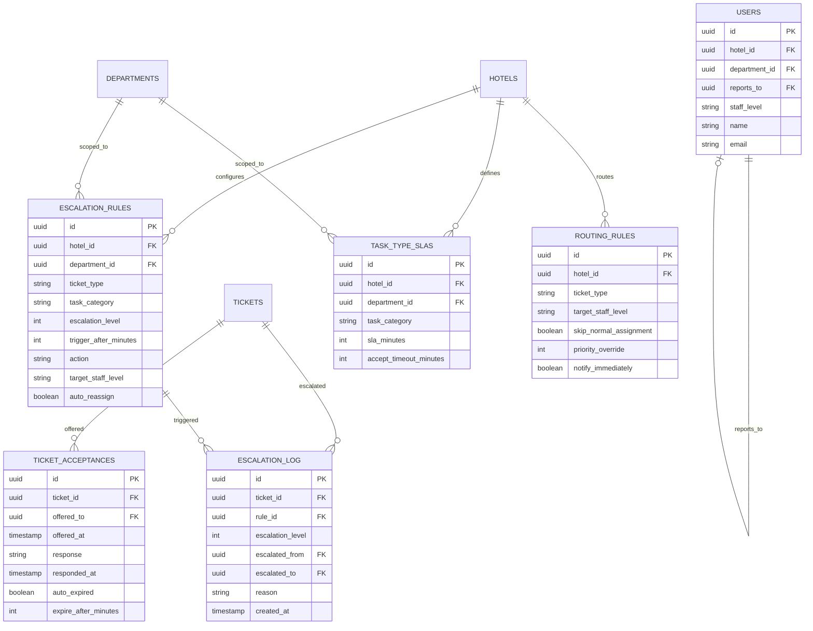

# Arcadia Platform — Architecture v5.1

> **v5.0** (75 tables, 10/10 design) + **v5.1** (staff hierarchy, escalation engine, acceptance flow, task SLAs, routing rules)
>
> This version fully supports the hotel operational hierarchy and real-world ticket lifecycle from your test cases.

---

## What Changed: v5.0 → v5.1

| # | Gap Found | v5.1 Fix | New Tables |
|---|---|---|---|
| 1 | No staff reporting chain | `users.reports_to` + `users.staff_level` | Modified `users` |
| 2 | No auto-escalation on timer | `escalation_rules` + `escalation_log` + Celery worker | 2 new tables |
| 3 | No ticket "Accept" step | `ticket_acceptances` + accept/expire flow | 1 new table |
| 4 | SLA only per department | `task_type_slas` — per task category | 1 new table |
| 5 | No supervisor approval step | Pre-configured default workflow | Config only |
| 6 | Complaints don't fast-track | `routing_rules` — skip hierarchy for complaints | 1 new table |
| 7 | No AI management API | New endpoints for frontend AI config | Code only |
| | **Total new** | | **5 new tables, 1 modified** |

**Grand total: ~80 tables**

---

## 1. Staff Reporting Hierarchy

### Schema Change

```sql
-- MODIFY users table: add hierarchy fields
ALTER TABLE users ADD COLUMN reports_to UUID REFERENCES users(id);
ALTER TABLE users ADD COLUMN staff_level VARCHAR(20);
-- Values: 'super_admin', 'admin', 'manager', 'supervisor', 'attendant'
```

### How the Hierarchy Maps to Your Diagram

```
┌─────────────────────────────────────────────────────────────────┐
│ PLATFORM LEVEL                                                   │
│                                                                  │
│  Super Admin (staff_level = 'super_admin')                       │
│    • Manages all hotels                                          │
│    • Adds chatbot, WhatsApp numbers                              │
│    • reports_to = NULL                                           │
└──────────────────────────┬──────────────────────────────────────┘
                           │
┌──────────────────────────▼──────────────────────────────────────┐
│ HOTEL LEVEL                                                      │
│                                                                  │
│  Admin / Owner (staff_level = 'admin')                           │
│    • hotel_id = 'grand-palace'                                   │
│    • reports_to = super_admin (or NULL for standalone)            │
│    • Manages all departments                                     │
└──────────────────────────┬──────────────────────────────────────┘
                           │
┌──────────────────────────▼──────────────────────────────────────┐
│ DEPARTMENT LEVEL — Example: Housekeeping                         │
│                                                                  │
│  HKP Manager (staff_level = 'manager')                           │
│    department_id = 'housekeeping'                                 │
│    reports_to = admin_id                                         │
│         │                                                        │
│         ▼                                                        │
│  HKP Supervisor (staff_level = 'supervisor')                     │
│    department_id = 'housekeeping'                                 │
│    reports_to = hkp_manager_id                                   │
│         │                                                        │
│         ├── Attendant 1 (staff_level = 'attendant')              │
│         │     reports_to = hkp_supervisor_id                     │
│         ├── Attendant 2                                          │
│         │     reports_to = hkp_supervisor_id                     │
│         └── Attendant 3                                          │
│               reports_to = hkp_supervisor_id                     │
└─────────────────────────────────────────────────────────────────┘
```

**Same pattern for every department**:

```
┌─────────────────────────────────────────────────────────────────┐
│ ADMIN (Owner Raj)                                                │
│   │                                                              │
│   ├── FRONT OFFICE                                               │
│   │     FO Manager (Sanjay) → FO Supervisor (Neha)               │
│   │       → Attendant 1, 2, 3                                    │
│   │                                                              │
│   ├── HOUSEKEEPING                                               │
│   │     HKP Manager (Priya) → HKP Supervisor (Amit)             │
│   │       → Attendant 1, 2, 3                                    │
│   │                                                              │
│   ├── FOOD & BEVERAGE                                            │
│   │     F&B Manager (Rohit) → F&B Supervisor (Meena)            │
│   │       → Attendant 1, 2, 3                                    │
│   │                                                              │
│   └── ENGINEERING                                                │
│         Eng Manager (Suresh) → Eng Supervisor (Dinesh)           │
│           → Attendant 1, 2, 3                                    │
└─────────────────────────────────────────────────────────────────┘
```

### HierarchyService

```python
# services/hierarchy_service.py

class HierarchyService:
    """
    Walks the reports_to chain for escalation.
    Handles Case 2 automatically — if a level is missing, it's skipped.
    """

    async def get_escalation_chain(self, user_id: UUID) -> list[User]:
        """
        Returns the full chain of superiors above this user.

        Example for Attendant 1 (HKP):
          → [Supervisor Amit, Manager Priya, Admin Raj]

        Example if NO Supervisor exists (Case 2):
          Attendant.reports_to = Manager directly
          → [Manager Priya, Admin Raj]
          Supervisor level skipped automatically.
        """
        chain = []
        current_id = user_id

        # Walk up, max 10 levels to prevent infinite loop
        for _ in range(10):
            user = await user_repo.get(current_id)
            if not user or not user.reports_to:
                break

            superior = await user_repo.get(user.reports_to)
            if superior and superior.is_active:
                chain.append(superior)
            current_id = superior.id if superior else None

            if not current_id:
                break

        return chain

    async def get_superior_at_level(
        self, user_id: UUID, target_level: str
    ) -> User | None:
        """
        Find a specific level in the chain.
        get_superior_at_level(attendant_1, 'supervisor') → Amit
        get_superior_at_level(attendant_1, 'manager') → Priya
        """
        chain = await self.get_escalation_chain(user_id)
        for user in chain:
            if user.staff_level == target_level:
                return user
        return chain[0] if chain else None  # fallback to next available

    async def get_department_tree(
        self, hotel_id: UUID, department_id: UUID
    ) -> dict:
        """
        Returns the full tree for a department (for frontend display).
        Used to render your hierarchy diagram on the dashboard.
        """
        staff = await user_repo.get_by_department(hotel_id, department_id)

        tree = {"manager": None, "supervisors": [], "attendants": []}
        for user in staff:
            if user.staff_level == 'manager':
                tree["manager"] = user
            elif user.staff_level == 'supervisor':
                tree["supervisors"].append(user)
            elif user.staff_level == 'attendant':
                tree["attendants"].append(user)

        return tree
```

### API for Department Hierarchy Tree (for frontend diagram)

```
GET /api/v1/hotels/{id}/departments/{dept_id}/hierarchy

Response:
{
  "department": "Housekeeping",
  "manager": {
    "id": "uuid-priya", "name": "Priya", "staff_level": "manager",
    "on_shift": true, "open_tickets": 2
  },
  "supervisors": [
    {
      "id": "uuid-amit", "name": "Amit", "staff_level": "supervisor",
      "reports_to": "uuid-priya", "on_shift": true, "open_tickets": 5,
      "attendants": [
        { "id": "uuid-a1", "name": "Ravi", "on_shift": true, "open_tickets": 3 },
        { "id": "uuid-a2", "name": "Sonu", "on_shift": true, "open_tickets": 1 },
        { "id": "uuid-a3", "name": "Kiran", "on_shift": false, "open_tickets": 0 }
      ]
    }
  ]
}
```

---

## 2. Escalation Rules Engine

### Tables

```sql
escalation_rules
----------------
id                      UUID PK
hotel_id                UUID FK → hotels
department_id           UUID FK → departments  -- NULL = applies to all departments
ticket_type             VARCHAR     -- 'ticket', 'complaint', 'food_order', NULL = all
task_category           VARCHAR     -- 'towel_request', 'checkout_clean', NULL = all
escalation_level        INTEGER     -- 1, 2, 3 (sequential)
trigger_after_minutes   INTEGER     -- 10, 20, 30
action                  VARCHAR     -- 'notify', 'reassign', 'escalate_up'
target_staff_level      VARCHAR     -- 'supervisor', 'manager', 'admin'
auto_reassign           BOOLEAN DEFAULT false
send_notification       BOOLEAN DEFAULT true
notification_channels   JSONB DEFAULT '["fcm", "websocket"]'
is_active               BOOLEAN DEFAULT true
created_at              TIMESTAMP

escalation_log
--------------
id                  UUID PK
ticket_id           UUID FK → tickets
rule_id             UUID FK → escalation_rules
escalation_level    INTEGER
escalated_from      UUID FK → users     -- who had the ticket
escalated_to        UUID FK → users     -- who it was escalated to
reason              VARCHAR             -- 'sla_breach', 'no_accept', 'manual_escalation'
notes               TEXT
created_at          TIMESTAMP
```

### Default Rules (seeded for every new hotel)

```
┌───────┬──────────┬──────────────────┬───────────┬────────────┬──────────────┐
│ Level │ Dept     │ Trigger After    │ Action    │ Target     │ Auto-Assign  │
├───────┼──────────┼──────────────────┼───────────┼────────────┼──────────────┤
│ 1     │ ALL      │ SLA time (varies)│ escalate  │ Supervisor │ Yes          │
│ 2     │ ALL      │ SLA × 2          │ escalate  │ Manager    │ No           │
│ 3     │ ALL      │ SLA × 3          │ escalate  │ Admin      │ No           │
└───────┴──────────┴──────────────────┴───────────┴────────────┴──────────────┘

Example for Housekeeping, towel_request (SLA = 10 min):
  Level 1 → after 10 min → Supervisor gets ring + can reassign
  Level 2 → after 20 min → Manager gets ring
  Level 3 → after 30 min → Admin/Owner gets ring
```

### Escalation Worker (Celery — runs every 60 seconds)

```python
# workers/escalation_worker.py

@celery.task(name='check_escalations')
async def check_escalations():
    """
    Runs every 1 minute.
    Checks all open tickets against their escalation rules.
    Fires escalation when timer is breached.
    """
    open_tickets = await ticket_repo.get_all_unresolved()

    for ticket in open_tickets:
        # Skip tickets in terminal states
        if ticket.stage in ('approved', 'cancelled'):
            continue

        # Calculate ticket age in minutes
        age_minutes = (utcnow() - ticket.created_at).total_seconds() / 60

        # What's the highest escalation already fired?
        max_fired = await escalation_log_repo.get_max_level(ticket.id)
        next_level = (max_fired or 0) + 1

        # Find the matching rule for next level
        rule = await escalation_rule_repo.find_matching(
            hotel_id=ticket.hotel_id,
            department_id=ticket.department_id,
            ticket_type=ticket.type,
            task_category=ticket.task_category,
            level=next_level
        )

        if not rule:
            continue  # No more escalation levels defined

        if age_minutes < rule.trigger_after_minutes:
            continue  # Not time yet

        # === ESCALATE === #

        # Find the target person
        if rule.action == 'escalate_up':
            # Walk up the reports_to chain from current assignee
            target = await hierarchy_service.get_superior_at_level(
                user_id=ticket.assigned_to,
                target_level=rule.target_staff_level
            )
        elif rule.auto_reassign:
            # Find another available staff at same level
            target = await staff_service.find_available(
                hotel_id=ticket.hotel_id,
                department_id=ticket.department_id,
                exclude_user=ticket.assigned_to
            )
        else:
            target = None

        # Send notification (RING! 🔔)
        if rule.send_notification and target:
            await notification_service.send(
                hotel_id=ticket.hotel_id,
                user_id=target.id,
                title=f"⚠️ Escalation Level {next_level}",
                message=(
                    f"Ticket {ticket.ticket_code} — {ticket.item_description}\n"
                    f"Room {ticket.room.room_number} — "
                    f"not resolved in {rule.trigger_after_minutes} min"
                ),
                channels=rule.notification_channels  # ['fcm', 'websocket']
            )

        # Reassign if configured
        if rule.auto_reassign and target:
            old_assignee = ticket.assigned_to
            ticket.assigned_to = target.id
            await ticket_repo.update(ticket)

            # Notify old assignee
            await notification_service.send(
                user_id=old_assignee,
                title="Ticket Reassigned",
                message=f"Ticket {ticket.ticket_code} reassigned to {target.name}",
                channels=['fcm']
            )

        # Log escalation
        await escalation_log_repo.insert(EscalationLog(
            ticket_id=ticket.id,
            rule_id=rule.id,
            escalation_level=next_level,
            escalated_from=ticket.assigned_to,
            escalated_to=target.id if target else None,
            reason='sla_breach'
        ))

        # Record event in ticket timeline
        await ticket_event_repo.insert(TicketEvent(
            ticket_id=ticket.id,
            event_type='escalated',
            payload={
                "level": next_level,
                "from": str(ticket.assigned_to),
                "to": str(target.id) if target else None,
                "reason": "SLA breach",
                "after_minutes": rule.trigger_after_minutes
            }
        ))

        # Push real-time update to dashboard
        await publish_redis(f"hotel:{ticket.hotel_id}:tickets", {
            "event": "ticket.escalated",
            "ticket_id": str(ticket.id),
            "ticket_code": ticket.ticket_code,
            "level": next_level,
            "escalated_to": target.name if target else "unassigned"
        })
```

---

## 3. Ticket Acceptance Flow

### Table

```sql
ticket_acceptances
------------------
id              UUID PK
ticket_id       UUID FK → tickets
offered_to      UUID FK → users     -- who was offered
offered_at      TIMESTAMP
response        VARCHAR             -- 'pending', 'accepted', 'rejected', 'expired'
responded_at    TIMESTAMP
auto_expired    BOOLEAN DEFAULT false
expire_after_minutes INTEGER DEFAULT 2
```

### Accept/Expire Logic

```python
# services/ticket_service.py

async def offer_ticket(self, ticket_id: UUID, attendant_id: UUID):
    """Offer a ticket to an attendant. They must accept within 2 minutes."""
    ticket = await ticket_repo.get(ticket_id)

    # Get accept timeout from task SLA config
    task_sla = await task_sla_repo.get(
        ticket.hotel_id, ticket.department_id, ticket.task_category
    )
    timeout = task_sla.accept_timeout_minutes if task_sla else 2

    # Record the offer
    await acceptance_repo.insert(TicketAcceptance(
        ticket_id=ticket_id,
        offered_to=attendant_id,
        offered_at=utcnow(),
        response='pending',
        expire_after_minutes=timeout
    ))

    # Set ticket stage
    ticket.stage = 'pending_accept'
    await ticket_repo.update(ticket)

    # Send FCM push with Accept/Reject buttons 🔔
    await notification_service.send(
        user_id=attendant_id,
        title="🔔 New Ticket — Accept?",
        message=f"{ticket.item_description} — Room {ticket.room.room_number}",
        channels=['fcm', 'websocket'],
        data={
            "type": "ticket_offer",
            "ticket_id": str(ticket_id),
            "action_buttons": ["accept", "reject"],
            "timeout_seconds": timeout * 60
        }
    )


async def accept_ticket(self, ticket_id: UUID, user_id: UUID):
    """Attendant taps Accept. Guest is notified within 5 seconds."""

    # Update acceptance record
    await acceptance_repo.update_response(
        ticket_id=ticket_id,
        user_id=user_id,
        response='accepted',
        responded_at=utcnow()
    )

    ticket = await ticket_repo.get(ticket_id)

    # Move to accepted stage
    ticket.stage = 'accepted'
    ticket.assigned_to = user_id

    # Start SLA timer NOW (not from creation — from acceptance)
    sla_minutes = await get_sla_minutes(
        ticket.hotel_id, ticket.department_id, ticket.task_category
    )
    ticket.sla_due_at = utcnow() + timedelta(minutes=sla_minutes)
    await ticket_repo.update(ticket)

    # Log acceptance event
    user = await user_repo.get(user_id)
    await ticket_event_repo.insert(TicketEvent(
        ticket_id=ticket_id,
        event_type='accepted',
        actor_id=user_id,
        payload={"sla_minutes": sla_minutes}
    ))

    # === NOTIFY GUEST WITHIN 5 SECONDS === #
    guest = await guest_repo.get(ticket.guest_id)
    if guest.whatsapp_phone:
        await whatsapp_service.send_message(
            hotel_id=ticket.hotel_id,
            to_phone=guest.whatsapp_phone,
            message=(
                f"✅ Your request has been accepted!\n"
                f"👤 {user.name} is on the way.\n"
                f"⏰ Expected: within {sla_minutes} minutes"
            )
        )

    # Push real-time update to dashboard
    await publish_redis(f"hotel:{ticket.hotel_id}:tickets", {
        "event": "ticket.accepted",
        "ticket_id": str(ticket_id),
        "accepted_by": user.name,
        "sla_due_at": ticket.sla_due_at.isoformat()
    })


async def reject_ticket(self, ticket_id: UUID, user_id: UUID):
    """Attendant rejects. Auto-offer to next available attendant."""
    await acceptance_repo.update_response(
        ticket_id=ticket_id, user_id=user_id,
        response='rejected', responded_at=utcnow()
    )

    # Find next available attendant (exclude the one who rejected)
    rejected_users = await acceptance_repo.get_all_rejected_users(ticket_id)
    next_attendant = await staff_service.find_available(
        hotel_id=ticket.hotel_id,
        department_id=ticket.department_id,
        exclude_users=rejected_users
    )

    if next_attendant:
        await self.offer_ticket(ticket_id, next_attendant.id)
    else:
        # No attendant available → escalate to supervisor
        supervisor = await hierarchy_service.get_superior_at_level(
            user_id=user_id, target_level='supervisor'
        )
        if supervisor:
            await self.offer_ticket(ticket_id, supervisor.id)
        else:
            # No supervisor either → escalate to manager
            manager = await hierarchy_service.get_superior_at_level(
                user_id=user_id, target_level='manager'
            )
            if manager:
                await self.offer_ticket(ticket_id, manager.id)
```

### Auto-Expire Worker (Celery — runs every 30 seconds)

```python
# workers/acceptance_worker.py

@celery.task(name='check_pending_acceptances')
async def check_pending_acceptances():
    """
    If an attendant doesn't accept within timeout (default 2 min),
    auto-expire and offer to the next person.
    """
    pending = await acceptance_repo.get_all_pending()

    for acceptance in pending:
        age_minutes = (utcnow() - acceptance.offered_at).total_seconds() / 60

        if age_minutes >= acceptance.expire_after_minutes:
            # Mark as expired
            acceptance.response = 'expired'
            acceptance.auto_expired = True
            acceptance.responded_at = utcnow()
            await acceptance_repo.update(acceptance)

            # Offer to next person
            await ticket_service.reject_ticket(
                acceptance.ticket_id, acceptance.offered_to
            )
```

---

## 4. Task-Type-Specific SLAs

### Table

```sql
task_type_slas
--------------
id                      UUID PK
hotel_id                UUID FK → hotels
department_id           UUID FK → departments
task_category           VARCHAR     -- 'towel_request', 'checkout_clean', etc.
sla_minutes             INTEGER     -- task completion deadline
accept_timeout_minutes  INTEGER DEFAULT 2    -- how long to wait for acceptance
description             VARCHAR
is_active               BOOLEAN DEFAULT true
created_at              TIMESTAMP
```

### Default Data (from your handwritten notes)

```
Grand Palace Hotel — Task SLAs:

┌────────────────────┬──────────────┬───────────┬────────────────┐
│ Task Category      │ Department   │ SLA (min) │ Accept Timeout │
├────────────────────┼──────────────┼───────────┼────────────────┤
│ towel_request      │ Housekeeping │ 10        │ 2 min          │
│ extra_pillow       │ Housekeeping │ 10        │ 2 min          │
│ extra_blanket      │ Housekeeping │ 10        │ 2 min          │
│ checkout_clean     │ Housekeeping │ 45        │ 5 min          │
│ occupied_clean     │ Housekeeping │ 13        │ 2 min          │
│ turndown_service   │ Housekeeping │ 15        │ 2 min          │
│ deep_clean         │ Housekeeping │ 60        │ 5 min          │
│                    │              │           │                │
│ food_order         │ F&B          │ 45        │ 3 min          │
│ food_prep_room_svc │ F&B          │ 45        │ 3 min          │
│ drink_order        │ F&B          │ 20        │ 2 min          │
│                    │              │           │                │
│ ac_repair          │ Engineering  │ 20        │ 2 min          │
│ plumbing           │ Engineering  │ 30        │ 5 min          │
│ electrical         │ Engineering  │ 25        │ 3 min          │
│ tv_repair          │ Engineering  │ 20        │ 2 min          │
│                    │              │           │                │
│ general_request    │ Front Office │ 15        │ 2 min          │
│ taxi_booking       │ Front Office │ 10        │ 2 min          │
│ luggage_assist     │ Front Office │ 10        │ 2 min          │
└────────────────────┴──────────────┴───────────┴────────────────┘
```

### SLA Resolution (priority cascade)

```python
# services/sla_service.py

async def get_sla_config(hotel_id, department_id, task_category) -> SLAConfig:
    """
    Resolution priority:
      1. Task-specific SLA (e.g., checkout_clean = 45 min) — HIGHEST
      2. Department default (e.g., Housekeeping = 15 min)
      3. Platform default (10 min) — LOWEST
    """
    # Priority 1: Task-specific
    task_sla = await task_sla_repo.find(hotel_id, department_id, task_category)
    if task_sla:
        return SLAConfig(
            sla_minutes=task_sla.sla_minutes,
            accept_timeout=task_sla.accept_timeout_minutes
        )

    # Priority 2: Department default
    dept_config = await dept_config_repo.get(hotel_id, department_id)
    if dept_config and dept_config.sla_minutes:
        return SLAConfig(
            sla_minutes=dept_config.sla_minutes,
            accept_timeout=2
        )

    # Priority 3: Platform default
    return SLAConfig(sla_minutes=10, accept_timeout=2)
```

### API for Managing Task SLAs

```
GET    /api/v1/hotels/{id}/departments/{dept_id}/task-slas
POST   /api/v1/hotels/{id}/departments/{dept_id}/task-slas
PUT    /api/v1/hotels/{id}/departments/{dept_id}/task-slas/{sla_id}
DELETE /api/v1/hotels/{id}/departments/{dept_id}/task-slas/{sla_id}
```

Hotel admin configures these from the Dashboard — no code change needed.

---

## 5. Default Ticket Workflow (with Supervisor Approval)

This uses the **workflow engine from v4** with a pre-configured default:

### State Machine Diagram

```
                    ┌─────────────────────────────────────────┐
                    │        TICKET LIFECYCLE (v5.1)           │
                    └─────────────────────────────────────────┘

    ┌──────────┐    auto-assign     ┌────────────────┐
    │ CREATED  │───────────────────▶│ PENDING ACCEPT │
    └──────────┘                    └───────┬────────┘
                                            │
                              ┌─────────────┼─────────────┐
                              │             │             │
                         Accepted      Rejected      Expired (2min)
                              │             │             │
                              ▼             ▼             ▼
                    ┌──────────────┐   Offer to      Offer to
                    │   ACCEPTED   │   next staff    next staff
                    │              │
                    │ SLA timer    │
                    │ starts NOW   │
                    │              │
                    │ Guest gets   │
                    │ WhatsApp     │
                    │ notification │
                    └──────┬───────┘
                           │
                    Attendant works on it
                           │
                           ▼
                    ┌──────────────┐
                    │ IN PROGRESS  │
                    └──────┬───────┘
                           │
                    Attendant clicks "Complete"
                           │
                           ▼
                    ┌───────────────────┐
                    │ PENDING APPROVAL  │◀──────── Reopened
                    │                   │          (Supervisor
                    │ Supervisor sees:  │           rejects)
                    │ [Approve][Reopen] │
                    └────────┬──────────┘
                             │
                    ┌────────┴────────┐
                    │                 │
                Approved          Reopened
                    │                 │
                    ▼                 ▼
             ┌──────────┐    ┌──────────────┐
             │ APPROVED │    │  Back to     │
             │ (closed) │    │  ACCEPTED    │
             │          │    │  (rework)    │
             │ Guest    │    └──────────────┘
             │ gets     │
             │ rating   │
             │ request  │
             └──────────┘

    ═══════════════════════════════════════════════════

    ESCALATION (runs parallel to above):

    If SLA breached at any stage:

    Level 1 (SLA time)     → 🔔 Supervisor
    Level 2 (SLA × 2)      → 🔔 Manager
    Level 3 (SLA × 3)      → 🔔 Admin/Owner
```

### Workflow Configuration (seeded on hotel creation)

```python
# seeds/default_workflow.py

DEFAULT_TICKET_WORKFLOW = {
    "name": "Standard Ticket Flow",
    "entity_type": "ticket",
    "is_default": True,
    "states": [
        {"key": "created",          "type": "initial",       "sort": 1},
        {"key": "pending_accept",   "type": "intermediate",  "sort": 2},
        {"key": "accepted",         "type": "intermediate",  "sort": 3},
        {"key": "in_progress",      "type": "intermediate",  "sort": 4},
        {"key": "pending_approval", "type": "intermediate",  "sort": 5,
         "required_permission": "ticket.approve"},
        {"key": "approved",         "type": "terminal",      "sort": 6},
        {"key": "reopened",         "type": "intermediate",  "sort": 7},
        {"key": "cancelled",        "type": "terminal",      "sort": 8},
    ],
    "transitions": [
        {"from": "created",          "to": "pending_accept",   "trigger": "auto"},
        {"from": "pending_accept",   "to": "accepted",         "trigger": "manual",
         "permission": "ticket.view"},
        {"from": "accepted",         "to": "in_progress",      "trigger": "manual",
         "permission": "ticket.view"},
        {"from": "in_progress",      "to": "pending_approval", "trigger": "manual",
         "permission": "ticket.view"},
        {"from": "pending_approval", "to": "approved",         "trigger": "manual",
         "permission": "ticket.approve",
         "notify_roles": ["manager"]},
        {"from": "pending_approval", "to": "reopened",         "trigger": "manual",
         "permission": "ticket.approve"},
        {"from": "reopened",         "to": "accepted",         "trigger": "auto"},
        {"from": "created",          "to": "cancelled",        "trigger": "manual",
         "permission": "ticket.close"},
    ]
}
```

---

## 6. Complaint & Emergency Fast-Track Routing

### Table

```sql
routing_rules
-------------
id                      UUID PK
hotel_id                UUID FK → hotels
ticket_type             VARCHAR     -- 'complaint', 'emergency', 'vip_request'
target_staff_level      VARCHAR     -- 'admin', 'manager'
target_user_id          UUID FK → users  -- specific person, or NULL for auto-find
skip_normal_assignment  BOOLEAN DEFAULT true
priority_override       INTEGER     -- 1 = highest
notify_immediately      BOOLEAN DEFAULT true
notification_channels   JSONB DEFAULT '["fcm", "websocket", "whatsapp"]'
is_active               BOOLEAN DEFAULT true
created_at              TIMESTAMP
```

### Default Rules

```
┌──────────────┬────────────────┬───────────────────────────────────────────┐
│ Ticket Type  │ Routes To      │ Behavior                                  │
├──────────────┼────────────────┼───────────────────────────────────────────┤
│ complaint    │ admin          │ Skips attendant/supervisor/manager        │
│              │                │ Admin gets immediate FCM + WhatsApp       │
│              │                │ Priority = 1 (highest)                    │
├──────────────┼────────────────┼───────────────────────────────────────────┤
│ emergency    │ manager + admin│ BOTH notified simultaneously             │
│              │                │ Priority = 1, notify ALL channels        │
├──────────────┼────────────────┼───────────────────────────────────────────┤
│ vip_request  │ manager        │ Direct to manager, high priority         │
│              │                │ Supervisor notified as CC                │
└──────────────┴────────────────┴───────────────────────────────────────────┘
```

### In TicketService (before normal assignment)

```python
async def create_ticket(self, hotel_id, ticket_type, task_category, ...):
    ticket = Ticket(...)

    # === CHECK FAST-TRACK ROUTING FIRST (Case 5) === #
    routing_rule = await routing_rule_repo.find(hotel_id, ticket_type)

    if routing_rule and routing_rule.skip_normal_assignment:
        # FAST-TRACK: complaint/emergency goes directly to admin/manager
        if routing_rule.target_user_id:
            target = await user_repo.get(routing_rule.target_user_id)
        else:
            target = await user_repo.find_by_hotel_and_level(
                hotel_id, routing_rule.target_staff_level
            )

        ticket.assigned_to = target.id if target else None
        ticket.priority = routing_rule.priority_override or 1
        ticket.stage = 'pending_accept'  # even admin must accept

        await ticket_repo.insert(ticket)

        # Immediate notification to admin
        if routing_rule.notify_immediately and target:
            await notification_service.send(
                hotel_id=hotel_id,
                user_id=target.id,
                title=f"🚨 {ticket_type.upper()} — Direct Escalation",
                message=(
                    f"Guest {guest.name} (Room {room.room_number})\n"
                    f"{ticket.item_description}"
                ),
                channels=routing_rule.notification_channels
            )

        await ticket_event_repo.insert(TicketEvent(
            ticket_id=ticket.id,
            event_type='fast_tracked',
            payload={
                "reason": f"routing_rule:{ticket_type}",
                "routed_to": target.name if target else "unassigned",
                "skipped_levels": ["attendant", "supervisor", "manager"]
            }
        ))

        return ticket

    # === NORMAL FLOW (non-complaint tickets) === #
    sla_config = await sla_service.get_sla_config(
        hotel_id, department_id, task_category
    )

    attendant = await staff_service.find_available(hotel_id, department_id)
    if attendant:
        await self.offer_ticket(ticket.id, attendant.id)

    return ticket
```

---

## 7. AI Provider Management API

```
GET  /api/v1/hotels/{id}/settings/ai
     Permission: hotel.settings.manage

     Response:
     {
       "provider": "openai",
       "model": "gpt-4o-mini",
       "status": "connected",
       "last_tested_at": "2026-06-14T08:00:00Z",
       "embedding_provider": "gemini",
       "embedding_model": "text-embedding-004"
     }

PUT  /api/v1/hotels/{id}/settings/ai
     Permission: hotel.settings.manage

     Request:
     {
       "provider": "claude",
       "api_key": "sk-ant-...",
       "model": "claude-sonnet-4-20250514"
     }

     Flow:
     1. Validate API key by making a test call
     2. If valid → encrypt key via Vault → store in hotel_secrets
     3. Return { "status": "connected" }
     4. If invalid → return 400 { "error": "Invalid API key" }

POST /api/v1/hotels/{id}/settings/ai/test
     Permission: hotel.settings.manage

     Sends a test prompt to verify the connection works.
     Response:
     {
       "success": true,
       "provider": "claude",
       "response_time_ms": 450,
       "response_preview": "Hello! I am working correctly."
     }

DELETE /api/v1/hotels/{id}/settings/ai
       Permission: hotel.settings.manage

       Reverts hotel to platform default AI provider (Gemini).
```

---

## Updated ER Diagram (v5.1 additions highlighted)



---

## Updated Folder Structure (v5.1 additions only)

```
arcadia/
├── services/
│   ├── hierarchy_service.py          # 🆕 reports_to chain walker
│   ├── escalation_service.py         # 🆕 escalation rule execution
│   ├── sla_service.py                # 🆕 task-type SLA resolution
│   ├── staff_service.py              # 🆕 find available staff (shift + load)
│   ├── ticket_service.py             # MODIFIED — accept/reject/offer/fast-track
│   └── ...
│
├── models/
│   ├── user.py                       # MODIFIED — reports_to, staff_level
│   ├── ticket_acceptance.py          # 🆕
│   ├── escalation.py                 # 🆕 escalation_rules + escalation_log
│   ├── task_type_sla.py              # 🆕
│   ├── routing_rule.py               # 🆕
│   └── ...
│
├── api/v1/
│   ├── hierarchy.py                  # 🆕 GET /departments/{id}/hierarchy
│   ├── escalation_rules.py           # 🆕 CRUD for escalation rules
│   ├── task_slas.py                   # 🆕 CRUD for task-type SLAs
│   ├── routing_rules.py              # 🆕 CRUD for routing rules
│   ├── ai_settings.py                # 🆕 GET/PUT/DELETE /settings/ai
│   ├── tickets.py                    # MODIFIED — accept/reject endpoints
│   └── ...
│
├── workers/
│   ├── escalation_worker.py          # 🆕 runs every 60 sec
│   ├── acceptance_worker.py          # 🆕 runs every 30 sec
│   └── ...
│
├── seeds/
│   ├── default_workflow.py           # 🆕 pre-configured ticket workflow
│   ├── default_escalation_rules.py   # 🆕 default 3-level escalation
│   ├── default_task_slas.py          # 🆕 default SLAs per task type
│   └── default_routing_rules.py      # 🆕 complaint → admin
│
└── ...
```

---

## Updated API Endpoints (v5.1 additions)

| Method | Endpoint | Permission | Purpose |
|---|---|---|---|
| **Hierarchy** |
| `GET` | `/hotels/{id}/departments/{did}/hierarchy` | `user.view` | Department tree diagram |
| **Ticket Accept/Reject** |
| `POST` | `/hotels/{id}/tickets/{tid}/accept` | `ticket.view` | Attendant accepts |
| `POST` | `/hotels/{id}/tickets/{tid}/reject` | `ticket.view` | Attendant rejects |
| `POST` | `/hotels/{id}/tickets/{tid}/complete` | `ticket.view` | Attendant marks complete |
| `POST` | `/hotels/{id}/tickets/{tid}/approve` | `ticket.approve` | Supervisor approves |
| `POST` | `/hotels/{id}/tickets/{tid}/reopen` | `ticket.approve` | Supervisor reopens |
| **Escalation Rules** |
| `GET` | `/hotels/{id}/escalation-rules` | `hotel.settings.manage` | List rules |
| `POST` | `/hotels/{id}/escalation-rules` | `hotel.settings.manage` | Create rule |
| `PUT` | `/hotels/{id}/escalation-rules/{rid}` | `hotel.settings.manage` | Update rule |
| `DELETE` | `/hotels/{id}/escalation-rules/{rid}` | `hotel.settings.manage` | Delete rule |
| **Task SLAs** |
| `GET` | `/hotels/{id}/departments/{did}/task-slas` | `hotel.settings.manage` | List SLAs |
| `POST` | `/hotels/{id}/departments/{did}/task-slas` | `hotel.settings.manage` | Create SLA |
| `PUT` | `/hotels/{id}/departments/{did}/task-slas/{sid}` | `hotel.settings.manage` | Update SLA |
| **Routing Rules** |
| `GET` | `/hotels/{id}/routing-rules` | `hotel.settings.manage` | List rules |
| `POST` | `/hotels/{id}/routing-rules` | `hotel.settings.manage` | Create rule |
| `PUT` | `/hotels/{id}/routing-rules/{rid}` | `hotel.settings.manage` | Update rule |
| **AI Settings** |
| `GET` | `/hotels/{id}/settings/ai` | `hotel.settings.manage` | Current provider |
| `PUT` | `/hotels/{id}/settings/ai` | `hotel.settings.manage` | Change provider |
| `POST` | `/hotels/{id}/settings/ai/test` | `hotel.settings.manage` | Test connection |
| `DELETE` | `/hotels/{id}/settings/ai` | `hotel.settings.manage` | Revert to default |
| **Escalation Log** |
| `GET` | `/hotels/{id}/tickets/{tid}/escalations` | `ticket.view` | Escalation history |

---

## Revised Build Timeline

| Wave | Modules | Time (2 devs) |
|---|---|---|
| **Wave 1** | Foundation + Auth + RBAC + **Hierarchy** | 3.5 weeks |
| **Wave 2** | Hotels + Room Types + Rooms + Departments + Dept Config | 2 weeks |
| **Wave 3** | Guests + Reservations + Stay Records + Multi-Guest | 2.5 weeks |
| **Wave 4** | Tickets + **Accept/Reject** + **Task SLAs** + **Routing Rules** + Workflow + Events | 4 weeks |
| **Wave 5** | **Escalation Engine** + **Escalation Worker** + **Acceptance Worker** | 2 weeks |
| **Wave 6** | WebSocket (JWT-secured) + FCM Push + Notifications | 2 weeks |
| **Wave 7** | WhatsApp: Accounts + Bot + Conversations + Health | 4 weeks |
| **Wave 8** | Menu + Restaurant/POS + F&B Timer | 2 weeks |
| **Wave 9** | Folios + Payments (stub) + Taxes | 2.5 weeks |
| **Wave 10** | Rate Plans + Housekeeping + Maintenance + Inventory | 3 weeks |
| **Wave 11** | Bot: FAQ + RAG/pgvector + **AI Provider Abstraction** + Forms | 3 weeks |
| **Wave 12** | Campaigns + Import/Export + Analytics + Audit + Feature Flags | 3 weeks |
| **Wave 13** | Organizations + Subscriptions + Backup/DR | 2 weeks |
| **Wave 14** | Testing + Migration + Docker + Deploy | 3 weeks |
| | **Total** | **~38 weeks (~9.5 months), 2 devs** |
| | **Core PMS + Android-ready (Wave 1–6)** | **~16 weeks (~4 months)** |

---

## Architecture Version History

| Version | Tables | Score | Key Addition |
|---|---|---|---|
| v1 | ~6 | 5.5/10 | Original Firebase project |
| v2 | ~30 | 9.1/10 | RBAC, reservations, WhatsApp credentials |
| v3 | ~55 | 9.4/10 | Financial, room types, workflow engine |
| v4 | ~65 | 9.8/10 | Inventory, POS, shifts, RLS, feature flags |
| v5 | ~75 | 10/10 | Availability engine, import/export, DR plan |
| **v5.1** | **~80** | **10/10** | **Staff hierarchy, escalation engine, accept flow, task SLAs, complaint routing** |
