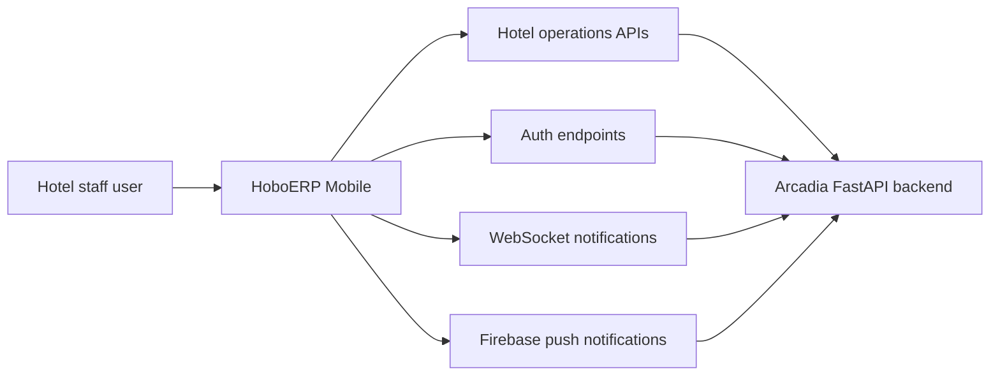

# HoboERP Mobile Documentation

This documentation is the developer handbook for the HoboERP React Native app.
It is organized so a developer can quickly answer:

- How do I run the app?
- Where is a feature located?
- How does data move from UI to backend?
- Where do logs appear?
- How do I debug API, UI, Metro, Android, and performance issues?
- How do I create debug and release APKs?
- What are the common errors and their fixes?

## Documentation Map

```text
docs/
  setup/
    development-environment.md
    android-setup.md
    ios-setup.md
    project-structure.md
  development/
    architecture.md
    navigation.md
    state-management.md
    api-flow.md
    authentication.md
    permissions.md
  debugging/
    debugging-guide.md
    network-debugging.md
    ui-debugging.md
    performance-debugging.md
    common-errors.md
    metro.md
    adb.md
  build/
    debug-build.md
    release-build.md
    apk.md
    playstore.md
  features/
    README.md
    authentication.md
    dashboard.md
    tickets.md
    escalation.md
    fb.md
    guests-reservations-rooms.md
    staff-housekeeping.md
    whatsapp.md
    settings.md
```

## Project Snapshot

| Topic | Current value |
| --- | --- |
| App folder | `hoboerp/` |
| Framework | React Native 0.86.0 |
| Language | TypeScript |
| Package manager | npm |
| Required Node | `>= 22.11.0` |
| Backend environment | Staging |
| Backend base URL | `https://arcadia-backend-staging-v3dj3lwhfa-em.a.run.app` |
| App display name | `HOBO` |
| Android application ID | `com.hoboerp` |
| Android min/target SDK | 24 / 36 |
| Server state | React Query |
| Local state | Zustand |
| Auth storage | AsyncStorage |
| API type generation | OpenAPI download plus `openapi-typescript` |

## Recommended Reading Order

1. [Development environment](setup/development-environment.md)
2. [Android setup](setup/android-setup.md)
3. [Project structure](setup/project-structure.md)
4. [Architecture](development/architecture.md)
5. [API flow](development/api-flow.md)
6. [Debugging guide](debugging/debugging-guide.md)
7. [Feature map](features/README.md)
8. [Release build](build/release-build.md)

## High-Level System



## What To Update When Features Change

| Change | Documentation to update |
| --- | --- |
| New setup requirement | `setup/development-environment.md` or platform setup page |
| New screen | `development/navigation.md` and `features/README.md` |
| New API module | `development/api-flow.md` and feature page |
| New permission | `development/permissions.md` |
| New build step | `build/debug-build.md` or `build/release-build.md` |
| New recurring issue | `debugging/common-errors.md` |
