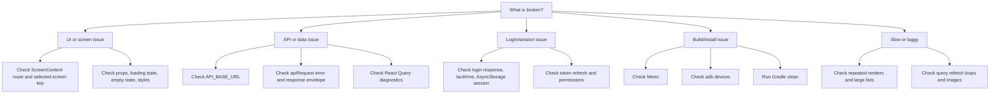

# Debugging Guide

Use this page as the first stop when something breaks in HoboERP Mobile.

## Quick Decision Tree



## Project Facts For Debugging

| Area | Current value |
| --- | --- |
| React Native | 0.86.0 |
| React | 19.2.3 |
| Node engine | `>= 22.11.0` |
| Package manager | npm |
| API base | Staging Cloud Run backend |
| State | React Query and Zustand |
| Android app ID | `com.hoboerp` |
| Metro port | 8081 by default |
| Android min/target SDK | 24 / 36 |

## Common Log Locations

| Log type | Where to look |
| --- | --- |
| JavaScript logs | Metro terminal, React Native logs, Flipper/React Native DevTools if configured. |
| React Query diagnostics | Metro terminal when `featureFlags.enableQueryDiagnostics` is true. |
| Android native logs | `adb logcat`. |
| App install/build logs | `npm run android` terminal or Gradle output. |
| Jest logs | `npm test` terminal. |
| Maestro E2E logs | `npm run test:e2e` terminal and Maestro reports. |

## App Logging

Use `src/services/logger/logger.ts` for application logs.

Behavior:

- `logger.debug()` and `logger.info()` log only in development.
- `logger.warn()` and `logger.error()` always log.
- Do not log tokens, passwords, or guest-sensitive data.

## Query Diagnostics

Development diagnostics are configured by:

- `src/app/AppProviders.tsx`
- `src/services/debug/queryDiagnostics.ts`
- `src/config/featureFlags.ts`

When enabled, fetch and error query events appear as:

```text
[query:fetching] ["operations","<hotelId>","tickets"]
[query:error] ["operations","<hotelId>","tickets"] <error>
```

## API Debugging Checklist

1. Confirm `src/config/api.ts` points to the expected backend.
2. Confirm the device has network access.
3. Check whether the failing request includes a bearer token.
4. Inspect the backend response envelope: `success`, `data`, `message`, `detail`,
   and `meta`.
5. If status is 401, check refresh token behavior.
6. If data is stale, check React Query key and `loadResource()` calls.
7. If only one feature fails, inspect the owning module API/service.

## UI Debugging Checklist

1. Confirm the active `ScreenKey`.
2. Confirm `ScreenContent` handles that screen key.
3. Check loading, error, empty, and permission states.
4. Check whether the screen receives the selected record it expects.
5. Check responsive logic from `useWindowDimensions()`.
6. Check theme tokens and shared styles.
7. For modals/popups, check `PopupKey` and selected record state.

## Auth Debugging Checklist

1. Verify login credentials.
2. Check `/api/v1/auth/login`.
3. Check `/api/v1/auth/me`.
4. Confirm `hotel_id` exists on the profile.
5. Inspect AsyncStorage session keys.
6. Confirm token refresh is not failing silently.
7. Confirm `user.permissions` contains the expected permission codes.

## Build Debugging Checklist

1. Confirm dependencies are installed with `npm install`.
2. Confirm Metro is running.
3. Confirm the emulator/device appears in `adb devices`.
4. Reset Metro cache if bundle behavior is strange.
5. Clean Gradle if native build state is stale.
6. Check Android SDK 36 and Build Tools 36.0.0 are installed.
7. Confirm `google-services.json` exists only when Firebase messaging is being
   tested for the target project.

## Useful Commands

```sh
npm start
npm start -- --reset-cache
npm run android
npm run typecheck
npm run lint
npm run test:unit
adb devices
adb logcat
adb reverse tcp:8000 tcp:8000
```

On Windows for Gradle:

```powershell
cd hoboerp\android
.\gradlew.bat clean
.\gradlew.bat assembleDebug
```
