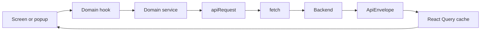

# Network Debugging

Use this page when API calls fail, data does not load, WebSocket updates are
missing, or local backend testing does not work.

## Current API Target

```text
https://arcadia-backend-staging-v3dj3lwhfa-em.a.run.app
```

Defined in:

```text
src/config/api.ts
```

## API Request Path



## First Checks

1. Is the backend URL correct for the environment?
2. Does the endpoint work from the host machine?
3. Does the Android emulator/device have internet access?
4. Is the request authenticated when required?
5. Did token refresh fail?
6. Is the response shape compatible with `ApiEnvelope<T>`?

## Local Backend On Android

If the app is temporarily pointed at a local backend on the development machine,
run:

```sh
adb reverse tcp:8000 tcp:8000
```

Then use `http://127.0.0.1:8000` or a host reachable by the device, depending on
how the API URL is configured.

Useful checks:

```sh
adb devices
adb reverse --list
adb shell ping 8.8.8.8
```

## 401 Unauthorized

Check:

- Access token is present.
- Refresh token is present.
- `/api/v1/auth/refresh` returns a valid `access_token`.
- The retried request succeeds.
- The user still has permission for the hotel and screen.

If refresh fails, the user may need to sign in again.

## 403 Forbidden

Check:

- Backend role assignment.
- `user.permissions` from `/api/v1/auth/me`.
- `screenPermissionMap` and `actionPermissionMap`.
- Whether the endpoint requires a more specific backend permission than the UI
  screen guard.

## 404 Not Found

Check:

- Hotel ID in the path.
- Entity ID in detail/action endpoints.
- Backend route version under `/api/v1`.
- Whether the record belongs to the current hotel.

## Empty Data

Check:

- `payload.data` is an array for list endpoints.
- `payload.meta.total` is present when expected.
- Query key uses the correct hotel ID and resource.
- Backend seed/demo data exists for the selected hotel.
- Filters/search are not hiding records.

## WebSocket Issues

Main file:

```text
src/services/websocket/WebSocketClient.ts
```

Flow:

```text
API_BASE_URL -> ws/wss conversion -> /ws/notifications?token=<token>
```

Check:

1. `featureFlags.enableRealtimeSockets` is true.
2. A valid access token exists.
3. The backend accepts the token on `/ws/notifications`.
4. Events include `event` or `type`.
5. Reconnect attempts are visible in logs.
6. The relevant handler refreshes the target resource.

## Query Diagnostics

When `featureFlags.enableQueryDiagnostics` is true, watch Metro for:

```text
[query:fetching]
[query:error]
```

Use the query key to find which resource is failing.
