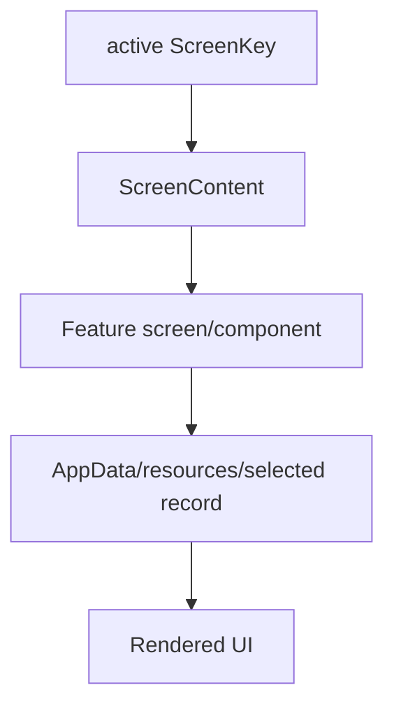

# UI Debugging

Use this page when a screen does not render correctly, data appears in the wrong
place, a modal does not open, or layout breaks on different screen sizes.

## Screen Rendering Flow



## Screen Not Rendering

Check:

1. The active `ScreenKey` in `ArcadiaMobileApp.tsx`.
2. Whether the screen key exists in `src/navigation/types.ts`.
3. Whether `ScreenContent` has a case/branch for the screen.
4. Whether the user is blocked by `canOpenScreen()`.
5. Whether a required selected record is null.
6. Whether an error boundary is catching the render error.

## Data Missing On Screen

Check:

- The resource is included in `resourceKeys`.
- The endpoint path exists in `resourcePaths`.
- The React Query key includes the active hotel ID.
- `buildAppData(resources)` maps the resource into the expected view model.
- Pull-to-refresh calls `onRefreshResource` or `onRefresh`.
- The UI handles loading, error, and empty states.

## Popup Or Modal Not Opening

Check:

- `PopupKey` value.
- Selected record state, such as `selectedTicket`, `selectedReservation`,
  `selectedGuest`, or `selectedRoom`.
- Permission checks before opening.
- `CustomPopup` branch for the popup key.
- Android back handler closing the popup.

## Responsive Layout

The app shell uses:

```ts
const wideLayout = width >= 900;
```

Behavior:

- Wide layout renders a persistent side drawer.
- Narrow layout renders a modal drawer.
- The phone surface remains the main content area.

Test both:

- Narrow phone emulator.
- Wider tablet or desktop-sized emulator.

## Images And Assets

Check:

- Asset exists under `src/assets/`.
- `require()` path is correct.
- Width and height are defined.
- `resizeMode` is appropriate.
- Android asset cache is not stale.

If an image still does not update, restart Metro with reset cache.

## Icons

Icons are centralized through:

```text
src/components/icons.tsx
```

Check:

- The exported icon exists.
- Color and size are passed.
- The parent container does not clip the icon.
- The icon is not hidden by a disabled/permission state.

## Error Boundaries

The active screen is wrapped by:

```text
src/components/ErrorBoundary.tsx
```

If a screen goes blank but the app stays alive, check the dialog/error emitted
by the boundary and inspect the stack trace in Metro.

## UI Test Targets

Prioritize:

- Login screen.
- Dashboard after session restore.
- Tickets list and ticket detail.
- Ticket form.
- Reservation detail.
- Guest detail.
- WhatsApp conversation.
- Popups for reservation, room, staff, and ticket actions.
