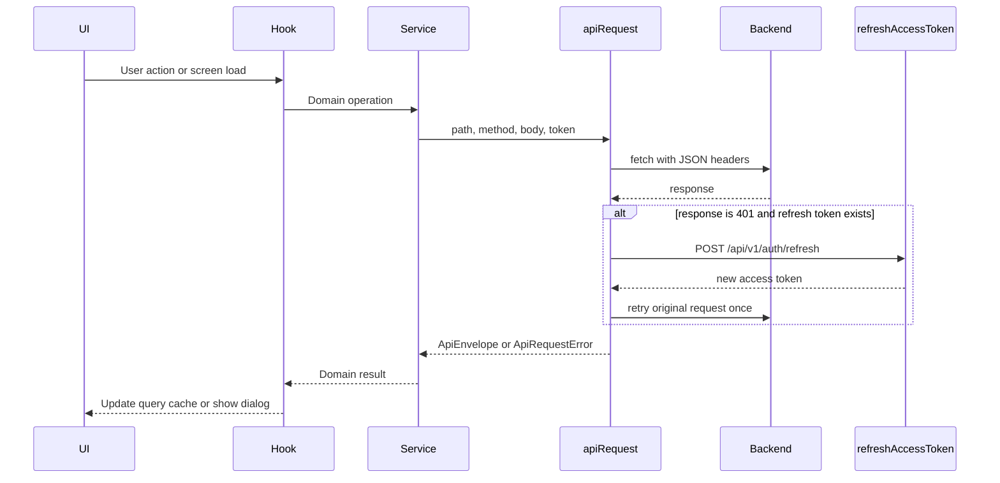

# API Flow

The mobile app talks to the backend through `apiRequest()` in
`src/services/api/client.ts`.

## API Configuration

| File | Value |
| --- | --- |
| `src/config/api.ts` | `API_BASE_URL`, `API_V1_PREFIX` |
| `src/config/env.ts` | `ENVIRONMENT = 'staging'` |

Current base URL:

```text
https://arcadia-backend-staging-v3dj3lwhfa-em.a.run.app
```

## Request Lifecycle



## Request Headers

`apiRequest()` sends:

```text
Accept: application/json
Content-Type: application/json
Authorization: Bearer <token>
```

The Authorization header is included only when a token is provided.

## Error Handling

`apiRequest()` throws `ApiRequestError` when:

- HTTP status is not OK.
- Response envelope has `success === false`.
- The refresh retry fails.

Error details are normalized with `formatErrorDetails()` and shown in dialogs by
feature hooks or the app shell.

## Operations Resource Endpoints

Defined in `src/modules/operations/constants.ts`:

| Resource | Endpoint |
| --- | --- |
| Tickets | `/api/v1/hotels/{hotelId}/tickets?limit=20` |
| Escalations | `/api/v1/hotels/{hotelId}/tickets/escalations?limit=20` |
| Notifications | `/api/v1/hotels/{hotelId}/notifications?limit=20` |
| Guests | `/api/v1/hotels/{hotelId}/guests?limit=50` |
| Reservations | `/api/v1/hotels/{hotelId}/reservations?limit=20` |
| Rooms | `/api/v1/hotels/{hotelId}/rooms?limit=40` |
| F&B orders | `/api/v1/hotels/{hotelId}/restaurant/orders?limit=20` |
| Staff | `/api/v1/hotels/{hotelId}/users?limit=200` |
| Housekeeping | `/api/v1/hotels/{hotelId}/housekeeping?limit=20` |
| WhatsApp | `/api/v1/hotels/{hotelId}/whatsapp/conversations?limit=20` |

## Generated Types

Generate API types when the backend schema changes:

```sh
npm run api:types:live
```

Preferred pattern:

1. Generate raw OpenAPI types into `src/types/generated/`.
2. Use generated endpoint/payload types in API modules.
3. Convert raw API payloads into domain view models close to the owning module.

## Adding A New API Call

1. Add the call under the owning module, usually `modules/<domain>/api/`.
2. Use `apiRequest()` instead of raw fetch.
3. Keep backend paths in the module or a small constants file.
4. Add a service layer if the call needs workflow logic or transformation.
5. Wire screen data through a hook or React Query query.
6. Show user-facing errors through `formatErrorDetails()` and `AppDialog`.
7. Add or update tests for success and failure behavior.
