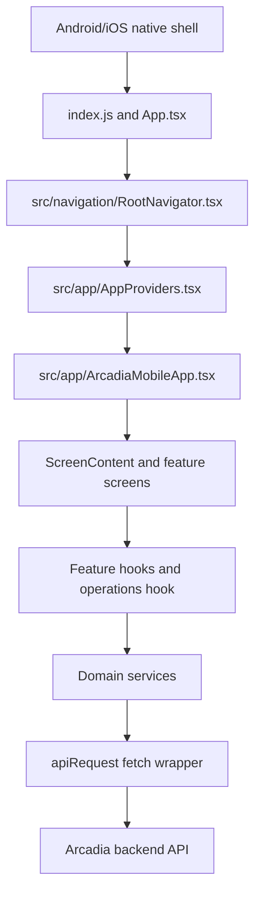
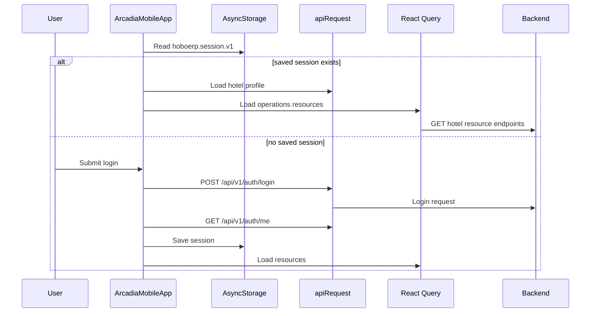
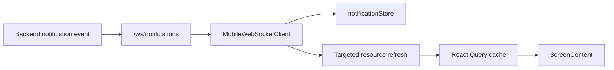

# Architecture

HoboERP Mobile is a React Native app with a domain-first module structure. The
main app shell currently coordinates authentication, resource loading,
navigation state, realtime updates, modal orchestration, and Android back
handling.

## Runtime Layers

## Important Runtime Files

| File | Responsibility |
| --- | --- |
| `App.tsx` | React Native root export. |
| `src/navigation/RootNavigator.tsx` | Wraps the app in providers. |
| `src/app/AppProviders.tsx` | Installs React Query and development diagnostics. |
| `src/app/queryClient.ts` | Configures React Query defaults and app focus behavior. |
| `src/app/ArcadiaMobileApp.tsx` | Main shell: auth, session restore, navigation, resource refresh, modals. |
| `src/modules/operations/hooks/useOperationsWorkspace.ts` | Loads operational resources and handles ticket/order workflow actions. |
| `src/services/api/client.ts` | API request, JSON parsing, token header, refresh retry, error formatting. |
| `src/services/websocket/WebSocketClient.ts` | WebSocket connection and reconnect behavior. |
| `src/services/pushNotifications.ts` | Firebase messaging registration for escalation notifications. |

## Data Ownership

| Data type | Owner |
| --- | --- |
| Server records | React Query through domain queries/hooks. |
| Auth/session | `useAuthStore` plus AsyncStorage session persistence. |
| Notifications and realtime alerts | `useNotificationStore`. |
| Local UI state | Component state and `useUiStore` where used. |
| Theme tokens | `src/theme/`. |

## Application Flow

## Realtime Flow

## Key Design Decisions

- The app uses React Query for backend-backed resource state.
- The operations workspace loads the shared hotel resources used by many
  screens.
- The app shell holds current screen, selected records, popup state, and session
  restoration behavior.
- Permissions are checked before screen navigation and protected actions.
- `apiRequest` retries once after a 401 when a refresh token is available.
- WebSocket reconnects with exponential backoff up to 30 seconds.

## Current Architecture Notes

- React Navigation packages are installed, but the active app shell uses local
  `ScreenKey` state rather than a full nested React Navigation tree.
- Release Android builds currently sign with the debug keystore and must be
  updated before production distribution.
- Offline queue support exists as a feature flag, but it is currently disabled.
