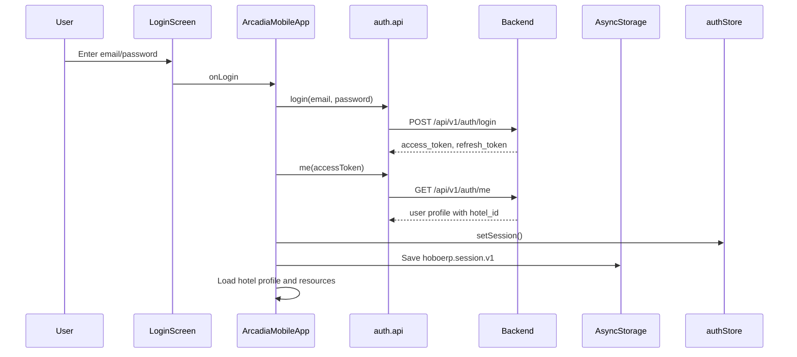

# Authentication

Authentication is handled by the app shell, auth API module, AsyncStorage, and
the auth Zustand store.

## Main Files

| File | Purpose |
| --- | --- |
| `src/modules/auth/screens/LoginScreen.tsx` | Login UI. |
| `src/modules/auth/api/auth.api.ts` | `login()` and `me()` API calls. |
| `src/services/session/SessionManager.ts` | Access-token refresh call. |
| `src/store/authStore.ts` | Persisted auth state. |
| `src/app/ArcadiaMobileApp.tsx` | Session restore, login, logout, refresh callback. |

## Login Flow



## Session Restore

On app start:

1. Read `hoboerp.session.v1` from AsyncStorage.
2. Validate access token and `user.hotel_id`.
3. Populate `useAuthStore`.
4. Load all operations resources.
5. Load hotel profile.
6. Show the app after the splash delay.

Invalid sessions are removed from AsyncStorage and the user returns to login.

## Token Refresh

`apiRequest()` performs one refresh attempt when:

- The response status is 401.
- A refresh token exists.
- The original path is not `/api/v1/auth/refresh`.

Refresh request:

```text
POST /api/v1/auth/refresh
```

Body:

```json
{
  "device_info": "hoboerp-mobile",
  "refresh_token": "<refresh-token>"
}
```

After a successful refresh, `ArcadiaMobileApp` updates the session in state and
AsyncStorage.

## Logout Flow

Logout:

1. Unregister escalation push notifications when possible.
2. Clear the local session.
3. Clear auth store.
4. Clear notification store.
5. Remove `hoboerp.session.v1`.
6. Reset operations workspace.
7. Return to dashboard/login state.

## Debugging Auth Issues

Check in this order:

1. Login endpoint response from `/api/v1/auth/login`.
2. Whether `access_token` and `refresh_token` are present.
3. `/api/v1/auth/me` response and `hotel_id`.
4. AsyncStorage keys `hoboerp.session.v1` and `hoboerp.auth.store.v1`.
5. 401 refresh response from `/api/v1/auth/refresh`.
6. Permission list in `user.permissions`.

## Security Notes

- Do not log access or refresh tokens.
- Do not commit real production credentials.
- Do not ship release builds signed with the debug keystore.
- Clear local session storage when testing role or hotel changes.
