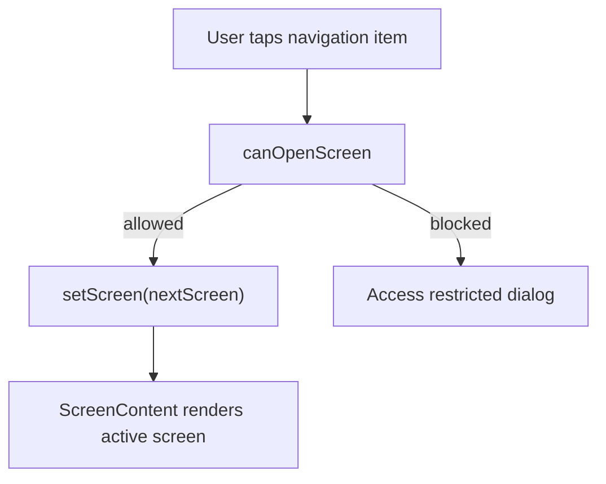

# Navigation

HoboERP Mobile currently uses screen-key state in `ArcadiaMobileApp.tsx` for
runtime navigation. React Navigation dependencies are installed, but the active
screen model is local to the app shell.

## Main Files

| File | Purpose |
| --- | --- |
| `src/navigation/types.ts` | Defines `ScreenKey`, `PopupKey`, and navigation action types. |
| `src/navigation/navigationConfig.ts` | Defines side drawer and bottom tab items. |
| `src/app/ArcadiaMobileApp.tsx` | Holds active screen, detail stack, drawer state, selected records, and popup state. |
| `src/modules/operations/screens/ScreenContent.tsx` | Renders content for the active screen key. |
| `src/permissions/navigationGuard.ts` | Blocks screens/actions when permissions are missing. |

## Screen Keys

| Screen key | Purpose |
| --- | --- |
| `dashboard` | Overview/home screen. |
| `reservations` | Booking list. |
| `room` | Room inventory. |
| `tickets` | Ticket list/board. |
| `escalations` | Escalated tickets and priority items. |
| `notifications` | Notification list. |
| `guests` | Guest profiles. |
| `housekeeping` | Housekeeping tasks. |
| `food` | F&B menu/order area. |
| `kitchen` | Kitchen order queue. |
| `whatsapp` | WhatsApp conversation list. |
| `assistant` | AI assistant. |
| `staff` | Staff portal. |
| `hierarchy` | Staff and department hierarchy. |
| `profile` | User profile/settings. |
| `ticketForm` | Ticket creation/detail form. |
| `ticketDetail` | Ticket detail view. |
| `reservationDetail` | Reservation detail view. |
| `guestDetail` | Guest detail view. |
| `whatsappChat` | Single WhatsApp conversation. |

## Side Drawer

Defined in `buildSideNavItems()`:

| Label | Screen key |
| --- | --- |
| Overview | `dashboard` |
| Staff Portal | `staff` |
| Tickets | `tickets` |
| Escalations | `escalations` |
| Guests | `guests` |
| Reservations | `reservations` |
| Rooms | `room` |
| F&B | `food` |
| Kitchen | `kitchen` |
| Housekeeping | `housekeeping` |
| Hierarchy | `hierarchy` |
| WhatsApp | `whatsapp` |

Drawer items are filtered by `filterNavItemsForUser()` before rendering.

## Bottom Tabs

Defined in `buildBottomTabs()`:

| Label | Screen key |
| --- | --- |
| Home | `dashboard` |
| Reservations | `reservations` |
| Create button | `assistant` in config, currently used by the shell as create-ticket action. |
| Escalations | `escalations` |
| Profile | `profile` |

## Detail Screen Stack

The app shell keeps a simple `screenStack` for detail pages. Detail screens are:

- `ticketForm`
- `ticketDetail`
- `reservationDetail`
- `guestDetail`
- `whatsappChat`

Back behavior:

1. If a drawer is open, close it.
2. If a popup is open, close it.
3. If a detail screen is open, return to the previous screen or fallback screen.
4. If not on dashboard, return to dashboard.
5. On dashboard, double back exits the app within 1.8 seconds.

## Navigation Permission Flow

When adding a screen:

1. Add the screen key in `src/navigation/types.ts`.
2. Add nav config if it should be visible.
3. Add render handling in `ScreenContent`.
4. Add permission mapping if the screen is protected.
5. Document the feature in `docs/features/`.
