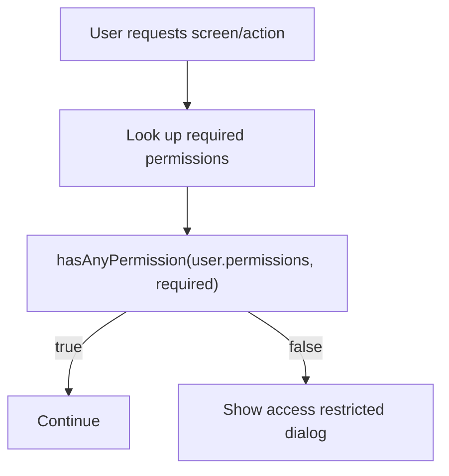

# Permissions

HoboERP Mobile uses backend-aligned permission codes to protect screens and
actions.

## Main Files

| File | Purpose |
| --- | --- |
| `src/permissions/permissionCodes.ts` | Permission constants and permission groups. |
| `src/permissions/rbac.ts` | Low-level permission helpers. |
| `src/permissions/navigationGuard.ts` | Screen and action permission maps. |
| `src/permissions/components/PermissionGate.tsx` | Component-level permission gating. |

## Screen Permission Map

Defined in `navigationGuard.ts`:

| Screen | Required permission group |
| --- | --- |
| `assistant` | Bot view/manage. |
| `escalations` | Ticket view permissions. |
| `food` | Restaurant or menu permissions. |
| `guestDetail` | Guest view/basic guest view. |
| `guests` | Guest view/basic guest view. |
| `housekeeping` | Housekeeping manage. |
| `hierarchy` | User or staff view. |
| `kitchen` | Restaurant manage. |
| `reservationDetail` | Reservation view. |
| `reservations` | Reservation view. |
| `room` | Room view. |
| `staff` | Staff, user, or shift view permissions. |
| `ticketDetail` | Ticket view permissions. |
| `ticketForm` | Ticket create. |
| `tickets` | Ticket view permissions. |
| `whatsapp` | Live chat manage. |
| `whatsappChat` | Live chat manage. |

Screens without a permission map are currently open to authenticated users.

## Action Permission Map

| Action | Required permissions |
| --- | --- |
| `createReservation` | Reservation create. |
| `createRoom` | Room create. |
| `createTicket` | Ticket create. |
| `updateRoom` | Room update. |
| `viewStaffProfile` | Staff or user view. |

## Navigation Guard Flow

## Adding A Protected Screen

1. Add the permission code in `permissionCodes.ts` if it does not exist.
2. Add the screen key to `screenPermissionMap`.
3. Confirm the backend sends the permission in `user.permissions`.
4. Add or update tests for allowed and blocked users.
5. Update the relevant feature documentation.

## Debugging Permission Issues

Check:

1. The logged-in user's `permissions` array from `/api/v1/auth/me`.
2. The target screen key in `screenPermissionMap`.
3. Whether `hasAnyPermission()` expects any or all listed permissions.
4. Whether drawer items are hidden by `filterNavItemsForUser()`.
5. Whether the action is guarded by `ensureActionAllowed()`.
