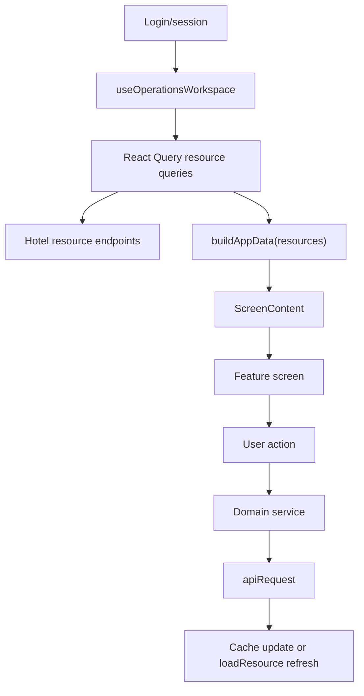

# Feature Map

This page maps user-facing features to the files developers usually need first.

## Feature Summary

| Feature | Screen key | Main UI files | Data/API owner | Permissions |
| --- | --- | --- | --- | --- |
| Authentication | Login state | `modules/auth/screens/LoginScreen.tsx` | `modules/auth/api/auth.api.ts` | Public before login |
| Dashboard | `dashboard` | `modules/operations/screens/OperationsScreens.tsx` | `modules/dashboard/services/dashboardData.service.ts` | Authenticated |
| Tickets | `tickets`, `ticketForm`, `ticketDetail` | `modules/operations/screens/*Ticket*`, `modules/ticket/components/*` | `modules/ticket/` and operations resources | Ticket view/create |
| Escalations | `escalations` | `modules/escalation/`, operations screens | Tickets escalation endpoint | Ticket view |
| Guests | `guests`, `guestDetail` | Operations screens and detail screens | Operations guests resource | Guest view |
| Reservations | `reservations`, `reservationDetail` | Operations screens and detail screens | Operations reservations resource | Reservation view/create |
| Rooms | `room` | Operations screens and room popup | Operations rooms resource | Room view/create/update |
| F&B | `food`, `kitchen` | Operations screens, `modules/food/` | Restaurant order APIs | Restaurant/menu permissions |
| Housekeeping | `housekeeping` | Operations screens | Operations housekeeping resource | Housekeeping manage |
| Staff | `staff` | Operations screens and staff popup | Operations staff resource | Staff/user/shift view |
| Hierarchy | `hierarchy` | Operations screens | Hierarchy screen request flow | Staff/user view |
| WhatsApp | `whatsapp`, `whatsappChat` | `modules/whatsapp/`, detail screens | Operations WhatsApp resource | Live chat manage |
| Assistant | `assistant` | Operations screens, `modules/assistant/` | Future assistant integrations | Bot view/manage |
| Profile/settings | `profile` | Operations screens, `modules/profile/` | Auth store/session | Authenticated |

## Main Resource Endpoints

| Resource | Endpoint |
| --- | --- |
| Tickets | `/api/v1/hotels/{hotelId}/tickets?limit=20` |
| Escalations | `/api/v1/hotels/{hotelId}/tickets/escalations?limit=20` |
| Notifications | `/api/v1/hotels/{hotelId}/notifications?limit=20` |
| Guests | `/api/v1/hotels/{hotelId}/guests?limit=50` |
| Reservations | `/api/v1/hotels/{hotelId}/reservations?limit=20` |
| Rooms | `/api/v1/hotels/{hotelId}/rooms?limit=40` |
| F&B orders | `/api/v1/hotels/{hotelId}/restaurant/orders?limit=20` |
| Staff | `/api/v1/hotels/{hotelId}/users?limit=200` |
| Housekeeping | `/api/v1/hotels/{hotelId}/housekeeping?limit=20` |
| WhatsApp | `/api/v1/hotels/{hotelId}/whatsapp/conversations?limit=20` |

## Screen Rendering Map

`ScreenContent` maps screen keys to components:

| Screen key | Rendered component |
| --- | --- |
| `dashboard` | `DashboardScreen` |
| `reservations` | `ReservationsScreen` |
| `guests` | `GuestsScreen` |
| `room` | `RoomScreen` |
| `tickets` | `TicketsScreen` |
| `escalations` | `EscalationsScreen` |
| `notifications` | `NotificationsScreen` |
| `housekeeping` | `HousekeepingScreen` |
| `food` | `FoodScreen` |
| `kitchen` | `KitchenScreen` |
| `whatsapp` | `WhatsAppScreen` |
| `assistant` | `AssistantScreen` |
| `staff` | `StaffScreen` |
| `hierarchy` | `HierarchyScreen` |
| default/profile | `ProfileScreen` |
| `ticketForm` | `TicketFormScreen` |
| `ticketDetail` | `TicketDetailScreen` |
| `reservationDetail` | `ReservationDetailScreen` |
| `guestDetail` | `GuestDetailScreen` |
| `whatsappChat` | `WhatsAppConversationScreen` |

## Feature Data Flow

## Adding A Feature

1. Create or extend the owning module under `src/modules/<domain>/`.
2. Add API and service files if backend calls are needed.
3. Add query/resource wiring if data should be shared globally.
4. Add screen rendering in `ScreenContent`.
5. Add navigation config if the feature needs a drawer or tab entry.
6. Add permissions in `navigationGuard.ts`.
7. Add tests near the feature.
8. Update this feature map and the feature-specific page.
