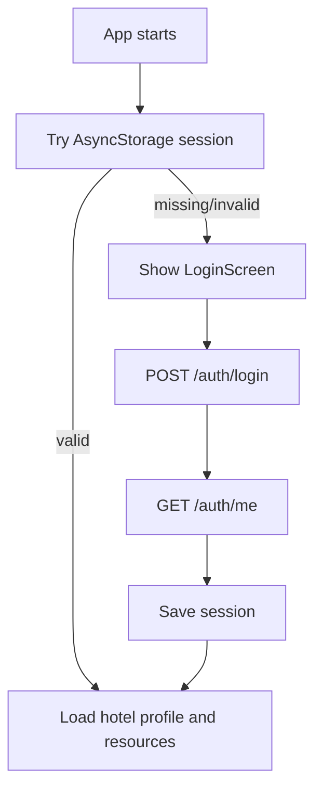

# Authentication Feature

Authentication lets hotel users sign in, restore a saved session, refresh access
tokens, and sign out.

## Main Files

| File | Purpose |
| --- | --- |
| `src/modules/auth/screens/LoginScreen.tsx` | Email/password login UI. |
| `src/modules/auth/api/auth.api.ts` | Login and current-user API calls. |
| `src/services/session/SessionManager.ts` | Refresh token API call. |
| `src/store/authStore.ts` | Persisted auth state. |
| `src/app/ArcadiaMobileApp.tsx` | Auth orchestration and session restore. |
| `src/constants/demoCredentials.ts` | Development/staging credential constants. |

## Backend Endpoints

| Action | Endpoint |
| --- | --- |
| Login | `POST /api/v1/auth/login` |
| Current profile | `GET /api/v1/auth/me` |
| Refresh token | `POST /api/v1/auth/refresh` |

## Stored Session Keys

| Key | Owner |
| --- | --- |
| `hoboerp.session.v1` | App shell full session. |
| `hoboerp.auth.store.v1` | Zustand persisted auth store. |

## Feature Flow

## Debug Checklist

- Login endpoint returns `access_token` and `refresh_token`.
- Profile endpoint returns `hotel_id`.
- Saved session contains token, refresh token, and user.
- Refresh endpoint returns a new access token.
- Permissions are present in `user.permissions`.
- Logout removes local session and resets workspace state.

## Test Checklist

- Empty credentials show validation or error state.
- Invalid credentials show a user-friendly error.
- Valid credentials load the dashboard.
- App restart restores a valid session.
- Invalid stored session returns to login.
- Logout clears session and notifications.
