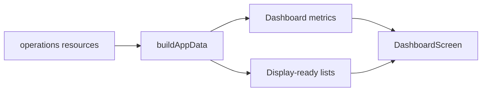

# Dashboard Feature

The dashboard is the operational overview for the active hotel.

## Main Files

| File | Purpose |
| --- | --- |
| `src/modules/dashboard/services/dashboardData.service.ts` | Converts resource records into dashboard view data. |
| `src/modules/dashboard/types/index.ts` | Dashboard and view-model types. |
| `src/modules/operations/screens/OperationsScreens.tsx` | Dashboard screen implementation. |
| `src/modules/operations/hooks/useOperationsWorkspace.ts` | Loads the resources used by dashboard. |

## Inputs

`buildAppData(resources)` consumes:

- Reservations.
- Tickets.
- Escalations.
- Notifications.
- Guests.
- Rooms.
- Orders.
- Staff.
- Housekeeping.
- WhatsApp conversations.

## Computed Metrics

The dashboard service computes:

- Today's check-ins.
- Today's check-outs.
- Total rooms.
- Occupied rooms.
- Vacant rooms.
- Out-of-order rooms.
- Occupancy percentage.
- Open tickets.

## Data Flow

## Debug Checklist

- Confirm all operation resources are loaded.
- On dashboard, `screenResourceError()` aggregates resource errors.
- Check room status values if occupancy is wrong.
- Check reservation status values if check-in/check-out counts are wrong.
- Check ticket `stage` or `status` if open ticket count is wrong.

## Test Checklist

- Empty resources render a stable empty dashboard.
- Occupancy handles zero rooms without division errors.
- Mixed room statuses calculate totals correctly.
- Failed resource loads show useful error text.
- Pull-to-refresh refreshes relevant dashboard resources.
