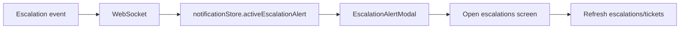

# Escalation Feature

Escalations surface urgent ticket workflow items and realtime escalation alerts.

## Main Files

| File | Purpose |
| --- | --- |
| `src/modules/escalation/components/EscalationAlertModal.tsx` | Realtime escalation alert UI. |
| `src/modules/escalation/hooks/useEscalations.ts` | Escalation hook support. |
| `src/modules/escalation/utils.ts` | Escalation utilities. |
| `src/modules/operations/screens/OperationsScreens.tsx` | Escalations screen. |
| `src/store/notificationStore.ts` | Active escalation alert state. |
| `src/services/websocket/` | Realtime event handling source. |

## Endpoint

```text
GET /api/v1/hotels/{hotelId}/tickets/escalations?limit=20
```

## Realtime Alert Flow



## Permissions

Escalations use ticket view permissions.

## Debug Checklist

- Confirm the escalations endpoint returns records.
- Confirm ticket view permission is present.
- Confirm WebSocket connection is active.
- Confirm notification store receives escalation payload.
- Confirm modal opens only once per active alert.
- Confirm opening escalations clears or preserves alert state as expected.

## Test Checklist

- Escalation list renders records and empty state.
- Escalation item opens ticket detail.
- Pull-to-refresh updates escalations.
- Ticket workflow action refreshes tickets and escalations.
- Realtime escalation alert opens modal.
