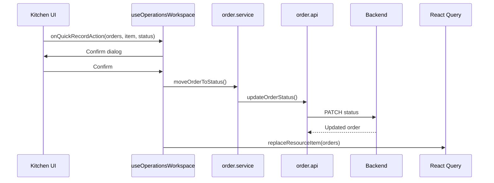

# F&B And Kitchen Features

F&B covers restaurant/menu ordering experiences. Kitchen covers order workflow
monitoring and status changes.

## Main Files

| File | Purpose |
| --- | --- |
| `src/modules/food/api/order.api.ts` | Order status API call. |
| `src/modules/food/services/order.service.ts` | Order workflow service. |
| `src/modules/operations/screens/OperationsScreens.tsx` | Food and Kitchen screens. |
| `src/modules/operations/hooks/useOperationsWorkspace.ts` | Order resource loading and quick actions. |

## Endpoints

| Action | Endpoint |
| --- | --- |
| List orders | `GET /api/v1/hotels/{hotelId}/restaurant/orders?limit=20` |
| Update order status | `PATCH /api/v1/hotels/{hotelId}/restaurant/orders/{orderId}/status` |

Status update body:

```json
{
  "status": "<next-status>"
}
```

## Screen Split

| Screen | Purpose |
| --- | --- |
| `food` | F&B ordering/menu area. |
| `kitchen` | Kitchen order queue and order status actions. |

## Order Action Flow



## Permissions

| Screen | Permission group |
| --- | --- |
| `food` | Restaurant manage, menu view, or menu manage. |
| `kitchen` | Restaurant manage. |

## Debug Checklist

- Confirm orders endpoint loads.
- Confirm order ID is present.
- Confirm status value matches backend accepted statuses.
- Confirm UI has restaurant/menu permissions.
- Confirm updated order replaces the cached record.
- Confirm errors show through `AppDialog`.

## Test Checklist

- Orders list loads.
- Empty order queue is stable.
- Status update asks for confirmation.
- Status update succeeds and changes visible state.
- Failed status update shows details.
- Kitchen screen still renders when guests/rooms/reservations are empty.
