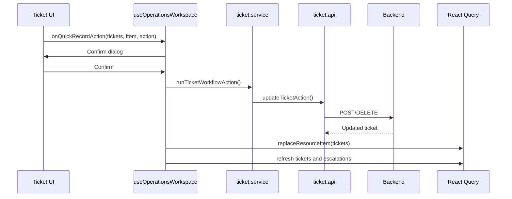

# Tickets Feature

Tickets cover guest/staff requests, workflow actions, dispatch handling, detail
views, and ticket creation.

## Main Files

| File | Purpose |
| --- | --- |
| `src/modules/ticket/api/ticket.api.ts` | Ticket action API wrapper. |
| `src/modules/ticket/services/ticket.service.ts` | Ticket workflow action service. |
| `src/modules/ticket/components/DispatchModal.tsx` | Dispatch alert handling. |
| `src/modules/operations/screens/DetailScreens.tsx` | Ticket form and ticket detail screens. |
| `src/modules/operations/screens/OperationsScreens.tsx` | Tickets list screen. |
| `src/modules/operations/hooks/useOperationsWorkspace.ts` | Ticket resource loading and quick workflow actions. |

## Endpoints

| Action | Endpoint |
| --- | --- |
| List tickets | `GET /api/v1/hotels/{hotelId}/tickets?limit=20` |
| Ticket escalations | `GET /api/v1/hotels/{hotelId}/tickets/escalations?limit=20` |
| Workflow action | `POST /api/v1/hotels/{hotelId}/tickets/{ticketId}/{action}` |
| Reject action | Same as workflow action with body `{ "reason": "Rejected from mobile app" }` |
| Delete ticket | `DELETE /api/v1/hotels/{hotelId}/tickets/{ticketId}` |

## Workflow Action Flow

## Permissions

| Operation | Permission group |
| --- | --- |
| View tickets | Ticket view permissions. |
| Open ticket detail | Ticket view permissions. |
| Create ticket | Ticket create. |
| Quick ticket actions | Backend action authorization plus visible UI action. |

## Debug Checklist

- Confirm tickets resource endpoint loads.
- Confirm selected ticket is set before opening `ticketDetail`.
- Confirm `ticketForm` has hotel ID, user, and any contextual reservation/guest/conversation.
- Confirm workflow action string matches backend route.
- Confirm rejected action body is accepted by backend.
- Confirm tickets and escalations refresh after workflow actions.

## Test Checklist

- Ticket list loads.
- Ticket detail opens from list and escalation views.
- Create ticket opens from bottom create button and contextual screens.
- Workflow actions show confirmation.
- Success updates the list.
- Failure shows `AppDialog` with formatted details.
- Dispatch modal clears after ticket handling.
