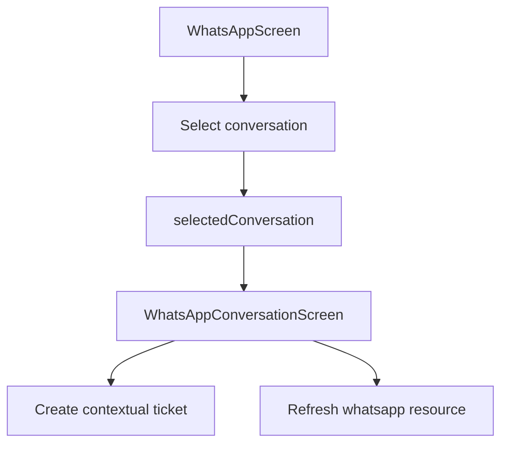

# WhatsApp Feature

WhatsApp supports CRM-style guest conversations, conversation detail, ticket
creation from conversations, and notification routing.

## Main Files

| File | Purpose |
| --- | --- |
| `src/modules/whatsapp/README.md` | Module ownership note. |
| `src/modules/operations/screens/OperationsScreens.tsx` | Conversation list screen. |
| `src/modules/operations/screens/DetailScreens.tsx` | Conversation detail screen. |
| `src/services/websocket/` | Realtime notification plumbing. |
| `src/store/notificationStore.ts` | Notification and alert state. |

## Endpoint

```text
GET /api/v1/hotels/{hotelId}/whatsapp/conversations?limit=20
```

Conversation detail and message actions use the shared `request` function inside
the WhatsApp screen components.

## Screen Keys

| Screen | Purpose |
| --- | --- |
| `whatsapp` | Conversation list. |
| `whatsappChat` | Single conversation thread. |

## Flow



## Permissions

WhatsApp screens require live chat manage permission.

## Debug Checklist

- Confirm the WhatsApp resource endpoint loads.
- Confirm selected conversation is set before opening `whatsappChat`.
- Confirm the current user has live chat permission.
- Confirm staff data is present if assignment/routing UI needs it.
- Confirm WebSocket events refresh the WhatsApp resource when appropriate.
- Confirm ticket creation from conversation carries conversation context.

## Test Checklist

- Conversation list loads.
- Empty conversation state is stable.
- Conversation detail opens and returns with back.
- Contextual ticket creation works from conversation detail.
- Pull-to-refresh updates conversations.
- Permission loss redirects or blocks access.
